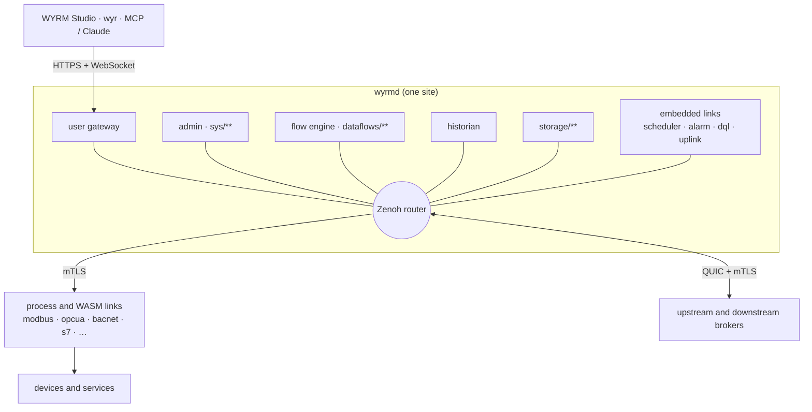

# WYRM

[](https://github.com/gencto/wyrm/actions/workflows/ci.yml)

WYRM is an industrial IoT broker. Devices, services and logic live in one tree of
nodes. Every client reads it the same way: `list` a node's children, `subscribe`
to values, `set` a value, `invoke` an action. Under the tree runs
[Eclipse Zenoh](https://zenoh.io) 1.x as the transport. WYRM adds the semantics
on top: key-space conventions, canonical CBOR, tokens and static plugins.
Zenoh itself is not patched or forked.

One binary, `wyrmd`, is the broker. It holds the router, the admin, the flow
engine, the historian, the user gateway and the links. **WYRM Studio**, a
Flutter app, is the desktop window onto one broker or a chain of them.

*Wyrm*: a wingless serpent-dragon. Its long body of segments is like a tree of
nodes, and it is kin to the dragon on Zenoh's logo.

> **Status: before 1.0 (version 0.1.0).** The protocol (`spec/` 0.2.32) and the
> broker are tested on every commit (unit, fixture and end-to-end tests). Every
> protocol link is tested against its own simulator. No link has been checked
> against a real device yet ([ADR 0029](docs/adr/0029-delegated-decisions.md),
> decision 5). Expect changes.

## What you get

**Broker core**
- A node tree under `wy/<site>/…` with live `list`, `subscribe`, `set` and `invoke`. Metadata, profiles and units come with every node ([spec](spec/README.md)).
- A control plane in the same tree (`sys/**`): links, packages, tokens, an internal CA, a generated ACL, quarantine, audit, logs and status values ([broker reference](docs/broker.md)).
- Security on by default: TLS/mTLS off loopback, signed per-request tokens (`ptok`), secrets sealed outside the tree, rate limits, and an audit of every `set` and `invoke` ([threats](docs/security/threats.md)).
- Broker storage `storage/**` for folders and typed values people create.

**Links (connectors)**
- Protocols: Modbus TCP/RTU (master and slave), BACnet/IP, OPC UA, Siemens S7, SNMP v2c/v3, MQTT and Sparkplug B, HTTP/REST JSON, Prometheus/OpenMetrics.
- File stores: S3 and compatible stores, Google Drive, WebDAV, a local directory.
- History sync to PostgreSQL/TimescaleDB, MySQL/MariaDB, MongoDB, InfluxDB and DynamoDB.
- Messengers: Telegram (paired users can read and set points from a chat) and Slack.
- Three ways to run a link: embedded, as a process, or as a sandboxed WebAssembly component. Links install while the broker runs: from the official list, a zip, a URL, Git or a `.wasm` file ([links](docs/links.md)).

**Logic and data**
- Dataflows: a graph of 125 block types. They cover math, logic, text, date and time, tables, readers, alarms, rhai scripts, WASM nodes and the action block that writes and invokes ([blocks](docs/flow-blocks.md)). Every block has a value test.
- 14 ready-made flows in [`examples/flows`](examples/flows/README.md): a threshold alarm, running hours, daily energy, a schedule setpoint and more. A test compiles and runs each one.
- Every deployed flow shows its counters in `dataflows/<id>/~val.stats`: samples, drops, restarts and command results ([ADR 0045](docs/adr/0045-flow-metrics.md)).
- An embedded historian with watch groups, rollups and one file per day ([history](docs/history.md)).
- Built-in links: a scheduler (weekly schedules, special days, overrides; [scheduler](docs/scheduler.md)), alarms (classes, acknowledgement, escalation, export; [alarm](docs/alarm.md)), DQL (live tables over many points; [dql](docs/dql.md)) and uplink (MQTT UNS, Sparkplug B, ThingsBoard, Azure IoT Hub, AWS IoT Core; [uplink](docs/uplink.md)).

**Many sites**
- Brokers form chains and stars over QUIC with mTLS. A downstream broker enrolls with its upstream, and the upstream reads it and commands it as the downstream allows ([broker reference](docs/broker.md#two-brokers)).
- A standby broker follows the active one (stores, files, storage, history) and takes over through a witness ([operations](docs/operations.md)).

**People and tools**
- **WYRM Studio** (`studio/`), a desktop app in English and Ukrainian. Its screens:
  - Explorer: the tree, actions, staged writes;
  - Links: the install wizard and quarantine;
  - Flows: the editor with live values, custom blocks, undo;
  - History, Access and Sites (a map of the broker network);
  - System: status, availability, log, maintenance;
  - Assistant ([studio](docs/studio.md)).
- A user gateway: logins, roles, and a WebSocket CBOR proxy that filters each point by the user's grants.
- `wyr`, the CLI for operators and developers ([tools/wyr](tools/wyr/README.md)).
- AI: an MCP server, a Claude Desktop extension and OAuth `/mcp` on the gateway ([claude](docs/claude.md), [mcp](docs/mcp.md)). The `wyrm-agent` CLI runs checked plans, and the agent link runs only plans a person approves ([agent](docs/agent.md)).
- SDKs: Rust (`wyrm-client`, `wyrm-link-sdk`, portable links on `wyrm-link-api`), Dart (`dart/`) and a C ABI (`crates/wyrm-ffi`).

## How it fits together



Rules that hold everywhere ([ADR 0001–0011](docs/adr/)):
- Zenoh is the transport; WYRM puts its meaning into the key space, a CBOR attachment, the SDKs and static plugins. It never loads dynamic Zenoh plugins.
- The broker persists only its own state: registry, ACL, PKI, profiles and flow definitions. A link owns its subtree and declares it again on every connect.
- Nobody reads another component's state directly. Every component uses `put`, `get` and `subscribe` on keys, in-process too.
- The wire has one codec: canonical CBOR with integer keys.

## Quick start

### The demo: three sites and Studio

```sh
examples/demo/run.sh          # build, then start plant → edge → central; Ctrl+C stops all
```

1. Wait until all three sites are up. Each site runs its links against their simulators: Modbus, HTTP, SNMP, Prometheus, S7, BACnet, OPC UA and mocks.
2. Log in to a site's gateway with user `admin` and password `wyrm-demo-1` (or `$WYRM_GATEWAY_ADMIN_PASSWORD`). The gateways are central `http://127.0.0.1:8445`, edge `:8444` and plant `:8446`.
3. Note that central reads plant through edge.

`examples/demo/run.sh --clean` starts from empty sites.

### WYRM Studio

Studio needs Flutter 3.50.0 (pinned in `studio/pubspec.yaml`) and [`frx`](docs/studio.md#3-toolchain).

```sh
cd studio && flutter pub get
cd app && flutter run -d macos     # or linux, windows
```

Log in to one of the demo gateways. Each screen and its broker calls are in [docs/studio.md](docs/studio.md).

### One broker

```sh
cargo build --release -p wyrmd -p wyr
target/release/wyr keygen --out admin.key        # prints the public key
```

1. Put the printed key into `admin_keys` in [`examples/wyrmd.json5`](examples/wyrmd.json5).
2. Start the Modbus simulator, which the example's `plc1` link talks to:
   ```sh
   cargo run -p wyrm-link-modbus --features bin --bin wyrm-modbus-sim &
   ```
3. Start the broker:
   ```sh
   target/release/wyrmd -c examples/wyrmd.json5
   ```
4. Read and write the tree:
   ```sh
   target/release/wyr list wy/local/downstream
   target/release/wyr sub 'wy/local/downstream/mock/**'
   target/release/wyr --key admin.key set wy/local/downstream/mock/g0/g0/p0 42
   target/release/wyr --key admin.key invoke wy/local/downstream/mock count n=3
   ```

To use Studio with this broker:
1. Uncomment the `gateway` line in the config.
2. Start `wyrmd` once with `WYRM_GATEWAY_ADMIN_PASSWORD` set. This creates the first admin ([broker reference](docs/broker.md#gateway)).

### Containers

[`deploy/docker`](deploy/docker/README.md) builds minimal `scratch` images: static musl binaries, no shell, a non-root user.

```sh
docker compose -f deploy/docker/compose.yaml up -d --build
```

## Official links

Each `links-v*` release on GitHub holds every official link as a package: WASM, and process binaries for linux-x86_64, linux-aarch64 and macos-aarch64. The release `links-index` holds the index. To get the official list in Studio's install wizard and in `install_repo`, set `packages.repository: "official"` in `wyrmd.json5`. The broker then checks the SHA-256 of every package. The manifest is [`links/official.json`](links/official.json); [links.md §12a](docs/links.md) describes the release.

## Repository

| Path | What |
|---|---|
| `crates/wyrmd` | the broker binary |
| `crates/wyrm-core` | wire types, canonical CBOR codec, key-space helpers |
| `crates/wyrm-link-sdk` | the link SDK and the driver framework (connection → device → point; ADR 0004) |
| `crates/wyrm-client`, `crates/wyrm-gateway-client` | clients of the tree and of the user gateway |
| `crates/wyrm-admin`, `wyrm-state`, `wyrm-gateway` | control plane, WAL state, user gateway |
| `crates/wyrm-flow`, `wyrm-wasm-host` | dataflow engine and WebAssembly host |
| `crates/wyrm-history`, `wyrm-history-sync`, `wyrm-storage`, `wyrm-schedule`, `wyrm-dql`, `wyrm-messenger`, `wyrm-filestore` | the cores of the historian, the sync links, storage, schedules, DQL, messengers and file stores |
| `crates/wyrm-link-api`, `wyrm-link-portable`, `wyrm-link-guest` | portable links that run natively or as WASM components |
| `crates/wyrm-ffi` | C ABI (`include/wyrm.h`) |
| `links/*` | the links; `links/official.json` lists those that are released |
| `studio/` | WYRM Studio (Flutter, AsyncRedux, made with `frx`) |
| `dart/` | Dart packages: codec, gateway client, FFI |
| `tools/wyr`, `tools/wyrm-mcp` | the CLI and the MCP server |
| `spec/` | the normative protocol and its CBOR fixtures |
| `docs/` | guides, ADRs, security review |
| `examples/` | the demo, broker configs, flows, agent plans, example links |
| `deploy/`, `packaging/` | container images, the Claude Desktop extension, the links release workflow |

## Documentation

Start at [docs/README.md](docs/README.md). It lists a guide for each task and each protocol, plus the rules and decisions. Key entry points:
- [broker.md](docs/broker.md): the `sys/**` tree, storage, many brokers, the gateway, flows from the CLI.
- [operations.md](docs/operations.md): systemd, backup and restore, standby.
- [`spec/`](spec/README.md): keys, metadata, values, tokens, methods, flow definitions.
- [`docs/adr/`](docs/adr/): one file per decision.
- [SECURITY.md](SECURITY.md): how to report a vulnerability, what is supported.

## Development

```sh
cargo fmt --all --check
cargo clippy --workspace --all-targets --all-features -- -D warnings
cargo test --workspace --all-features
```

- `spec/` is normative. A change there needs four more steps: update `spec/fixtures/gen.py`, regenerate the 28 fixtures, make every SDK's fixture test pass, and add a line to `spec/CHANGELOG.md`.
- A decision goes into `docs/adr/`.
- [CONTRIBUTING.md](CONTRIBUTING.md) has the code rules (wire enums, QoS, logging, drivers).
- Zenoh is pinned to an exact version, now 1.10.1. The MSRV is Rust 1.89.

## License

[Apache-2.0](LICENSE)
