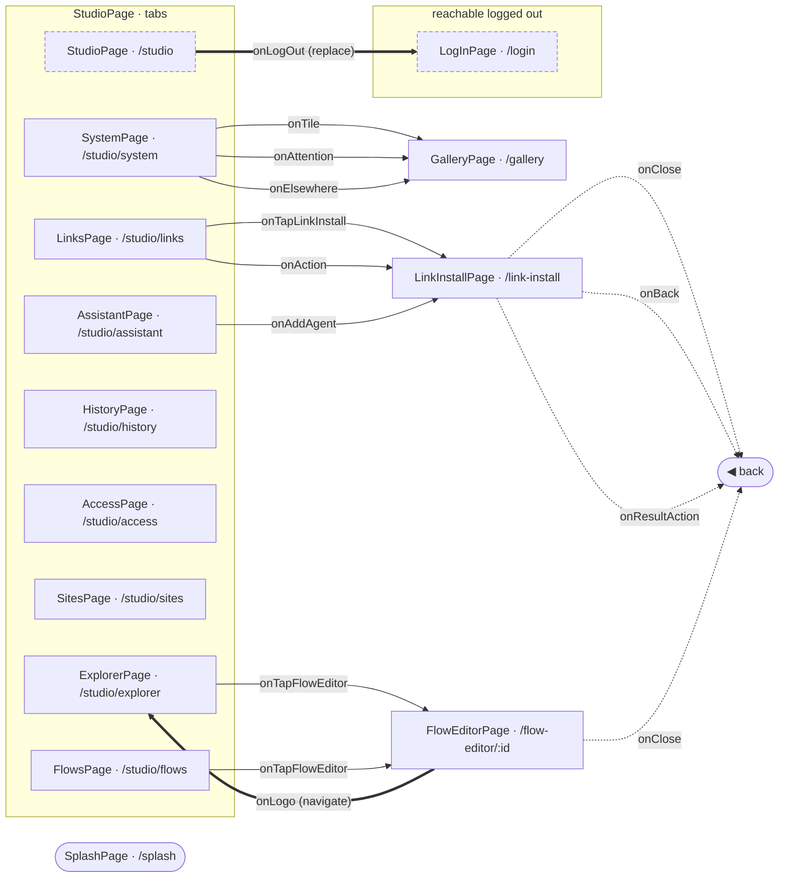

<!-- generated by `frx flow --md` — do not edit, re-run it -->

# App flows

Every screen the router registers, and every hop between them — read out of the connectors by `frx flow`.

Solid arrow: `push`. Dashed: `pop` (drawn back to the only screen that pushes it, when there is exactly one). Thick: a hop that replaces the stack. `⚡` marks navigation dispatched from a reducer rather than the view-model. A dashed border means nothing pushes that screen — you arrive by path, deep link or a guard redirect.

| Screen | Path | Logged out | Use cases | Flow |
| --- | --- | --- | --- | --- |
| `SplashPage` _(initial)_ | `/splash` | no | 0 | [splash](splash.md) |
| `LogInPage` | `/login` | yes | 8 | [logIn](logIn.md) |
| `GalleryPage` | `/gallery` | no | 0 | [gallery](gallery.md) |
| `StudioPage` | `/studio` | no | 13 | [studio](studio.md) |
| `ExplorerPage` | `/studio/explorer` | no | 29 | [explorer](explorer.md) |
| `LinksPage` | `/studio/links` | no | 8 | [links](links.md) |
| `FlowsPage` | `/studio/flows` | no | 3 | [flows](flows.md) |
| `HistoryPage` | `/studio/history` | no | 5 | [history](history.md) |
| `AccessPage` | `/studio/access` | no | 4 | [access](access.md) |
| `SitesPage` | `/studio/sites` | no | 8 | [sites](sites.md) |
| `AssistantPage` | `/studio/assistant` | no | 8 | [assistant](assistant.md) |
| `SystemPage` | `/studio/system` | no | 23 | [system](system.md) |
| `LinkInstallPage` | `/link-install` | no | 15 | [linkInstall](linkInstall.md) |
| `FlowEditorPage` | `/flow-editor/:id` | no | 42 | [flowEditor](flowEditor.md) |
