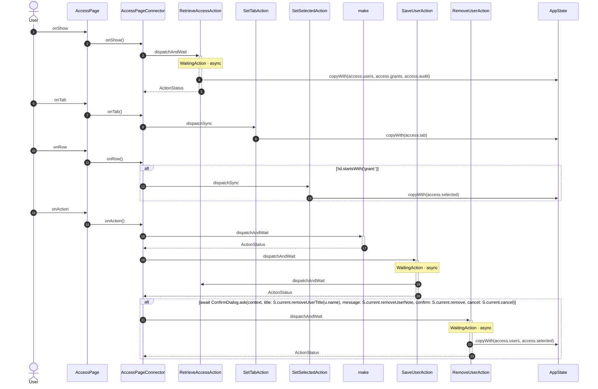

<!-- generated by `frx flow --md` — do not edit, re-run it -->

# AccessPage

`app/lib/connectors/access_page_connector.dart`

| Interaction | Dispatches | Writes |
| --- | --- | --- |
| `onShow` | `RetrieveAccessAction` | `access.users, access.grants, access.audit` |
| `onTab` | `SetTabAction` | `access.tab` |
| `onRow` | `SetSelectedAction` ? | `access.selected` |
| `onAction` | `make`, `SaveUserAction`, `RemoveUserAction` ? | `access.users, access.selected` |

`?` marks a dispatch that only runs under a condition.

[← all flows](README.md)
