<!-- generated by `frx flow --md` — do not edit, re-run it -->

# AssistantPage

`app/lib/connectors/assistant_page_connector.dart`

## onTick

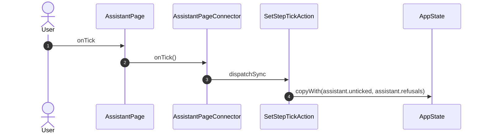

## onPick

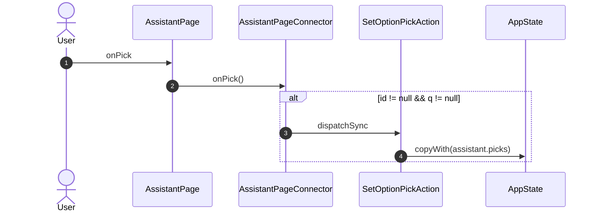

## onAnswer

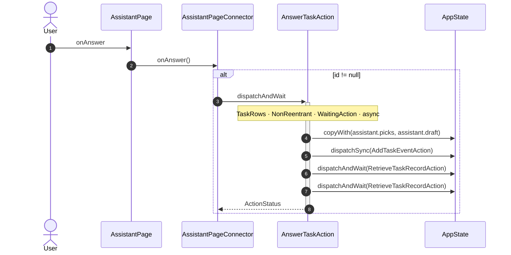

## onShow

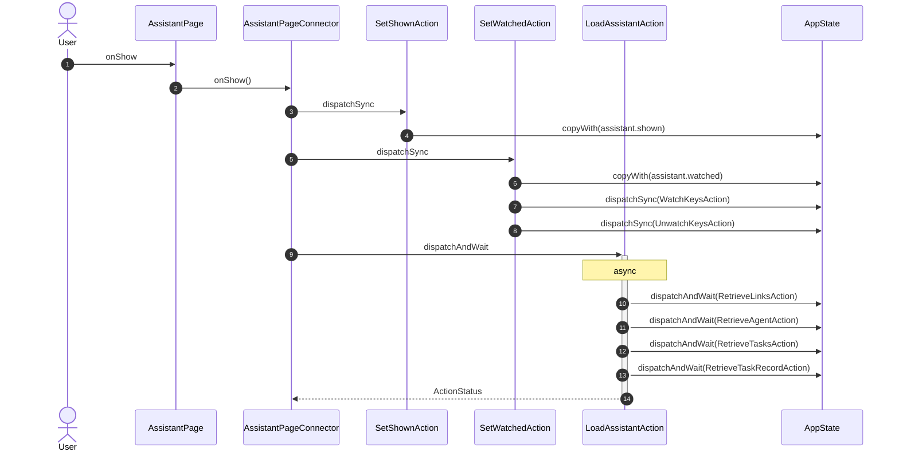

## onHide

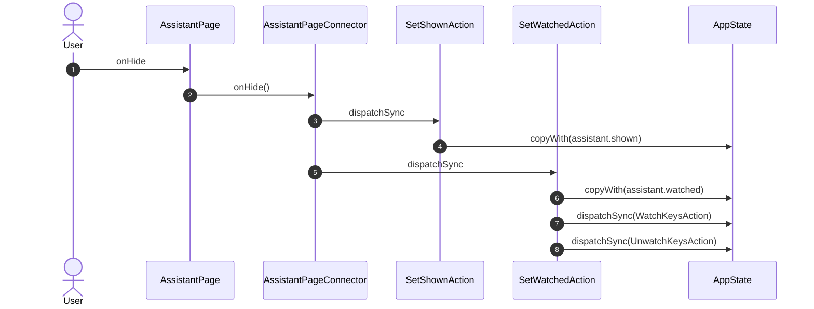

## onNew

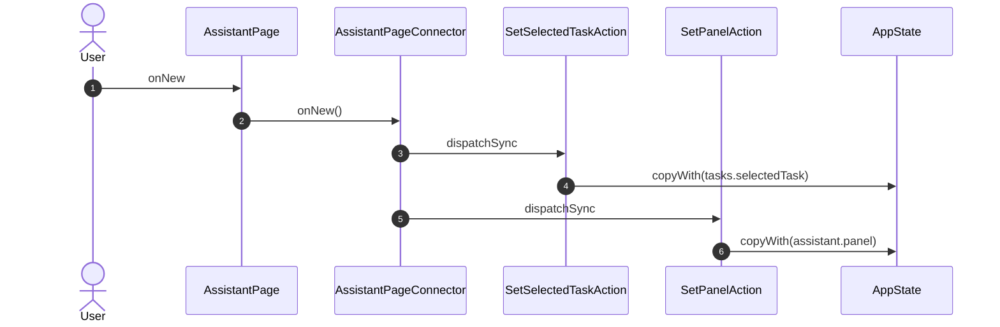

## onTask

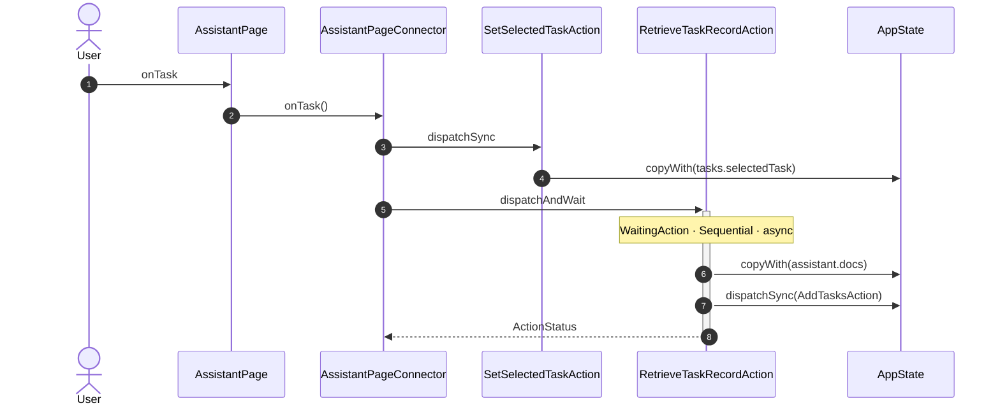

## onDraft

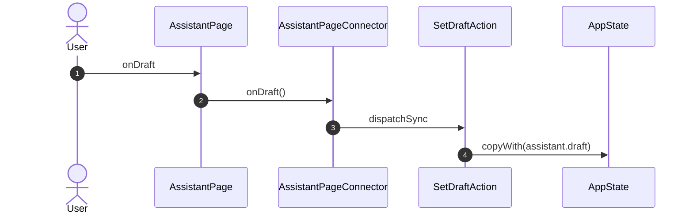

## onAsk

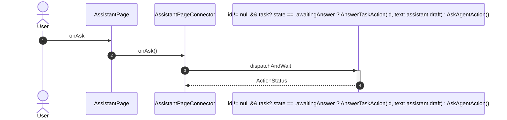

## onPanel

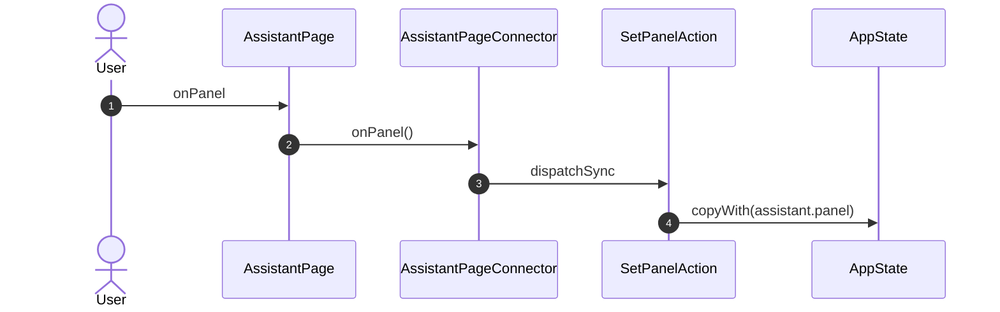

## onAddAgent

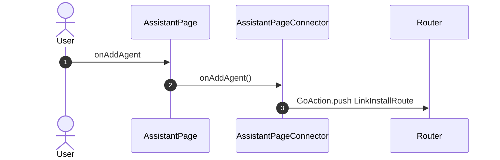

## onButton

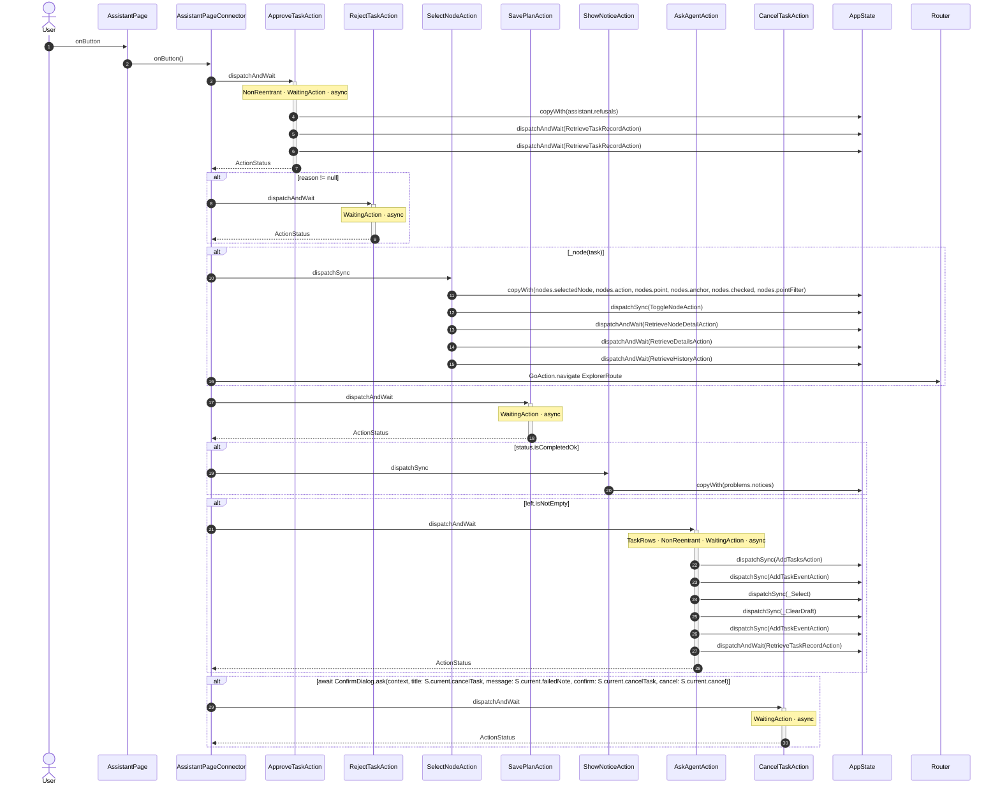

_Not drawn — these files dispatch outside any interaction:_

- `AssistantPageConnector` — 1 dispatch

| Interaction | Dispatches | Writes |
| --- | --- | --- |
| `onTick` | `SetStepTickAction` | `assistant.unticked, assistant.refusals` |
| `onPick` | `SetOptionPickAction` ? | `assistant.picks` |
| `onAnswer` | `AnswerTaskAction` ? | `assistant.picks, assistant.draft` |
| `onShow` | `SetShownAction`, `SetWatchedAction`, `LoadAssistantAction` | `assistant.shown`, `assistant.watched` |
| `onHide` | `SetShownAction`, `SetWatchedAction` | `assistant.shown`, `assistant.watched` |
| `onNew` | `SetSelectedTaskAction`, `SetPanelAction` | `tasks.selectedTask`, `assistant.panel` |
| `onTask` | `SetSelectedTaskAction`, `RetrieveTaskRecordAction` | `tasks.selectedTask`, `assistant.docs` |
| `onDraft` | `SetDraftAction` | `assistant.draft` |
| `onAsk` | `id != null && task?.state == .awaitingAnswer ? AnswerTaskAction(id, text: assistant.draft) : AskAgentAction()` | — |
| `onPanel` | `SetPanelAction` | `assistant.panel` |
| `onAddAgent` | `GoAction.push` | — |
| `onButton` | `ApproveTaskAction`, `RejectTaskAction` ?, `SelectNodeAction` ?, `GoAction.navigate` ?, `SavePlanAction`, `ShowNoticeAction` ?, `AskAgentAction` ?, `CancelTaskAction` ? | `assistant.refusals`, `nodes.selectedNode, nodes.action, nodes.point, nodes.anchor, nodes.checked, nodes.pointFilter`, `problems.notices` |

`?` marks a dispatch that only runs under a condition.

[← all flows](README.md)
