<!-- generated by `frx flow --md` — do not edit, re-run it -->

# AssistantPage

`app/lib/connectors/assistant_page_connector.dart`

## onTick

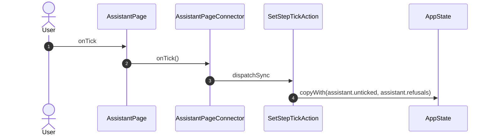

## onPick

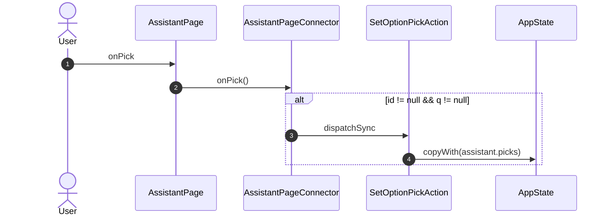

## onAnswer

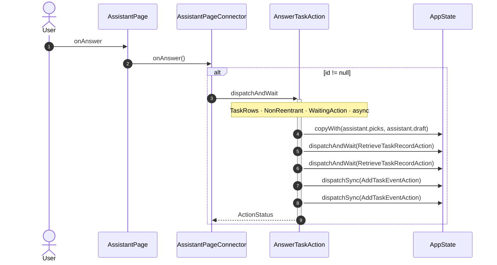

## onPickSuggestion

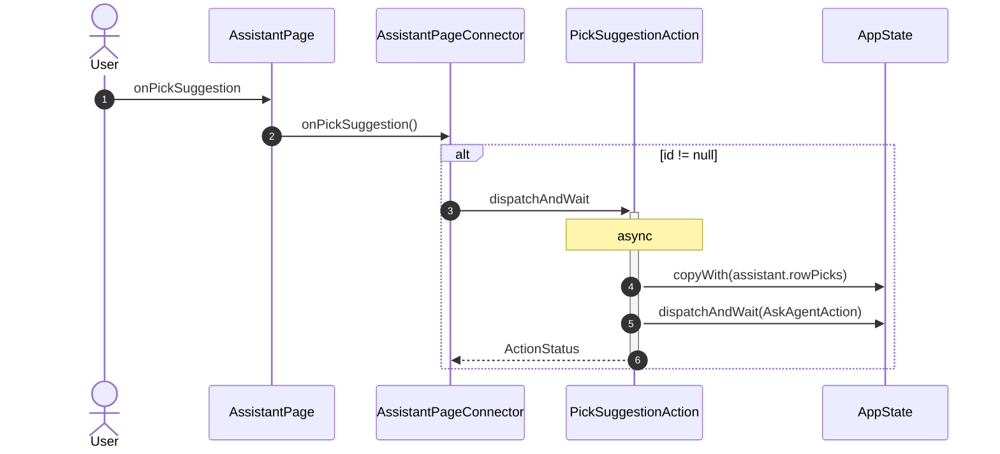

## onRow

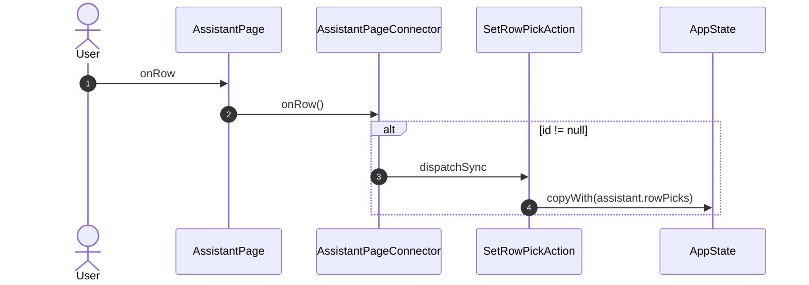

## onReveal

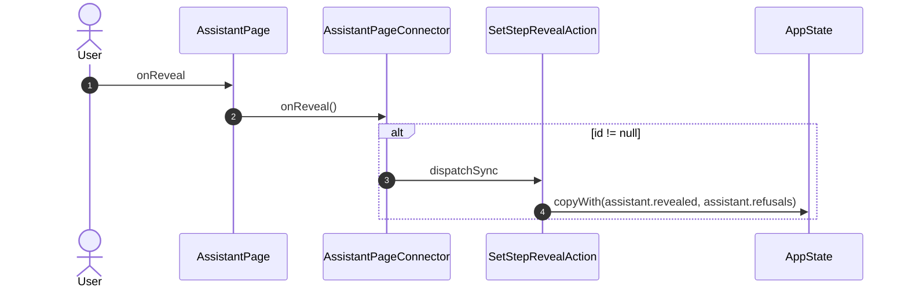

## onTimelineWindow


## onTimelineReset

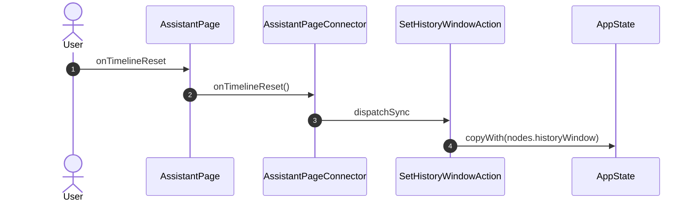

## onMode

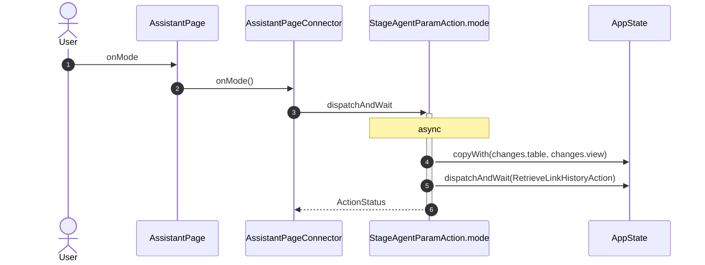

## onRemovePrefix

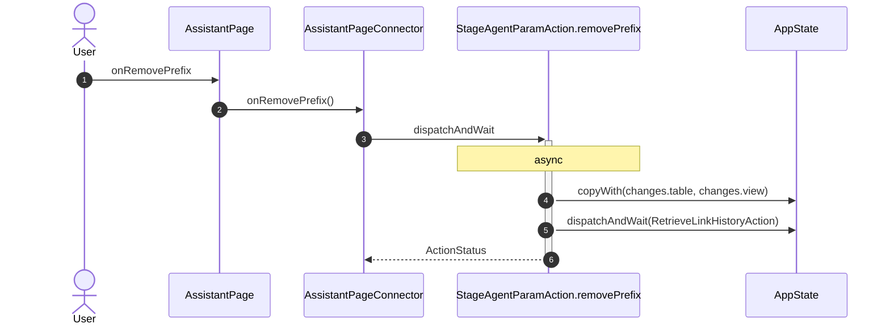

## onAddPrefix

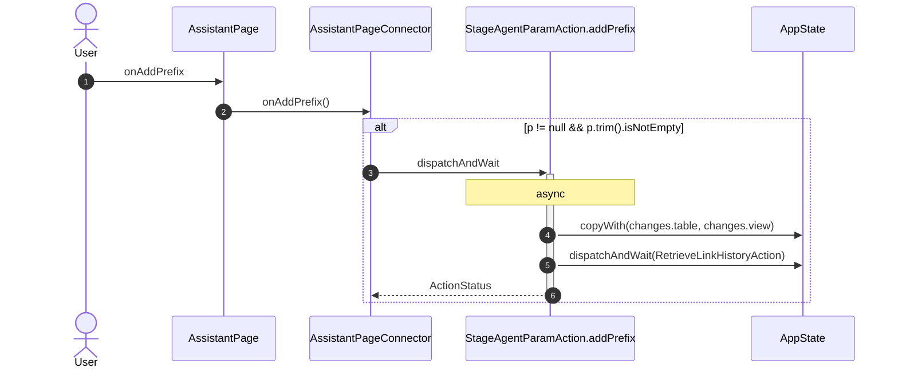

## onOpenFull

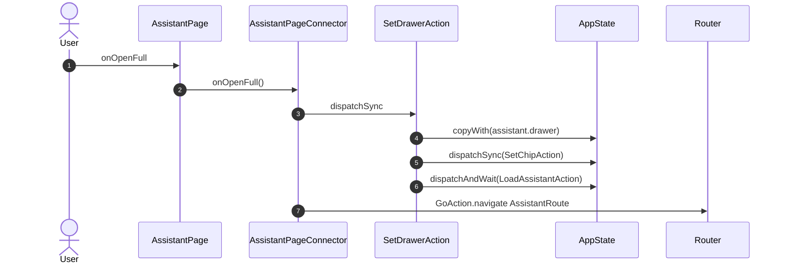

## onCloseDrawer

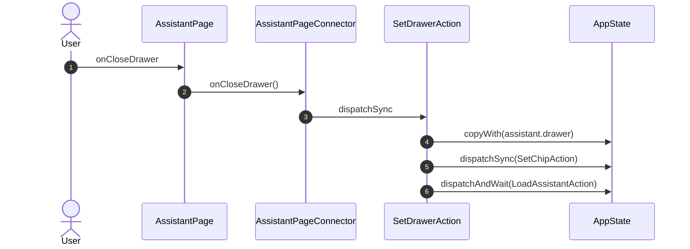

## onChipRemove

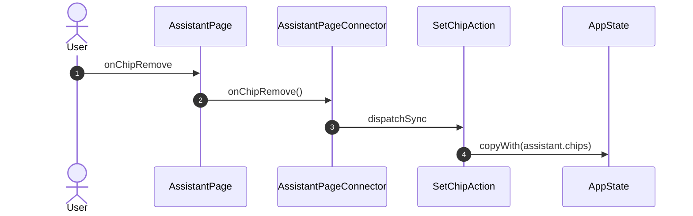

## onAddChip

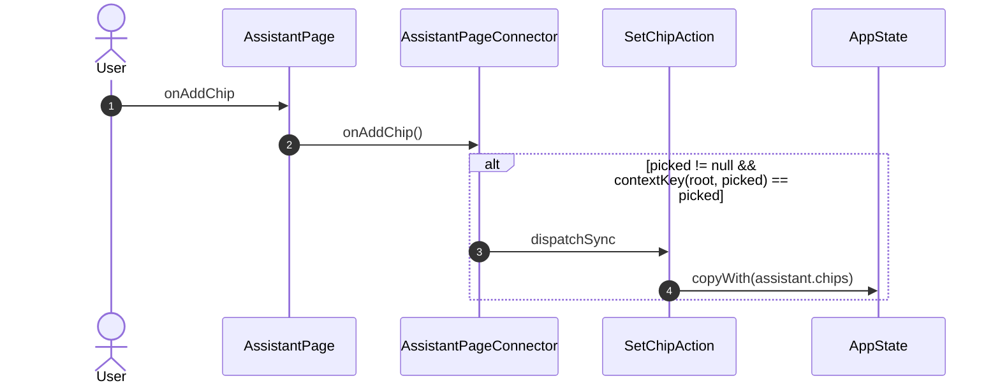

## onShow

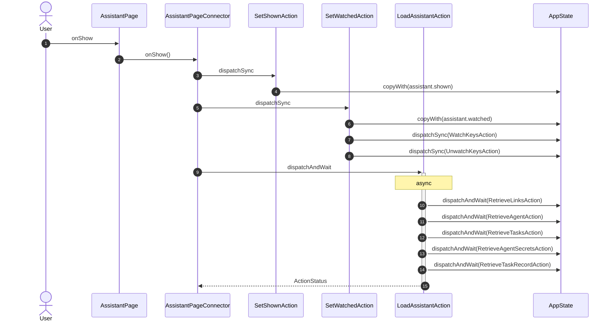

## onHide

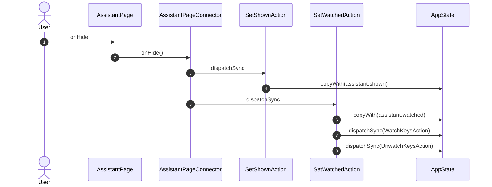

## onNew

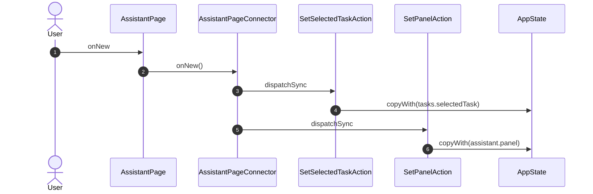

## onTask

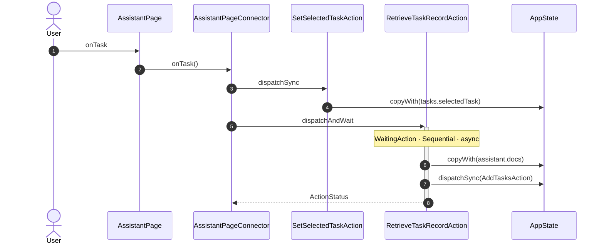

## onDraft

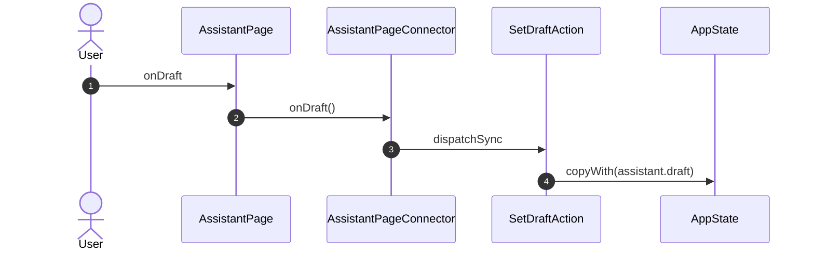

## onAskFresh

```mermaid
sequenceDiagram
    autonumber
    actor User
    participant UI as AssistantPage
    participant VM as AssistantPageConnector
    participant A1 as id != null && task?.state == .awaitingAnswer ? AnswerTaskAction(id, text: assistant.draft) : AskAgentAction()

    User->>UI: onAskFresh
    UI->>VM: onAskFresh()
    VM->>+A1: dispatchAndWait
    A1-->>-VM: ActionStatus
```

## onNewTask

```mermaid
sequenceDiagram
    autonumber
    actor User
    participant UI as AssistantPage
    participant VM as AssistantPageConnector
    participant A1 as SetSelectedTaskAction
    participant ST as AppState

    User->>UI: onNewTask
    UI->>VM: onNewTask()
    VM->>A1: dispatchSync
    A1->>ST: copyWith(tasks.selectedTask)
```

## onAsk

```mermaid
sequenceDiagram
    autonumber
    actor User
    participant UI as AssistantPage
    participant VM as AssistantPageConnector
    participant A1 as id != null && task?.state == .awaitingAnswer ? AnswerTaskAction(id, text: assistant.draft) : AskAgentAction(parent: task != null && task.replacedBy == null && mayFollow(task) ? id : null)

    User->>UI: onAsk
    UI->>VM: onAsk()
    VM->>+A1: dispatchAndWait
    A1-->>-VM: ActionStatus
```

## onPanel

```mermaid
sequenceDiagram
    autonumber
    actor User
    participant UI as AssistantPage
    participant VM as AssistantPageConnector
    participant A1 as SetPanelAction
    participant A2 as RetrieveAgentSecretsAction
    participant ST as AppState

    User->>UI: onPanel
    UI->>VM: onPanel()
    VM->>A1: dispatchSync
    A1->>ST: copyWith(assistant.panel)
    alt p == 'rights'
        VM->>+A2: dispatchAndWait
        Note over A2: async
        A2->>ST: copyWith(assistant.secrets)
        A2-->>-VM: ActionStatus
    end
```

## onAddAgent

```mermaid
sequenceDiagram
    autonumber
    actor User
    participant UI as AssistantPage
    participant VM as AssistantPageConnector
    participant NAV as Router

    User->>UI: onAddAgent
    UI->>VM: onAddAgent()
    VM->>NAV: GoAction.push LinkInstallRoute
```

## onButton

```mermaid
sequenceDiagram
    autonumber
    actor User
    participant UI as AssistantPage
    participant VM as AssistantPageConnector
    participant A1 as ApproveTaskAction
    participant A2 as RejectTaskAction
    participant A3 as SetSelectedTaskAction
    participant A4 as RetrieveTaskRecordAction
    participant A5 as SetDrawerAction
    participant A6 as OpenTrendAction
    participant A7 as ShowNoticeAction
    participant A8 as PickSuggestionAction
    participant A9 as SelectNodeAction
    participant A10 as SavePlanAction
    participant A11 as AskAgentAction
    participant A12 as CancelTaskAction
    participant ST as AppState
    participant NAV as Router

    User->>UI: onButton
    UI->>VM: onButton()
    VM->>+A1: dispatchAndWait
    Note over A1: NonReentrant · WaitingAction · async
    A1->>ST: copyWith(assistant.refusals)
    A1->>A4: dispatchAndWait
    A1->>A4: dispatchAndWait
    A1-->>-VM: ActionStatus
    alt reason != null
        VM->>+A2: dispatchAndWait
        Note over A2: WaitingAction · async
        A2-->>-VM: ActionStatus
    end
    alt task?.replacedBy
        VM->>A3: dispatchSync
        A3->>ST: copyWith(tasks.selectedTask)
        VM->>+A4: dispatchAndWait
        Note over A4: WaitingAction · Sequential · async
        A4->>ST: copyWith(assistant.docs)
        A4->>ST: dispatchSync(AddTasksAction)
        A4-->>-VM: ActionStatus
    end
    alt _touched(task).lastOrNull
        VM->>A5: dispatchSync
        A5->>ST: copyWith(assistant.drawer)
        A5->>ST: dispatchSync(SetChipAction)
        A5->>ST: dispatchAndWait(LoadAssistantAction)
        VM->>A6: dispatchSync
        A6->>A9: dispatchSync
        A6->>ST: dispatchSync(SetTabAction)
        A6->>ST: dispatchSync(SelectPointAction)
        A6->>ST: dispatchAndWait(RetrieveHistoryAction)
        VM->>NAV: GoAction.navigate ExplorerRoute
    end
    alt copy
        VM->>A7: dispatchSync
        A7->>ST: copyWith(problems.notices)
    end
    alt task!.state == .awaitingApproval
        VM->>+A8: dispatchAndWait
        Note over A8: async
        A8->>ST: copyWith(assistant.rowPicks)
        A8->>A11: dispatchAndWait
        A8-->>-VM: ActionStatus
    end
    alt _node(task)
        VM->>A9: dispatchSync
        A9->>ST: copyWith(nodes.selectedNode, nodes.action, nodes.point, nodes.anchor, nodes.checked, nodes.pointFilter)
        A9->>ST: dispatchSync(ToggleNodeAction)
        A9->>ST: dispatchAndWait(RetrieveNodeDetailAction)
        A9->>ST: dispatchAndWait(RetrieveDetailsAction)
        A9->>ST: dispatchAndWait(RetrieveHistoryAction)
        VM->>NAV: GoAction.navigate ExplorerRoute
    end
    VM->>+A10: dispatchAndWait
    Note over A10: WaitingAction · async
    A10-->>-VM: ActionStatus
    alt status.isCompletedOk
        VM->>A7: dispatchSync
        A7->>ST: copyWith(problems.notices)
    end
    alt left.isNotEmpty
        VM->>+A11: dispatchAndWait
        Note over A11: TaskRows · NonReentrant · WaitingAction · async
        A11->>ST: dispatchSync(AddTasksAction)
        A11->>ST: dispatchSync(AddTaskEventAction)
        A11->>ST: dispatchSync(_Select)
        A11->>ST: dispatchSync(_ClearDraft)
        A11->>ST: dispatchSync(AddTaskEventAction)
        A11->>A4: dispatchAndWait
        A11-->>-VM: ActionStatus
    end
    alt await ConfirmDialog.ask(context, title: S.current.cancelTask, message: S.current.failedNote, confirm: S.current.cancelTask, cancel: S.current.cancel)
        VM->>+A12: dispatchAndWait
        Note over A12: WaitingAction · async
        A12-->>-VM: ActionStatus
    end
```

_Not drawn — these files dispatch outside any interaction:_

- `AssistantPageConnector` — 6 dispatches

| Interaction | Dispatches | Writes |
| --- | --- | --- |
| `onTick` | `SetStepTickAction` | `assistant.unticked, assistant.refusals` |
| `onPick` | `SetOptionPickAction` ? | `assistant.picks` |
| `onAnswer` | `AnswerTaskAction` ? | `assistant.picks, assistant.draft` |
| `onPickSuggestion` | `PickSuggestionAction` ? | `assistant.rowPicks` |
| `onRow` | `SetRowPickAction` ? | `assistant.rowPicks` |
| `onReveal` | `SetStepRevealAction` ? | `assistant.revealed, assistant.refusals` |
| `onTimelineWindow` | `SetHistoryWindowAction` | `nodes.historyWindow` |
| `onTimelineReset` | `SetHistoryWindowAction` | `nodes.historyWindow` |
| `onMode` | `StageAgentParamAction.mode` | `changes.table, changes.view` |
| `onRemovePrefix` | `StageAgentParamAction.removePrefix` | `changes.table, changes.view` |
| `onAddPrefix` | `StageAgentParamAction.addPrefix` ? | `changes.table, changes.view` |
| `onOpenFull` | `SetDrawerAction`, `GoAction.navigate` | `assistant.drawer` |
| `onCloseDrawer` | `SetDrawerAction` | `assistant.drawer` |
| `onChipRemove` | `SetChipAction` | `assistant.chips` |
| `onAddChip` | `SetChipAction` ? | `assistant.chips` |
| `onShow` | `SetShownAction`, `SetWatchedAction`, `LoadAssistantAction` | `assistant.shown`, `assistant.watched` |
| `onHide` | `SetShownAction`, `SetWatchedAction` | `assistant.shown`, `assistant.watched` |
| `onNew` | `SetSelectedTaskAction`, `SetPanelAction` | `tasks.selectedTask`, `assistant.panel` |
| `onTask` | `SetSelectedTaskAction`, `RetrieveTaskRecordAction` | `tasks.selectedTask`, `assistant.docs` |
| `onDraft` | `SetDraftAction` | `assistant.draft` |
| `onAskFresh` | `id != null && task?.state == .awaitingAnswer ? AnswerTaskAction(id, text: assistant.draft) : AskAgentAction()` | — |
| `onNewTask` | `SetSelectedTaskAction` | `tasks.selectedTask` |
| `onAsk` | `id != null && task?.state == .awaitingAnswer ? AnswerTaskAction(id, text: assistant.draft) : AskAgentAction(parent: task != null && task.replacedBy == null && mayFollow(task) ? id : null)` | — |
| `onPanel` | `SetPanelAction`, `RetrieveAgentSecretsAction` ? | `assistant.panel`, `assistant.secrets` |
| `onAddAgent` | `GoAction.push` | — |
| `onButton` | `ApproveTaskAction`, `RejectTaskAction` ?, `SetSelectedTaskAction` ?, `RetrieveTaskRecordAction` ?, `SetDrawerAction` ?, `OpenTrendAction` ?, `GoAction.navigate` ?, `ShowNoticeAction` ?, `PickSuggestionAction` ?, `SelectNodeAction` ?, `GoAction.navigate` ?, `SavePlanAction`, `ShowNoticeAction` ?, `AskAgentAction` ?, `CancelTaskAction` ? | `assistant.refusals`, `tasks.selectedTask`, `assistant.docs`, `assistant.drawer`, `problems.notices`, `assistant.rowPicks`, `nodes.selectedNode, nodes.action, nodes.point, nodes.anchor, nodes.checked, nodes.pointFilter` |

`?` marks a dispatch that only runs under a condition.

[← all flows](README.md)
