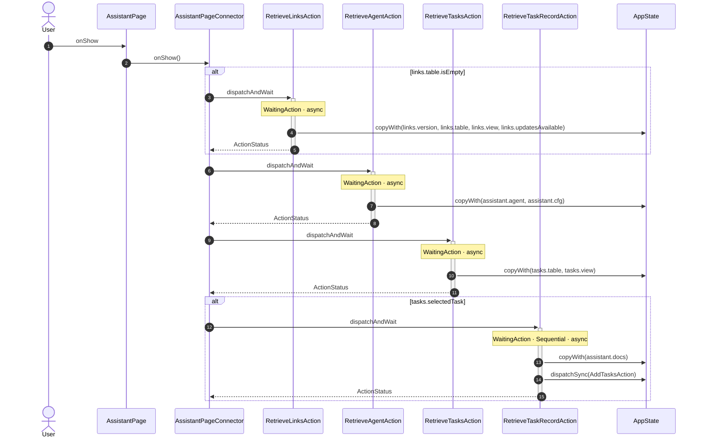
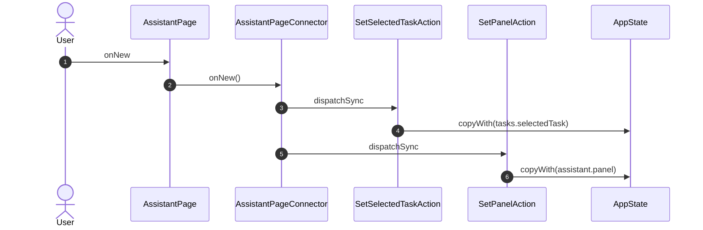
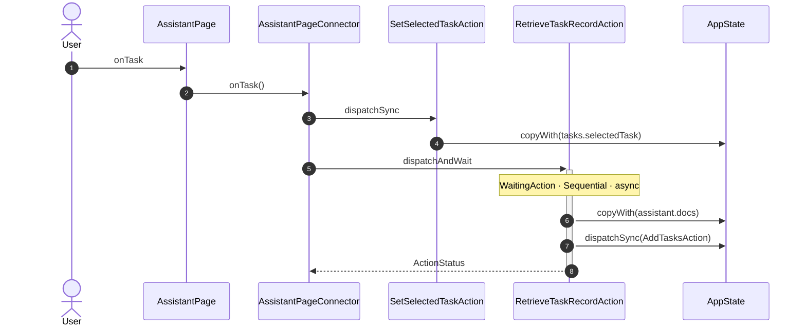
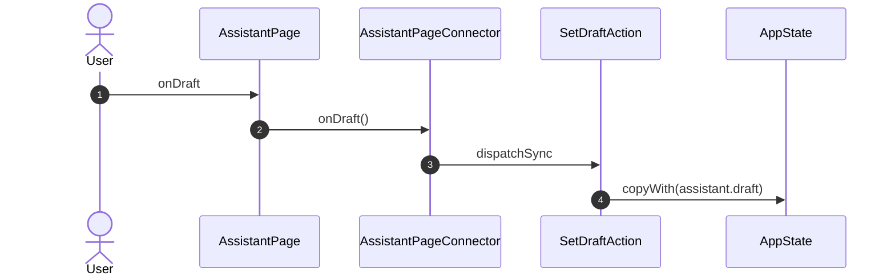
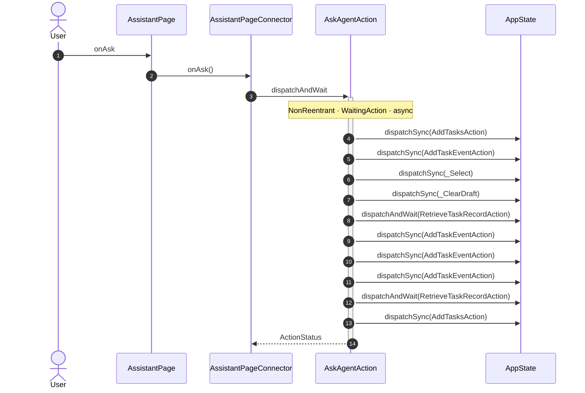
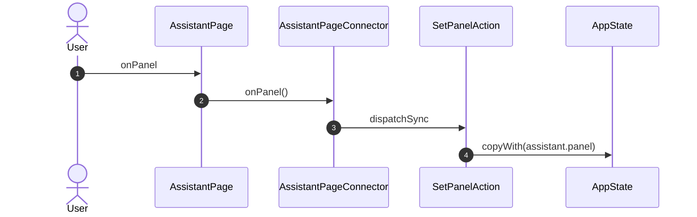
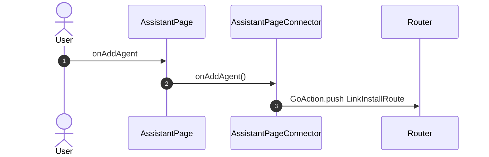
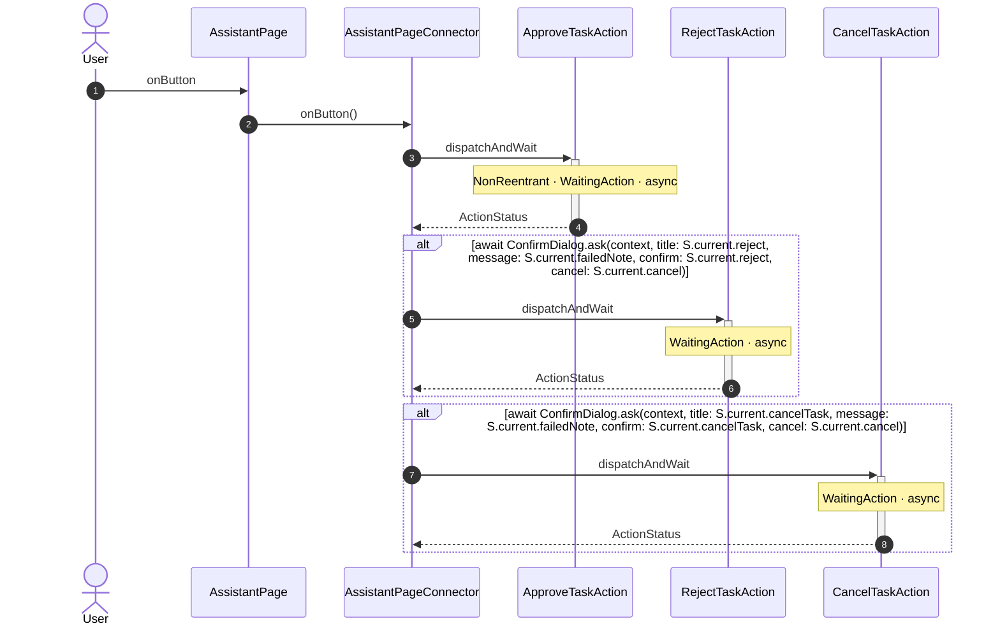

<!-- generated by `frx flow --md` — do not edit, re-run it -->

# AssistantPage

`app/lib/connectors/assistant_page_connector.dart`

## onShow

## onNew

## onTask

## onDraft

## onAsk

## onPanel

## onAddAgent

## onButton

| Interaction | Dispatches | Writes |
| --- | --- | --- |
| `onShow` | `RetrieveLinksAction` ?, `RetrieveAgentAction`, `RetrieveTasksAction`, `RetrieveTaskRecordAction` ? | `links.version, links.table, links.view, links.updatesAvailable`, `assistant.agent, assistant.cfg`, `tasks.table, tasks.view`, `assistant.docs` |
| `onNew` | `SetSelectedTaskAction`, `SetPanelAction` | `tasks.selectedTask`, `assistant.panel` |
| `onTask` | `SetSelectedTaskAction`, `RetrieveTaskRecordAction` | `tasks.selectedTask`, `assistant.docs` |
| `onDraft` | `SetDraftAction` | `assistant.draft` |
| `onAsk` | `AskAgentAction` | — |
| `onPanel` | `SetPanelAction` | `assistant.panel` |
| `onAddAgent` | `GoAction.push` | — |
| `onButton` | `ApproveTaskAction`, `RejectTaskAction` ?, `CancelTaskAction` ? | — |

`?` marks a dispatch that only runs under a condition.

[← all flows](README.md)
