<!-- generated by `frx flow --md` — do not edit, re-run it -->

# AssistantPage

`app/lib/connectors/assistant_page_connector.dart`

## ticks.onToggle

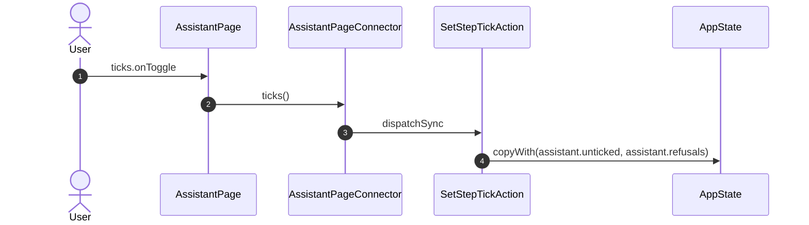

## onPick

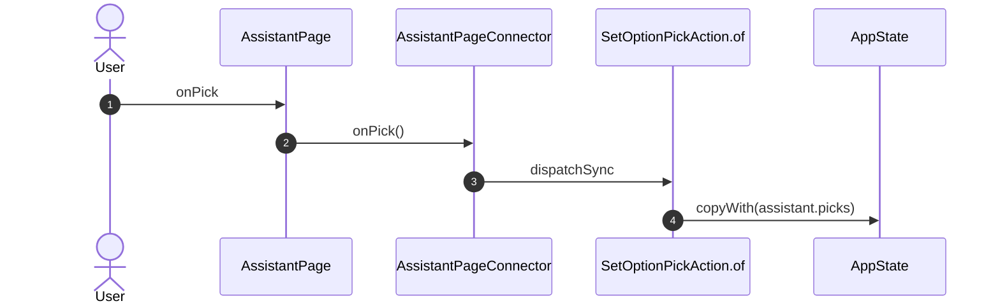

## onAnswer

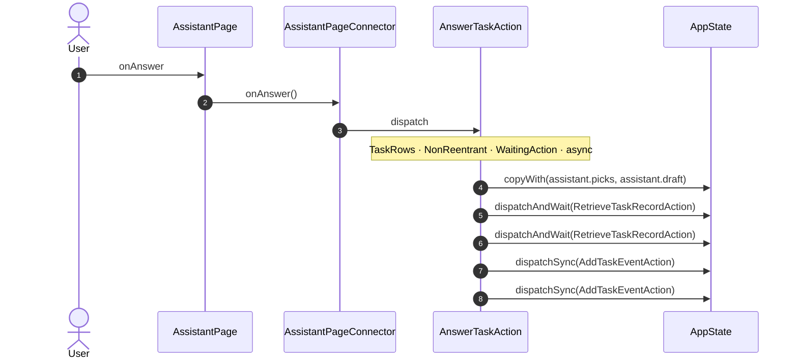

## onPickSuggestion

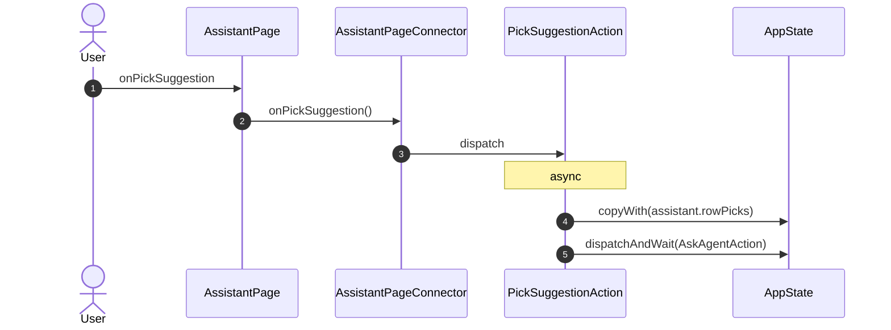

## rows.onToggle

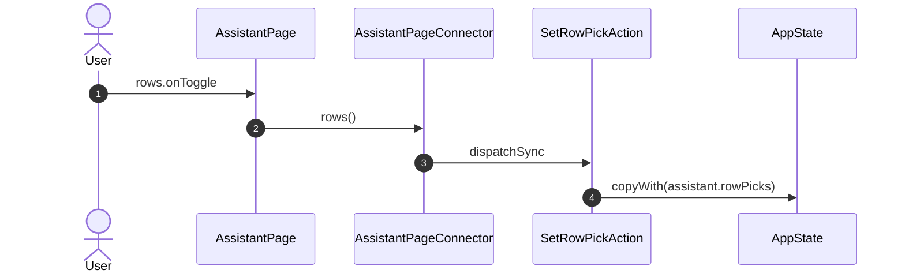

## onReveal

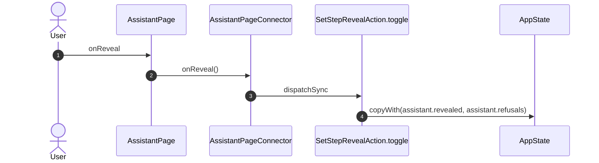

## buttons

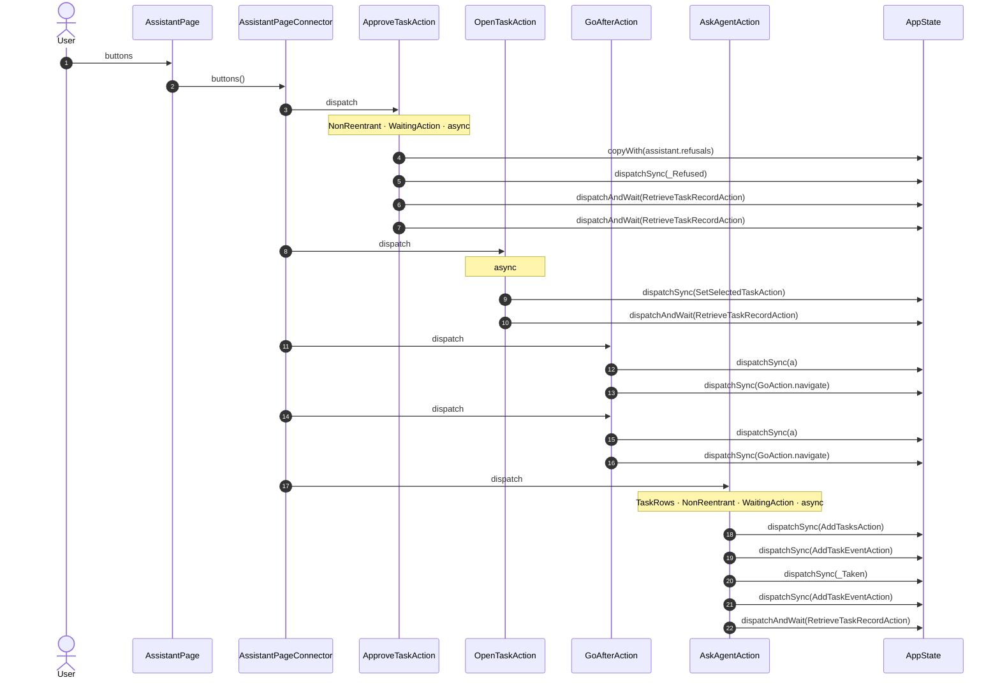

## onTimelineWindow


## onTimelineReset

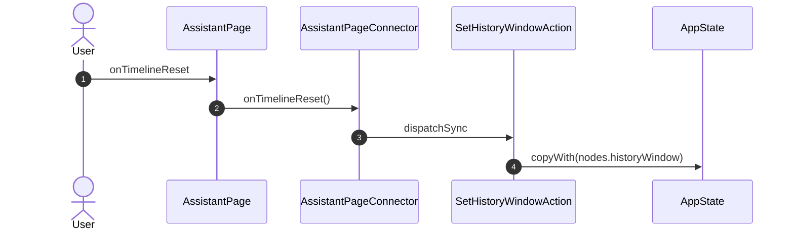

## onDraft

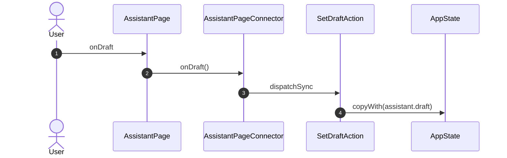

## onAsk

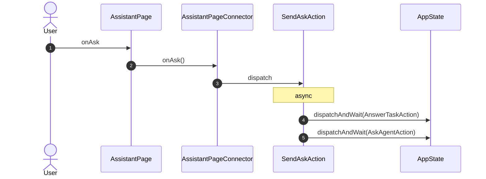

## onChipRemove

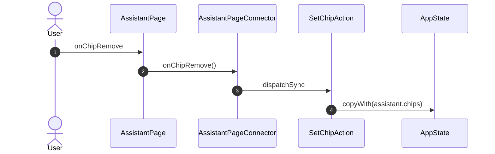

## onPanel

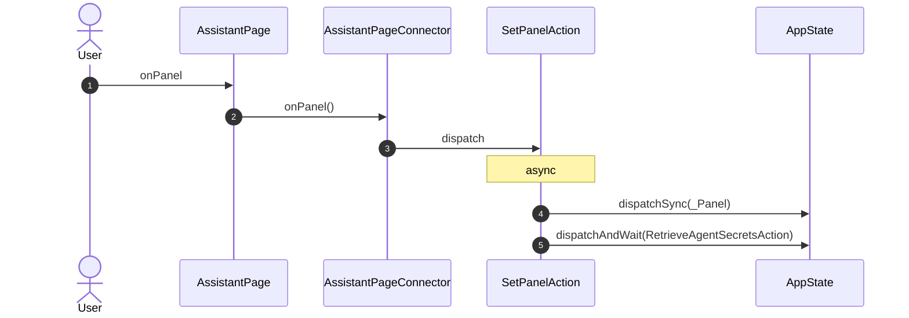

## onMode

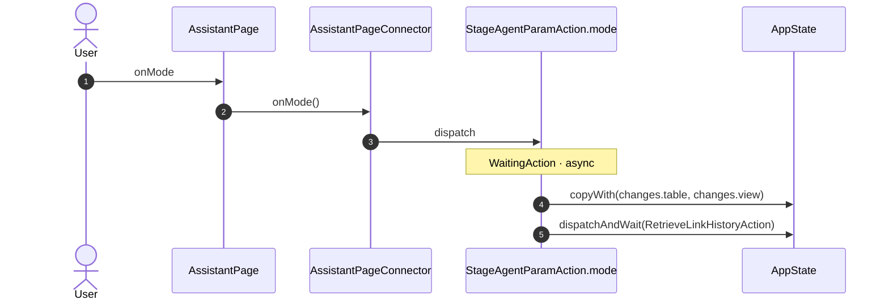

## onRemovePrefix

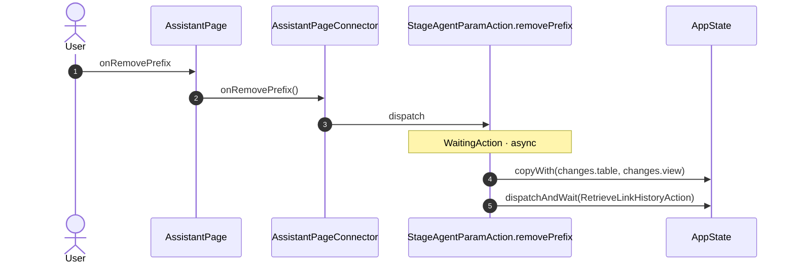

## onAddAgent

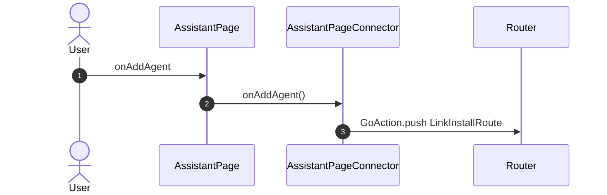

## onShow

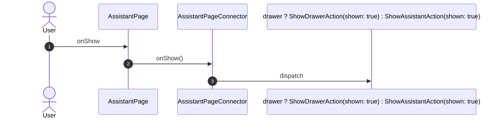

## onHide

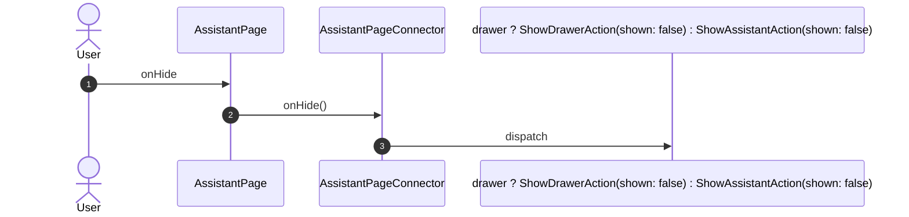

## onNew

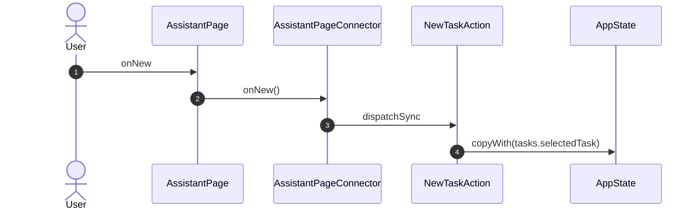

## onNewTask

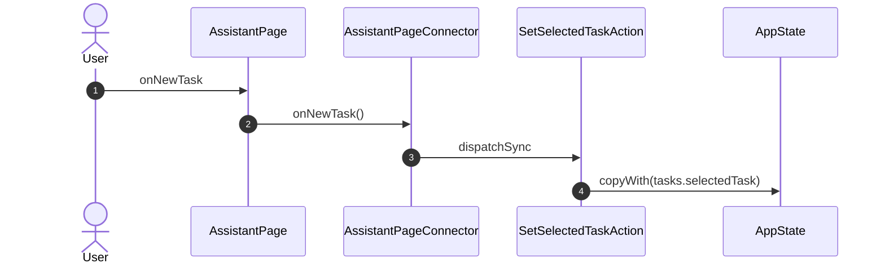

## onTask

```mermaid
sequenceDiagram
    autonumber
    actor User
    participant UI as AssistantPage
    participant VM as AssistantPageConnector
    participant A1 as OpenTaskAction
    participant ST as AppState

    User->>UI: onTask
    UI->>VM: onTask()
    VM->>A1: dispatch
    Note over A1: async
    A1->>ST: dispatchSync(SetSelectedTaskAction)
    A1->>ST: dispatchAndWait(RetrieveTaskRecordAction)
```

## onOpenFull

```mermaid
sequenceDiagram
    autonumber
    actor User
    participant UI as AssistantPage
    participant VM as AssistantPageConnector
    participant A1 as GoAfterAction
    participant ST as AppState

    User->>UI: onOpenFull
    UI->>VM: onOpenFull()
    VM->>A1: dispatch
    A1->>ST: dispatchSync(a)
    A1->>ST: dispatchSync(GoAction.navigate)
```

## onCloseDrawer

```mermaid
sequenceDiagram
    autonumber
    actor User
    participant UI as AssistantPage
    participant VM as AssistantPageConnector
    participant A1 as SetDrawerAction
    participant ST as AppState

    User->>UI: onCloseDrawer
    UI->>VM: onCloseDrawer()
    VM->>A1: dispatchSync
    A1->>ST: copyWith(assistant.drawer)
    A1->>ST: dispatchSync(SetChipAction)
```

_Not drawn — these files dispatch outside any interaction:_

- `AssistantPageConnector` — 3 dispatches

| Interaction | Dispatches | Writes |
| --- | --- | --- |
| `ticks.onToggle` | `SetStepTickAction` | `assistant.unticked, assistant.refusals` |
| `onPick` | `SetOptionPickAction.of` | `assistant.picks` |
| `onAnswer` | `AnswerTaskAction` | `assistant.picks, assistant.draft` |
| `onPickSuggestion` | `PickSuggestionAction` | `assistant.rowPicks` |
| `rows.onToggle` | `SetRowPickAction` | `assistant.rowPicks` |
| `onReveal` | `SetStepRevealAction.toggle` | `assistant.revealed, assistant.refusals` |
| `buttons` | `ApproveTaskAction`, `OpenTaskAction`, `GoAfterAction`, `GoAfterAction`, `AskAgentAction` | `assistant.refusals` |
| `onTimelineWindow` | `SetHistoryWindowAction` | `nodes.historyWindow` |
| `onTimelineReset` | `SetHistoryWindowAction` | `nodes.historyWindow` |
| `onDraft` | `SetDraftAction` | `assistant.draft` |
| `onAsk` | `SendAskAction` | — |
| `onChipRemove` | `SetChipAction` | `assistant.chips` |
| `onPanel` | `SetPanelAction` | — |
| `onMode` | `StageAgentParamAction.mode` | `changes.table, changes.view` |
| `onRemovePrefix` | `StageAgentParamAction.removePrefix` | `changes.table, changes.view` |
| `onAddAgent` | `GoAction.push` | — |
| `onShow` | `drawer ? ShowDrawerAction(shown: true) : ShowAssistantAction(shown: true)` | — |
| `onHide` | `drawer ? ShowDrawerAction(shown: false) : ShowAssistantAction(shown: false)` | — |
| `onNew` | `NewTaskAction` | `tasks.selectedTask` |
| `onNewTask` | `SetSelectedTaskAction` | `tasks.selectedTask` |
| `onTask` | `OpenTaskAction` | — |
| `onOpenFull` | `GoAfterAction` | — |
| `onCloseDrawer` | `SetDrawerAction` | `assistant.drawer` |

`?` marks a dispatch that only runs under a condition.

[← all flows](README.md)
