<!-- generated by `frx flow --md` — do not edit, re-run it -->

# ExplorerPage

`app/lib/connectors/explorer_page_connector.dart`

## params.onChanged

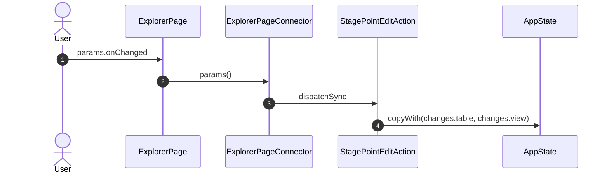

## inspector

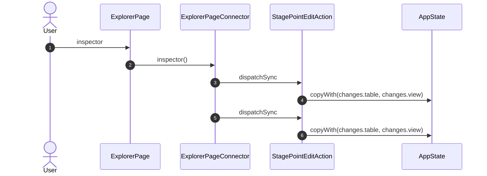

## onShow

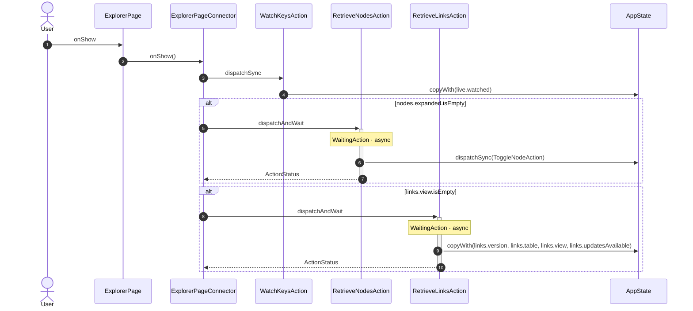

## onHide

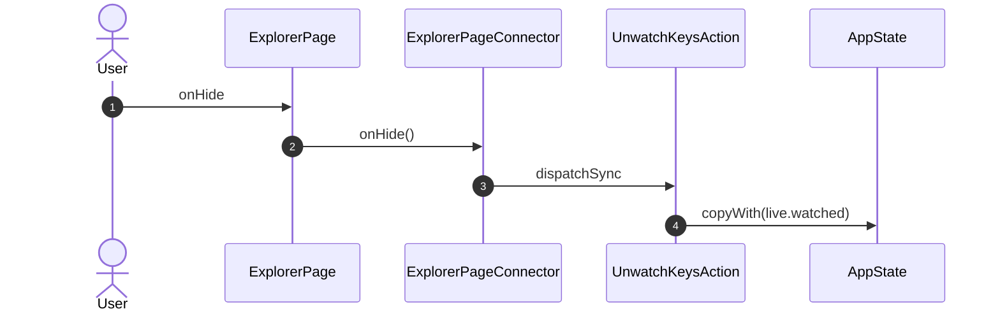

## onSelect

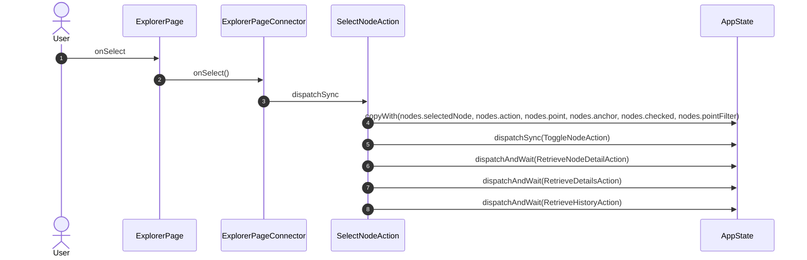

## onToggle

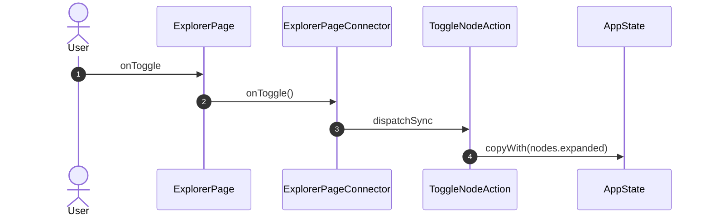

## onMark

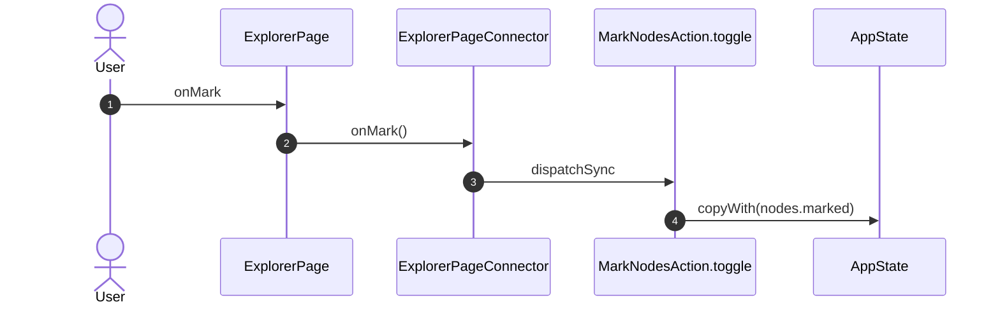

## onMarkRange

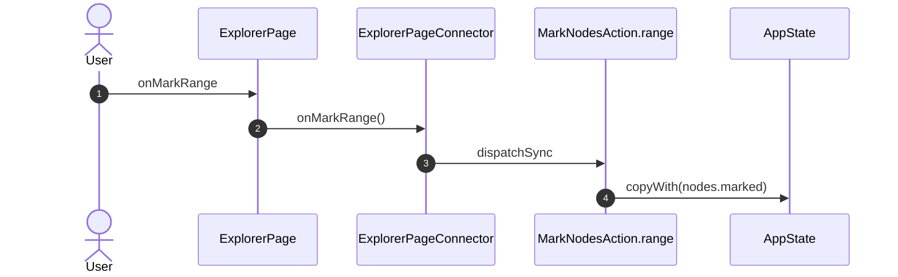

## onTreeFilter

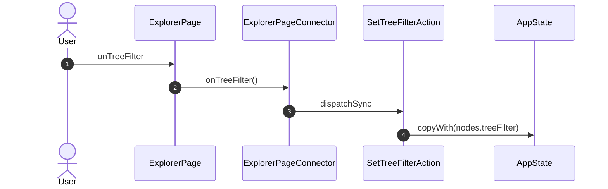

## onPointFilter

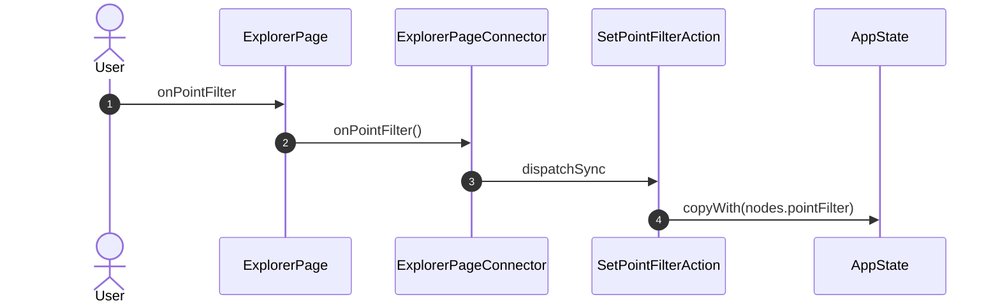

## onPoint

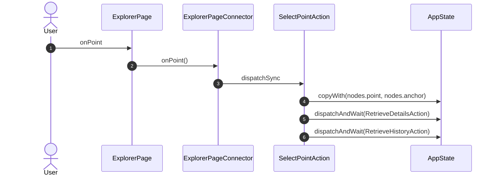

## onCheck

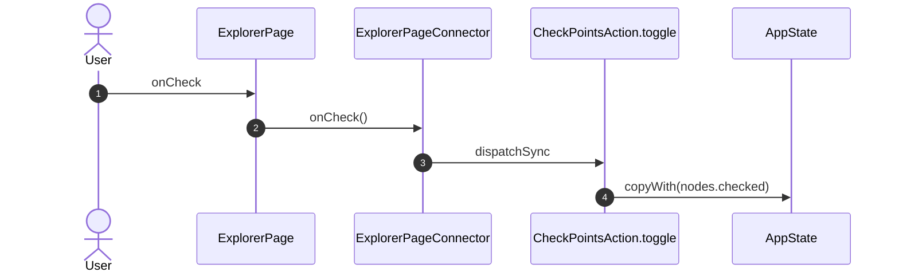

## onRange

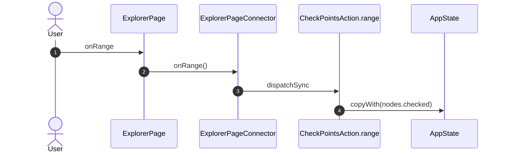

## onCheckAll

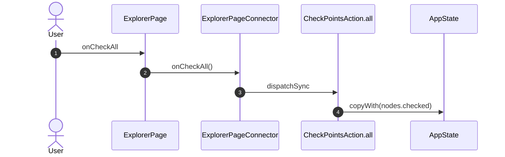

## onClear

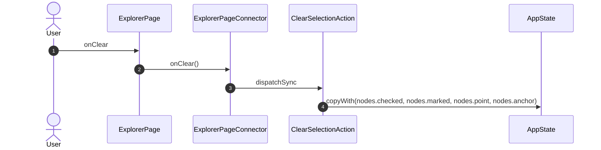

## onToggleAssistant

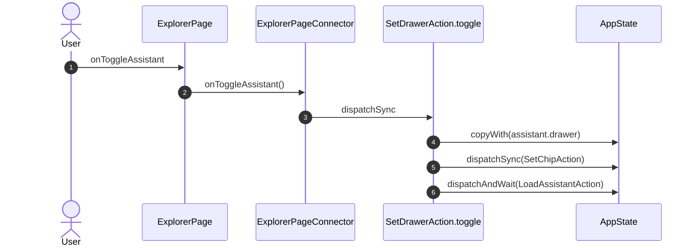

## onTab

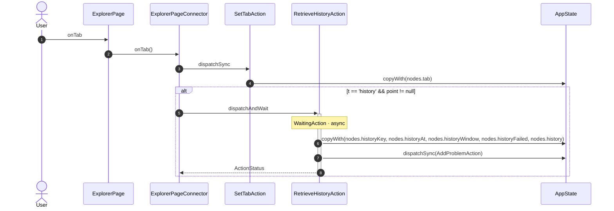

## onAudit

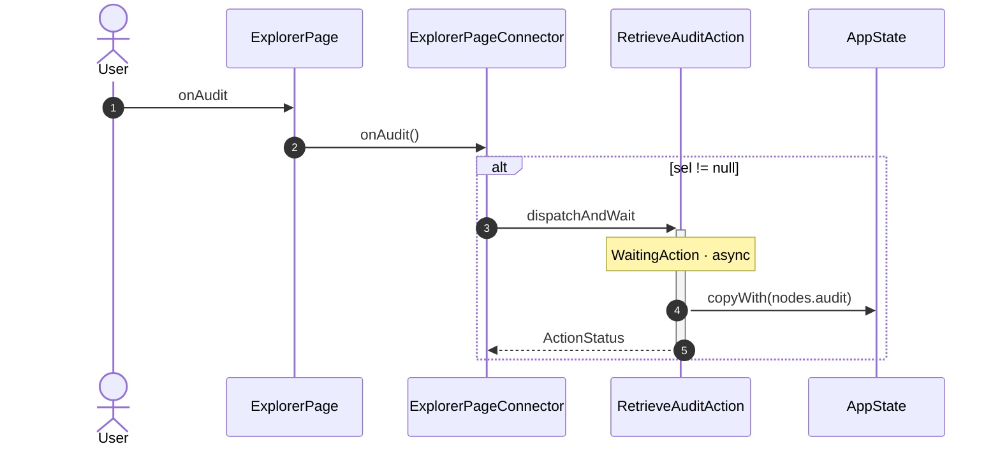

## onAction

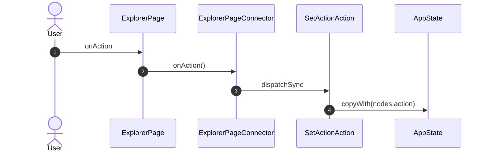

## onPickAction

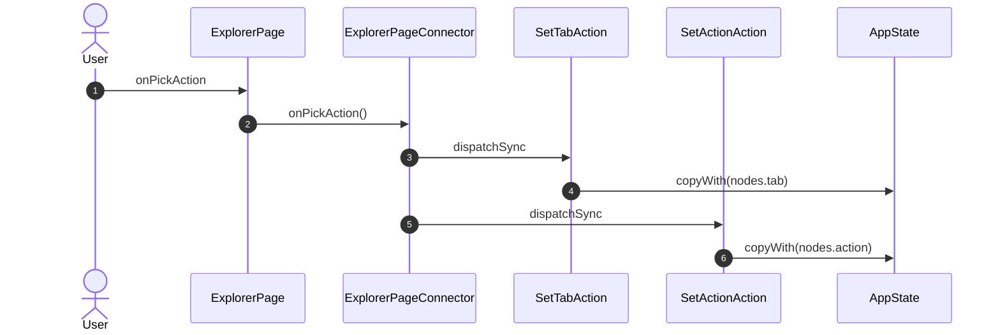

## onHistoryRange

```mermaid
sequenceDiagram
    autonumber
    actor User
    participant UI as ExplorerPage
    participant VM as ExplorerPageConnector
    participant A1 as SetHistoryRangeAction
    participant A2 as RetrieveHistoryAction
    participant ST as AppState

    User->>UI: onHistoryRange
    UI->>VM: onHistoryRange()
    VM->>A1: dispatchSync
    A1->>ST: copyWith(nodes.historyRange, nodes.historyWindow)
    alt point != null
        VM->>+A2: dispatchAndWait
        Note over A2: WaitingAction · async
        A2->>ST: copyWith(nodes.historyKey, nodes.historyAt, nodes.historyWindow, nodes.historyFailed, nodes.history)
        A2->>ST: dispatchSync(AddProblemAction)
        A2-->>-VM: ActionStatus
    end
```

## onTrendWindow

```mermaid
sequenceDiagram
    autonumber
    actor User
    participant UI as ExplorerPage
    participant VM as ExplorerPageConnector
    participant A1 as SetHistoryWindowAction
    participant ST as AppState

    User->>UI: onTrendWindow
    UI->>VM: onTrendWindow()
    VM->>A1: dispatchSync
    A1->>ST: copyWith(nodes.historyWindow)
```

## onTrendReset

```mermaid
sequenceDiagram
    autonumber
    actor User
    participant UI as ExplorerPage
    participant VM as ExplorerPageConnector
    participant A1 as SetHistoryWindowAction
    participant ST as AppState

    User->>UI: onTrendReset
    UI->>VM: onTrendReset()
    VM->>A1: dispatchSync
    A1->>ST: copyWith(nodes.historyWindow)
```

## onCloseInspector

```mermaid
sequenceDiagram
    autonumber
    actor User
    participant UI as ExplorerPage
    participant VM as ExplorerPageConnector
    participant A1 as SetActionAction
    participant ST as AppState

    User->>UI: onCloseInspector
    UI->>VM: onCloseInspector()
    VM->>A1: dispatchSync
    A1->>ST: copyWith(nodes.action)
```

## onSubmit

```mermaid
sequenceDiagram
    autonumber
    actor User
    participant UI as ExplorerPage
    participant VM as ExplorerPageConnector
    participant A1 as StageInvokeAction
    participant A2 as InvokeNodeAction
    participant A3 as StageValueAction
    participant ST as AppState

    User->>UI: onSubmit
    UI->>VM: onSubmit()
    alt act.level == 'config'
        VM->>A1: dispatchSync
        A1->>ST: dispatchSync(AddChangesAction)
    end
    alt act != null
        VM->>+A2: dispatchAndWait
        Note over A2: WaitingAction · async
        A2->>ST: copyWith(nodes.results)
        A2-->>-VM: ActionStatus
    end
    alt point != null && values.containsKey('value')
        VM->>A3: dispatchSync
        A3->>ST: dispatchSync(AddChangesAction)
    end
```

## onReadAgain

```mermaid
sequenceDiagram
    autonumber
    actor User
    participant UI as ExplorerPage
    participant VM as ExplorerPageConnector
    participant A1 as RetryReadAction
    participant ST as AppState

    User->>UI: onReadAgain
    UI->>VM: onReadAgain()
    VM->>A1: dispatchSync
    A1->>ST: dispatchAndWait(RetrieveNodeDetailAction)
```

## onTool

```mermaid
sequenceDiagram
    autonumber
    actor User
    participant UI as ExplorerPage
    participant VM as ExplorerPageConnector
    participant A1 as StageInvokeAction
    participant A2 as ClearSelectionAction
    participant A3 as InvokeNodeAction
    participant A4 as SetActionAction
    participant ST as AppState

    User->>UI: onTool
    UI->>VM: onTool()
    VM->>A1: dispatchSync
    A1->>ST: dispatchSync(AddChangesAction)
    VM->>A2: dispatchSync
    A2->>ST: copyWith(nodes.checked, nodes.marked, nodes.point, nodes.anchor)
    VM->>+A3: dispatchAndWait
    Note over A3: WaitingAction · async
    A3->>ST: copyWith(nodes.results)
    A3-->>-VM: ActionStatus
    VM->>A4: dispatchSync
    A4->>ST: copyWith(nodes.action)
```

## onSetPoll

```mermaid
sequenceDiagram
    autonumber
    actor User
    participant UI as ExplorerPage
    participant VM as ExplorerPageConnector
    participant A1 as StagePointEditAction
    participant ST as AppState

    User->>UI: onSetPoll
    UI->>VM: onSetPoll()
    alt _actionOf(k, 'edit') != null
        VM->>A1: dispatchSync
        A1->>ST: copyWith(changes.table, changes.view)
    end
```

## onPanelWidth

```mermaid
sequenceDiagram
    autonumber
    actor User
    participant UI as ExplorerPage
    participant VM as ExplorerPageConnector
    participant A1 as SetPanelWidthAction
    participant ST as AppState

    User->>UI: onPanelWidth
    UI->>VM: onPanelWidth()
    VM->>A1: dispatchSync
    A1->>ST: copyWith(panels.widths)
```

## onTapFlowEditor

```mermaid
sequenceDiagram
    autonumber
    actor User
    participant UI as ExplorerPage
    participant VM as ExplorerPageConnector
    participant NAV as Router

    User->>UI: onTapFlowEditor
    UI->>VM: onTapFlowEditor()
    VM->>NAV: GoAction.push FlowEditorRoute(id: id)
```

## onViewPoint

```mermaid
sequenceDiagram
    autonumber
    actor User
    participant UI as ExplorerPage
    participant VM as ExplorerPageConnector
    participant A1 as SetViewedPointAction
    participant ST as AppState

    User->>UI: onViewPoint
    UI->>VM: onViewPoint()
    VM->>A1: dispatchSync
    A1->>ST: copyWith(nodes.viewedPoint)
```

## onCloseViewer

```mermaid
sequenceDiagram
    autonumber
    actor User
    participant UI as ExplorerPage
    participant VM as ExplorerPageConnector
    participant A1 as SetViewedPointAction
    participant ST as AppState

    User->>UI: onCloseViewer
    UI->>VM: onCloseViewer()
    VM->>A1: dispatchSync
    A1->>ST: copyWith(nodes.viewedPoint)
```

## AssistantDrawer ▸ onTick

```mermaid
sequenceDiagram
    autonumber
    actor User
    participant UI as ExplorerPage
    participant R1 as AssistantDrawerConnector
    participant A1 as SetStepTickAction
    participant ST as AppState

    User->>UI: AssistantDrawer ▸ onTick
    UI->>R1: onTick()
    R1->>A1: dispatchSync
    A1->>ST: copyWith(assistant.unticked, assistant.refusals)
```

## AssistantDrawer ▸ onPick

```mermaid
sequenceDiagram
    autonumber
    actor User
    participant UI as ExplorerPage
    participant R1 as AssistantDrawerConnector
    participant A1 as SetOptionPickAction
    participant ST as AppState

    User->>UI: AssistantDrawer ▸ onPick
    UI->>R1: onPick()
    alt id != null && q != null
        R1->>A1: dispatchSync
        A1->>ST: copyWith(assistant.picks)
    end
```

## AssistantDrawer ▸ onAnswer

```mermaid
sequenceDiagram
    autonumber
    actor User
    participant UI as ExplorerPage
    participant R1 as AssistantDrawerConnector
    participant A1 as AnswerTaskAction
    participant ST as AppState

    User->>UI: AssistantDrawer ▸ onAnswer
    UI->>R1: onAnswer()
    alt id != null
        R1->>+A1: dispatchAndWait
        Note over A1: TaskRows · NonReentrant · WaitingAction · async
        A1->>ST: copyWith(assistant.picks, assistant.draft)
        A1->>ST: dispatchAndWait(RetrieveTaskRecordAction)
        A1->>ST: dispatchAndWait(RetrieveTaskRecordAction)
        A1->>ST: dispatchSync(AddTaskEventAction)
        A1->>ST: dispatchSync(AddTaskEventAction)
        A1-->>-R1: ActionStatus
    end
```

## AssistantDrawer ▸ onPickSuggestion

```mermaid
sequenceDiagram
    autonumber
    actor User
    participant UI as ExplorerPage
    participant R1 as AssistantDrawerConnector
    participant A1 as PickSuggestionAction
    participant ST as AppState

    User->>UI: AssistantDrawer ▸ onPickSuggestion
    UI->>R1: onPickSuggestion()
    alt id != null
        R1->>+A1: dispatchAndWait
        Note over A1: async
        A1->>ST: copyWith(assistant.rowPicks)
        A1->>ST: dispatchAndWait(AskAgentAction)
        A1-->>-R1: ActionStatus
    end
```

## AssistantDrawer ▸ onRow

```mermaid
sequenceDiagram
    autonumber
    actor User
    participant UI as ExplorerPage
    participant R1 as AssistantDrawerConnector
    participant A1 as SetRowPickAction
    participant ST as AppState

    User->>UI: AssistantDrawer ▸ onRow
    UI->>R1: onRow()
    alt id != null
        R1->>A1: dispatchSync
        A1->>ST: copyWith(assistant.rowPicks)
    end
```

## AssistantDrawer ▸ onReveal

```mermaid
sequenceDiagram
    autonumber
    actor User
    participant UI as ExplorerPage
    participant R1 as AssistantDrawerConnector
    participant A1 as SetStepRevealAction
    participant ST as AppState

    User->>UI: AssistantDrawer ▸ onReveal
    UI->>R1: onReveal()
    alt id != null
        R1->>A1: dispatchSync
        A1->>ST: copyWith(assistant.revealed)
    end
```

## AssistantDrawer ▸ onMode

```mermaid
sequenceDiagram
    autonumber
    actor User
    participant UI as ExplorerPage
    participant R1 as AssistantDrawerConnector
    participant A1 as StageAgentParamAction
    participant ST as AppState

    User->>UI: AssistantDrawer ▸ onMode
    UI->>R1: onMode()
    R1->>+A1: dispatchAndWait
    Note over A1: async
    A1->>ST: dispatchAndWait(RetrieveLinkHistoryAction)
    A1->>ST: dispatchAndWait(UpdateLinkParamsAction)
    A1-->>-R1: ActionStatus
```

## AssistantDrawer ▸ onRemovePrefix

```mermaid
sequenceDiagram
    autonumber
    actor User
    participant UI as ExplorerPage
    participant R1 as AssistantDrawerConnector
    participant A1 as StageAgentParamAction
    participant ST as AppState

    User->>UI: AssistantDrawer ▸ onRemovePrefix
    UI->>R1: onRemovePrefix()
    R1->>+A1: dispatchAndWait
    Note over A1: async
    A1->>ST: dispatchAndWait(RetrieveLinkHistoryAction)
    A1->>ST: dispatchAndWait(UpdateLinkParamsAction)
    A1-->>-R1: ActionStatus
```

## AssistantDrawer ▸ onAddPrefix

```mermaid
sequenceDiagram
    autonumber
    actor User
    participant UI as ExplorerPage
    participant R1 as AssistantDrawerConnector
    participant A1 as StageAgentParamAction
    participant ST as AppState

    User->>UI: AssistantDrawer ▸ onAddPrefix
    UI->>R1: onAddPrefix()
    alt p != null && p.trim().isNotEmpty && !assistant.prefixes.contains(p.trim())
        R1->>+A1: dispatchAndWait
        Note over A1: async
        A1->>ST: dispatchAndWait(RetrieveLinkHistoryAction)
        A1->>ST: dispatchAndWait(UpdateLinkParamsAction)
        A1-->>-R1: ActionStatus
    end
```

## AssistantDrawer ▸ onOpenFull

```mermaid
sequenceDiagram
    autonumber
    actor User
    participant UI as ExplorerPage
    participant R1 as AssistantDrawerConnector
    participant A1 as SetDrawerAction
    participant ST as AppState
    participant NAV as Router

    User->>UI: AssistantDrawer ▸ onOpenFull
    UI->>R1: onOpenFull()
    R1->>A1: dispatchSync
    A1->>ST: copyWith(assistant.drawer)
    A1->>ST: dispatchSync(SetChipAction)
    A1->>ST: dispatchAndWait(LoadAssistantAction)
    R1->>NAV: GoAction.navigate AssistantRoute
```

## AssistantDrawer ▸ onCloseDrawer

```mermaid
sequenceDiagram
    autonumber
    actor User
    participant UI as ExplorerPage
    participant R1 as AssistantDrawerConnector
    participant A1 as SetDrawerAction
    participant ST as AppState

    User->>UI: AssistantDrawer ▸ onCloseDrawer
    UI->>R1: onCloseDrawer()
    R1->>A1: dispatchSync
    A1->>ST: copyWith(assistant.drawer)
    A1->>ST: dispatchSync(SetChipAction)
    A1->>ST: dispatchAndWait(LoadAssistantAction)
```

## AssistantDrawer ▸ onChipRemove

```mermaid
sequenceDiagram
    autonumber
    actor User
    participant UI as ExplorerPage
    participant R1 as AssistantDrawerConnector
    participant A1 as SetChipAction
    participant ST as AppState

    User->>UI: AssistantDrawer ▸ onChipRemove
    UI->>R1: onChipRemove()
    R1->>A1: dispatchSync
    A1->>ST: copyWith(assistant.chips)
```

## AssistantDrawer ▸ onAddChip

```mermaid
sequenceDiagram
    autonumber
    actor User
    participant UI as ExplorerPage
    participant R1 as AssistantDrawerConnector
    participant A1 as SetChipAction
    participant ST as AppState

    User->>UI: AssistantDrawer ▸ onAddChip
    UI->>R1: onAddChip()
    alt offered != null
        R1->>A1: dispatchSync
        A1->>ST: copyWith(assistant.chips)
    end
```

## AssistantDrawer ▸ onShow

```mermaid
sequenceDiagram
    autonumber
    actor User
    participant UI as ExplorerPage
    participant R1 as AssistantDrawerConnector
    participant A1 as SetShownAction
    participant A2 as SetWatchedAction
    participant A3 as LoadAssistantAction
    participant ST as AppState

    User->>UI: AssistantDrawer ▸ onShow
    UI->>R1: onShow()
    R1->>A1: dispatchSync
    A1->>ST: copyWith(assistant.shown)
    R1->>A2: dispatchSync
    A2->>ST: copyWith(assistant.watched)
    A2->>ST: dispatchSync(WatchKeysAction)
    A2->>ST: dispatchSync(UnwatchKeysAction)
    R1->>+A3: dispatchAndWait
    Note over A3: async
    A3->>ST: dispatchAndWait(RetrieveLinksAction)
    A3->>ST: dispatchAndWait(RetrieveAgentAction)
    A3->>ST: dispatchAndWait(RetrieveTasksAction)
    A3->>ST: dispatchAndWait(RetrieveTaskRecordAction)
    A3-->>-R1: ActionStatus
```

## AssistantDrawer ▸ onHide

```mermaid
sequenceDiagram
    autonumber
    actor User
    participant UI as ExplorerPage
    participant R1 as AssistantDrawerConnector
    participant A1 as SetShownAction
    participant A2 as SetWatchedAction
    participant ST as AppState

    User->>UI: AssistantDrawer ▸ onHide
    UI->>R1: onHide()
    R1->>A1: dispatchSync
    A1->>ST: copyWith(assistant.shown)
    R1->>A2: dispatchSync
    A2->>ST: copyWith(assistant.watched)
    A2->>ST: dispatchSync(WatchKeysAction)
    A2->>ST: dispatchSync(UnwatchKeysAction)
```

## AssistantDrawer ▸ onNew

```mermaid
sequenceDiagram
    autonumber
    actor User
    participant UI as ExplorerPage
    participant R1 as AssistantDrawerConnector
    participant A1 as SetSelectedTaskAction
    participant A2 as SetPanelAction
    participant ST as AppState

    User->>UI: AssistantDrawer ▸ onNew
    UI->>R1: onNew()
    R1->>A1: dispatchSync
    A1->>ST: copyWith(tasks.selectedTask)
    R1->>A2: dispatchSync
    A2->>ST: copyWith(assistant.panel)
```

## AssistantDrawer ▸ onTask

```mermaid
sequenceDiagram
    autonumber
    actor User
    participant UI as ExplorerPage
    participant R1 as AssistantDrawerConnector
    participant A1 as SetSelectedTaskAction
    participant A2 as RetrieveTaskRecordAction
    participant ST as AppState

    User->>UI: AssistantDrawer ▸ onTask
    UI->>R1: onTask()
    R1->>A1: dispatchSync
    A1->>ST: copyWith(tasks.selectedTask)
    R1->>+A2: dispatchAndWait
    Note over A2: WaitingAction · Sequential · async
    A2->>ST: copyWith(assistant.docs)
    A2->>ST: dispatchSync(AddTasksAction)
    A2-->>-R1: ActionStatus
```

## AssistantDrawer ▸ onDraft

```mermaid
sequenceDiagram
    autonumber
    actor User
    participant UI as ExplorerPage
    participant R1 as AssistantDrawerConnector
    participant A1 as SetDraftAction
    participant ST as AppState

    User->>UI: AssistantDrawer ▸ onDraft
    UI->>R1: onDraft()
    R1->>A1: dispatchSync
    A1->>ST: copyWith(assistant.draft)
```

## AssistantDrawer ▸ onAsk

```mermaid
sequenceDiagram
    autonumber
    actor User
    participant UI as ExplorerPage
    participant R1 as AssistantDrawerConnector
    participant A1 as id != null && task?.state == .awaitingAnswer ? AnswerTaskAction(id, text: assistant.draft) : AskAgentAction(parent: task != null && task.replacedBy == null && mayFollow(task) ? id : null)

    User->>UI: AssistantDrawer ▸ onAsk
    UI->>R1: onAsk()
    R1->>+A1: dispatchAndWait
    A1-->>-R1: ActionStatus
```

## AssistantDrawer ▸ onPanel

```mermaid
sequenceDiagram
    autonumber
    actor User
    participant UI as ExplorerPage
    participant R1 as AssistantDrawerConnector
    participant A1 as SetPanelAction
    participant A2 as RetrieveAgentSecretsAction
    participant ST as AppState

    User->>UI: AssistantDrawer ▸ onPanel
    UI->>R1: onPanel()
    R1->>A1: dispatchSync
    A1->>ST: copyWith(assistant.panel)
    alt p == 'rights'
        R1->>+A2: dispatchAndWait
        Note over A2: async
        A2->>ST: copyWith(assistant.secrets)
        A2-->>-R1: ActionStatus
    end
```

## AssistantDrawer ▸ onAddAgent

```mermaid
sequenceDiagram
    autonumber
    actor User
    participant UI as ExplorerPage
    participant R1 as AssistantDrawerConnector
    participant NAV as Router

    User->>UI: AssistantDrawer ▸ onAddAgent
    UI->>R1: onAddAgent()
    R1->>NAV: GoAction.push LinkInstallRoute
```

## AssistantDrawer ▸ onButton

```mermaid
sequenceDiagram
    autonumber
    actor User
    participant UI as ExplorerPage
    participant R1 as AssistantDrawerConnector
    participant A1 as ApproveTaskAction
    participant A2 as RejectTaskAction
    participant A3 as SetSelectedTaskAction
    participant A4 as RetrieveTaskRecordAction
    participant A5 as SetDrawerAction
    participant A6 as OpenTrendAction
    participant A7 as ShowNoticeAction
    participant A8 as PickSuggestionAction
    participant A9 as SelectNodeAction
    participant A10 as SavePlanAction
    participant A11 as AskAgentAction
    participant A12 as CancelTaskAction
    participant ST as AppState
    participant NAV as Router

    User->>UI: AssistantDrawer ▸ onButton
    UI->>R1: onButton()
    R1->>+A1: dispatchAndWait
    Note over A1: NonReentrant · WaitingAction · async
    A1->>ST: copyWith(assistant.refusals)
    A1->>A4: dispatchAndWait
    A1->>A4: dispatchAndWait
    A1-->>-R1: ActionStatus
    alt reason != null
        R1->>+A2: dispatchAndWait
        Note over A2: WaitingAction · async
        A2-->>-R1: ActionStatus
    end
    alt task?.replacedBy
        R1->>A3: dispatchSync
        A3->>ST: copyWith(tasks.selectedTask)
        R1->>+A4: dispatchAndWait
        Note over A4: WaitingAction · Sequential · async
        A4->>ST: copyWith(assistant.docs)
        A4->>ST: dispatchSync(AddTasksAction)
        A4-->>-R1: ActionStatus
    end
    alt _touched(task).lastOrNull
        R1->>A5: dispatchSync
        A5->>ST: copyWith(assistant.drawer)
        A5->>ST: dispatchSync(SetChipAction)
        A5->>ST: dispatchAndWait(LoadAssistantAction)
        R1->>A6: dispatchSync
        A6->>A9: dispatchSync
        A6->>ST: dispatchSync(SetTabAction)
        A6->>ST: dispatchSync(SelectPointAction)
        A6->>ST: dispatchAndWait(RetrieveHistoryAction)
        R1->>NAV: GoAction.navigate ExplorerRoute
    end
    alt copy
        R1->>A7: dispatchSync
        A7->>ST: copyWith(problems.notices)
    end
    alt task!.state == .awaitingApproval
        R1->>+A8: dispatchAndWait
        Note over A8: async
        A8->>ST: copyWith(assistant.rowPicks)
        A8->>A11: dispatchAndWait
        A8-->>-R1: ActionStatus
    end
    alt _node(task)
        R1->>A9: dispatchSync
        A9->>ST: copyWith(nodes.selectedNode, nodes.action, nodes.point, nodes.anchor, nodes.checked, nodes.pointFilter)
        A9->>ST: dispatchSync(ToggleNodeAction)
        A9->>ST: dispatchAndWait(RetrieveNodeDetailAction)
        A9->>ST: dispatchAndWait(RetrieveDetailsAction)
        A9->>ST: dispatchAndWait(RetrieveHistoryAction)
        R1->>NAV: GoAction.navigate ExplorerRoute
    end
    R1->>+A10: dispatchAndWait
    Note over A10: WaitingAction · async
    A10-->>-R1: ActionStatus
    alt status.isCompletedOk
        R1->>A7: dispatchSync
        A7->>ST: copyWith(problems.notices)
    end
    alt left.isNotEmpty
        R1->>+A11: dispatchAndWait
        Note over A11: TaskRows · NonReentrant · WaitingAction · async
        A11->>ST: dispatchSync(AddTasksAction)
        A11->>ST: dispatchSync(AddTaskEventAction)
        A11->>ST: dispatchSync(_Select)
        A11->>ST: dispatchSync(_ClearDraft)
        A11->>ST: dispatchSync(AddTaskEventAction)
        A11->>A4: dispatchAndWait
        A11-->>-R1: ActionStatus
    end
    alt await ConfirmDialog.ask(context, title: S.current.cancelTask, message: S.current.failedNote, confirm: S.current.cancelTask, cancel: S.current.cancel)
        R1->>+A12: dispatchAndWait
        Note over A12: WaitingAction · async
        A12-->>-R1: ActionStatus
    end
```

_Not drawn — these files dispatch outside any interaction:_

- `ExplorerPageConnector` — 4 dispatches
- `AssistantDrawerConnector` — 1 dispatch

| Interaction | Dispatches | Writes |
| --- | --- | --- |
| `params.onChanged` | `StagePointEditAction` | `changes.table, changes.view` |
| `inspector` | `StagePointEditAction`, `StagePointEditAction` | `changes.table, changes.view` |
| `onShow` | `WatchKeysAction`, `RetrieveNodesAction` ?, `RetrieveLinksAction` ? | `live.watched`, `links.version, links.table, links.view, links.updatesAvailable` |
| `onHide` | `UnwatchKeysAction` | `live.watched` |
| `onSelect` | `SelectNodeAction` | `nodes.selectedNode, nodes.action, nodes.point, nodes.anchor, nodes.checked, nodes.pointFilter` |
| `onToggle` | `ToggleNodeAction` | `nodes.expanded` |
| `onMark` | `MarkNodesAction.toggle` | `nodes.marked` |
| `onMarkRange` | `MarkNodesAction.range` | `nodes.marked` |
| `onTreeFilter` | `SetTreeFilterAction` | `nodes.treeFilter` |
| `onPointFilter` | `SetPointFilterAction` | `nodes.pointFilter` |
| `onPoint` | `SelectPointAction` | `nodes.point, nodes.anchor` |
| `onCheck` | `CheckPointsAction.toggle` | `nodes.checked` |
| `onRange` | `CheckPointsAction.range` | `nodes.checked` |
| `onCheckAll` | `CheckPointsAction.all` | `nodes.checked` |
| `onClear` | `ClearSelectionAction` | `nodes.checked, nodes.marked, nodes.point, nodes.anchor` |
| `onToggleAssistant` | `SetDrawerAction.toggle` | `assistant.drawer` |
| `onTab` | `SetTabAction`, `RetrieveHistoryAction` ? | `nodes.tab`, `nodes.historyKey, nodes.historyAt, nodes.historyWindow, nodes.historyFailed, nodes.history` |
| `onAudit` | `RetrieveAuditAction` ? | `nodes.audit` |
| `onAction` | `SetActionAction` | `nodes.action` |
| `onPickAction` | `SetTabAction`, `SetActionAction` | `nodes.tab`, `nodes.action` |
| `onHistoryRange` | `SetHistoryRangeAction`, `RetrieveHistoryAction` ? | `nodes.historyRange, nodes.historyWindow`, `nodes.historyKey, nodes.historyAt, nodes.historyWindow, nodes.historyFailed, nodes.history` |
| `onTrendWindow` | `SetHistoryWindowAction` | `nodes.historyWindow` |
| `onTrendReset` | `SetHistoryWindowAction` | `nodes.historyWindow` |
| `onCloseInspector` | `SetActionAction` | `nodes.action` |
| `onSubmit` | `StageInvokeAction` ?, `InvokeNodeAction` ?, `StageValueAction` ? | `nodes.results` |
| `onReadAgain` | `RetryReadAction` | — |
| `onTool` | `StageInvokeAction`, `ClearSelectionAction`, `InvokeNodeAction`, `SetActionAction` | `nodes.checked, nodes.marked, nodes.point, nodes.anchor`, `nodes.results`, `nodes.action` |
| `onSetPoll` | `StagePointEditAction` ? | `changes.table, changes.view` |
| `onPanelWidth` | `SetPanelWidthAction` | `panels.widths` |
| `onTapFlowEditor` | `GoAction.push` | — |
| `onViewPoint` | `SetViewedPointAction` | `nodes.viewedPoint` |
| `onCloseViewer` | `SetViewedPointAction` | `nodes.viewedPoint` |
| `AssistantDrawer ▸ onTick` | `SetStepTickAction` | `assistant.unticked, assistant.refusals` |
| `AssistantDrawer ▸ onPick` | `SetOptionPickAction` ? | `assistant.picks` |
| `AssistantDrawer ▸ onAnswer` | `AnswerTaskAction` ? | `assistant.picks, assistant.draft` |
| `AssistantDrawer ▸ onPickSuggestion` | `PickSuggestionAction` ? | `assistant.rowPicks` |
| `AssistantDrawer ▸ onRow` | `SetRowPickAction` ? | `assistant.rowPicks` |
| `AssistantDrawer ▸ onReveal` | `SetStepRevealAction` ? | `assistant.revealed` |
| `AssistantDrawer ▸ onMode` | `StageAgentParamAction` | — |
| `AssistantDrawer ▸ onRemovePrefix` | `StageAgentParamAction` | — |
| `AssistantDrawer ▸ onAddPrefix` | `StageAgentParamAction` ? | — |
| `AssistantDrawer ▸ onOpenFull` | `SetDrawerAction`, `GoAction.navigate` | `assistant.drawer` |
| `AssistantDrawer ▸ onCloseDrawer` | `SetDrawerAction` | `assistant.drawer` |
| `AssistantDrawer ▸ onChipRemove` | `SetChipAction` | `assistant.chips` |
| `AssistantDrawer ▸ onAddChip` | `SetChipAction` ? | `assistant.chips` |
| `AssistantDrawer ▸ onShow` | `SetShownAction`, `SetWatchedAction`, `LoadAssistantAction` | `assistant.shown`, `assistant.watched` |
| `AssistantDrawer ▸ onHide` | `SetShownAction`, `SetWatchedAction` | `assistant.shown`, `assistant.watched` |
| `AssistantDrawer ▸ onNew` | `SetSelectedTaskAction`, `SetPanelAction` | `tasks.selectedTask`, `assistant.panel` |
| `AssistantDrawer ▸ onTask` | `SetSelectedTaskAction`, `RetrieveTaskRecordAction` | `tasks.selectedTask`, `assistant.docs` |
| `AssistantDrawer ▸ onDraft` | `SetDraftAction` | `assistant.draft` |
| `AssistantDrawer ▸ onAsk` | `id != null && task?.state == .awaitingAnswer ? AnswerTaskAction(id, text: assistant.draft) : AskAgentAction(parent: task != null && task.replacedBy == null && mayFollow(task) ? id : null)` | — |
| `AssistantDrawer ▸ onPanel` | `SetPanelAction`, `RetrieveAgentSecretsAction` ? | `assistant.panel`, `assistant.secrets` |
| `AssistantDrawer ▸ onAddAgent` | `GoAction.push` | — |
| `AssistantDrawer ▸ onButton` | `ApproveTaskAction`, `RejectTaskAction` ?, `SetSelectedTaskAction` ?, `RetrieveTaskRecordAction` ?, `SetDrawerAction` ?, `OpenTrendAction` ?, `GoAction.navigate` ?, `ShowNoticeAction` ?, `PickSuggestionAction` ?, `SelectNodeAction` ?, `GoAction.navigate` ?, `SavePlanAction`, `ShowNoticeAction` ?, `AskAgentAction` ?, `CancelTaskAction` ? | `assistant.refusals`, `tasks.selectedTask`, `assistant.docs`, `assistant.drawer`, `problems.notices`, `assistant.rowPicks`, `nodes.selectedNode, nodes.action, nodes.point, nodes.anchor, nodes.checked, nodes.pointFilter` |

`?` marks a dispatch that only runs under a condition.

[← all flows](README.md)
