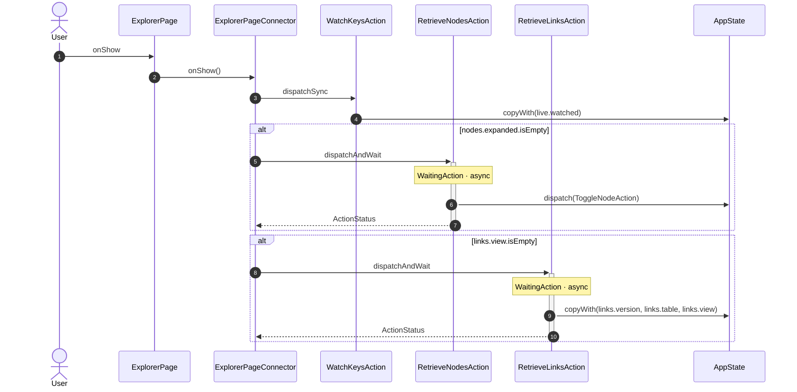
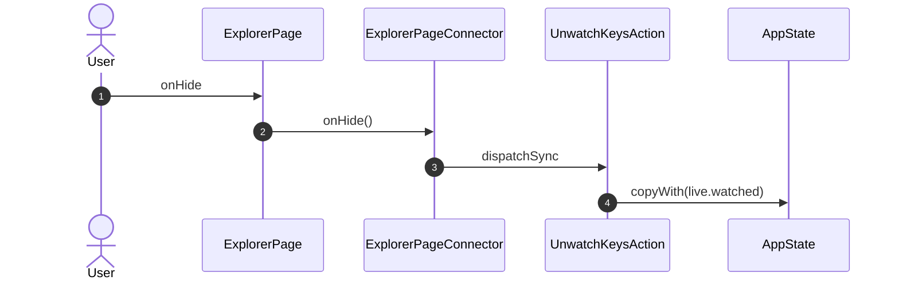
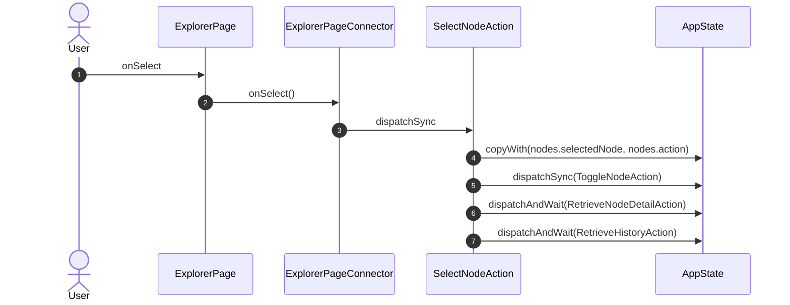
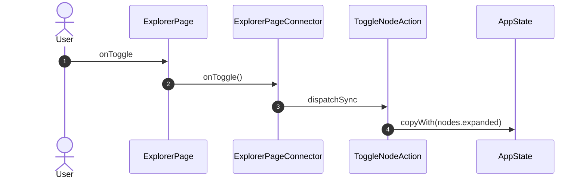
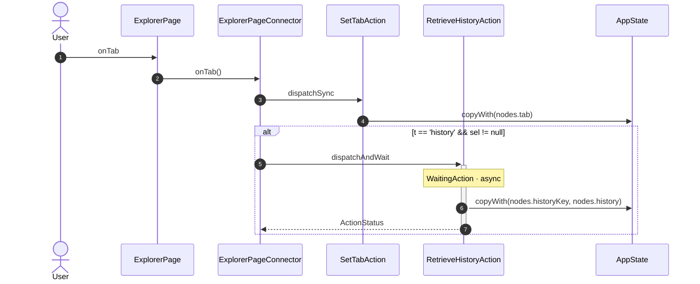
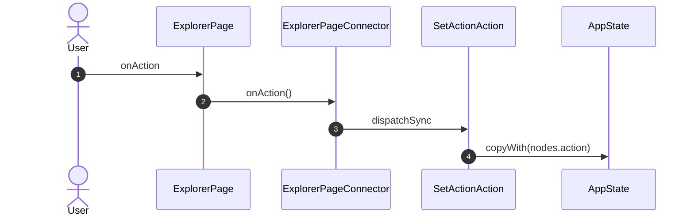
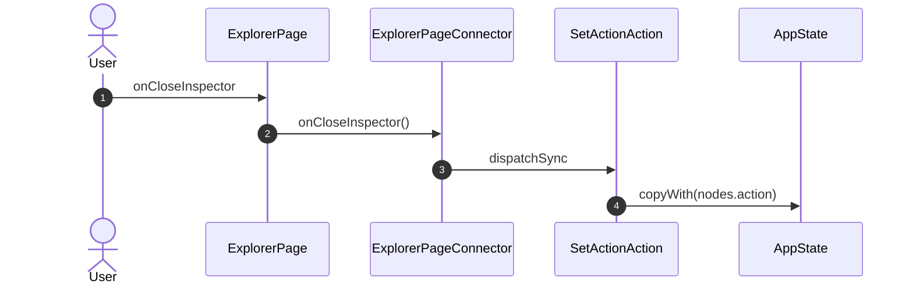
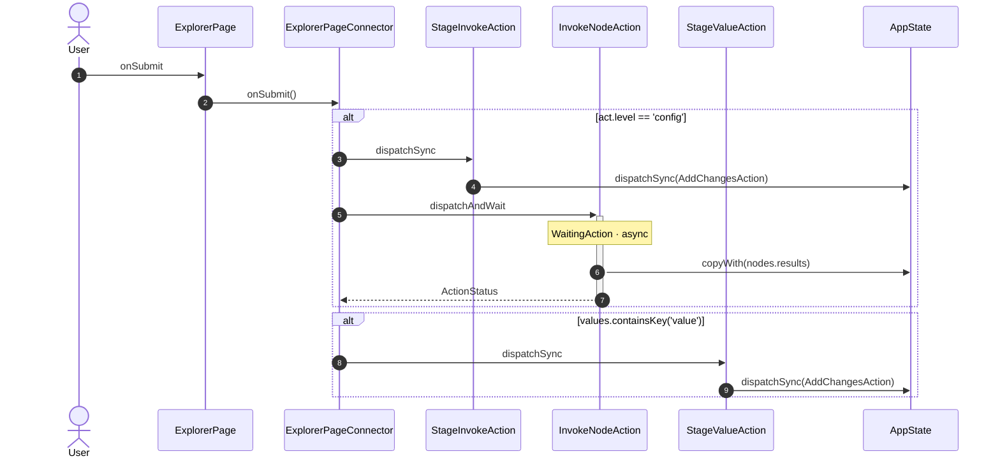
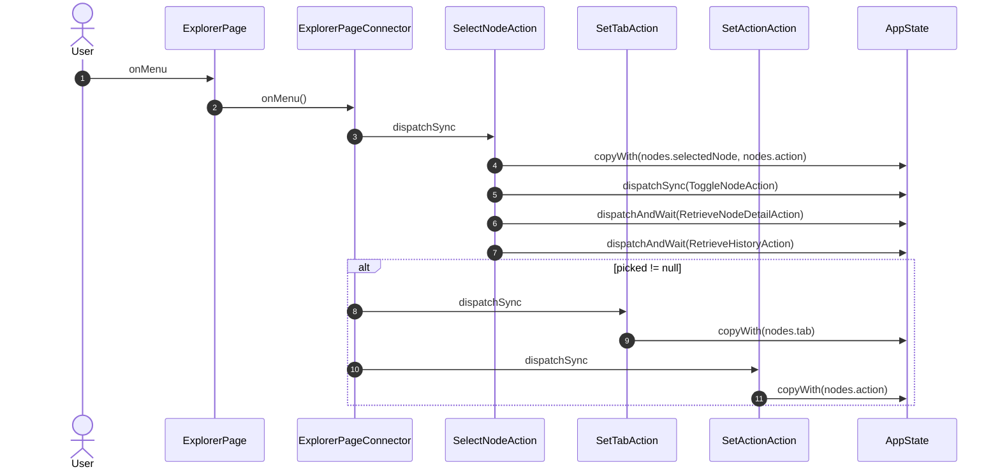

<!-- generated by `frx flow --md` — do not edit, re-run it -->

# ExplorerPage

`app/lib/connectors/explorer_page_connector.dart`

## onShow

## onHide

## onSelect

## onToggle

## onTab

## onAction

## onRange

## onCloseInspector

## onSubmit

## onMenu

_Not drawn — these files dispatch outside any interaction:_

- `ExplorerPageConnector` — 2 dispatches

| Interaction | Dispatches | Writes |
| --- | --- | --- |
| `onShow` | `WatchKeysAction`, `RetrieveNodesAction` ?, `RetrieveLinksAction` ? | `live.watched`, `links.version, links.table, links.view` |
| `onHide` | `UnwatchKeysAction` | `live.watched` |
| `onSelect` | `SelectNodeAction` | `nodes.selectedNode, nodes.action` |
| `onToggle` | `ToggleNodeAction` | `nodes.expanded` |
| `onTab` | `SetTabAction`, `RetrieveHistoryAction` ? | `nodes.tab`, `nodes.historyKey, nodes.history` |
| `onAction` | `SetActionAction` | `nodes.action` |
| `onRange` | `SetHistoryRangeAction`, `RetrieveHistoryAction` ? | `nodes.historyRange`, `nodes.historyKey, nodes.history` |
| `onCloseInspector` | `SetActionAction` | `nodes.action` |
| `onSubmit` | `StageInvokeAction` ?, `InvokeNodeAction` ?, `StageValueAction` ? | `nodes.results` |
| `onMenu` | `SelectNodeAction`, `SetTabAction` ?, `SetActionAction` ? | `nodes.selectedNode, nodes.action`, `nodes.tab`, `nodes.action` |

`?` marks a dispatch that only runs under a condition.

[← all flows](README.md)
