<!-- generated by `frx flow --md` — do not edit, re-run it -->

# ExplorerPage

`app/lib/connectors/explorer_page_connector.dart`

## submit

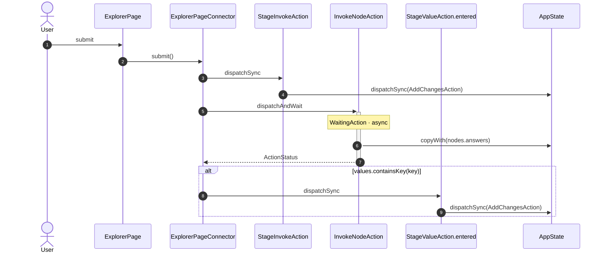

## onShow

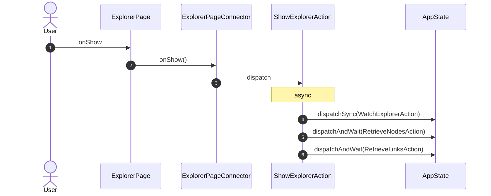

## onHide

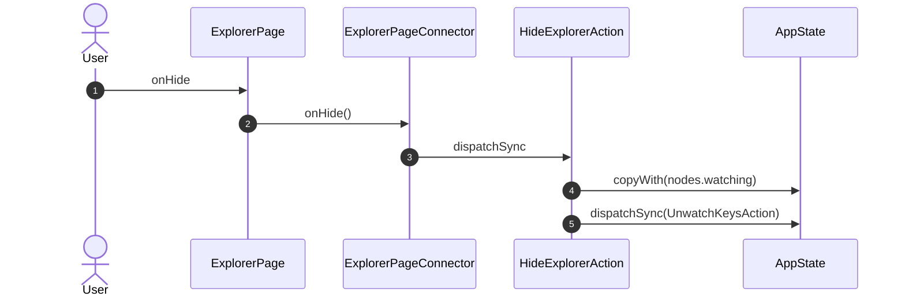

## onSelect

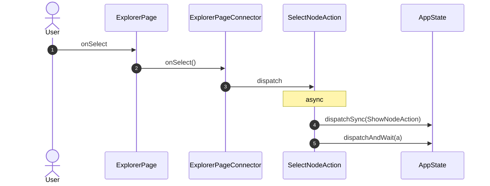

## onToggle

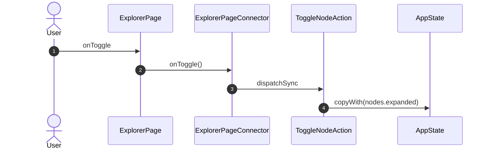

## onMark

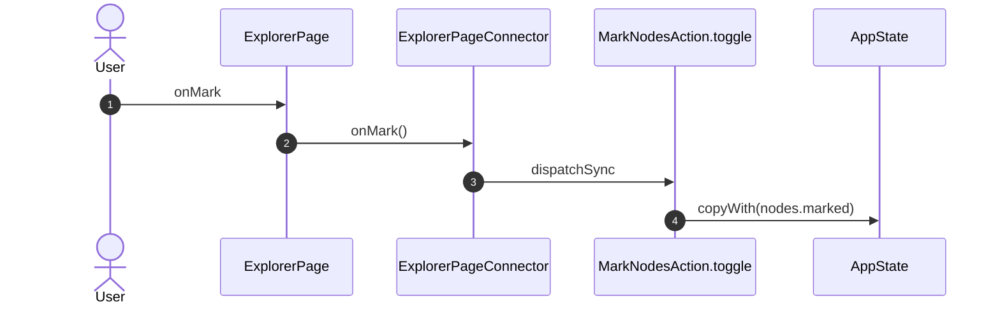

## onMarkRange

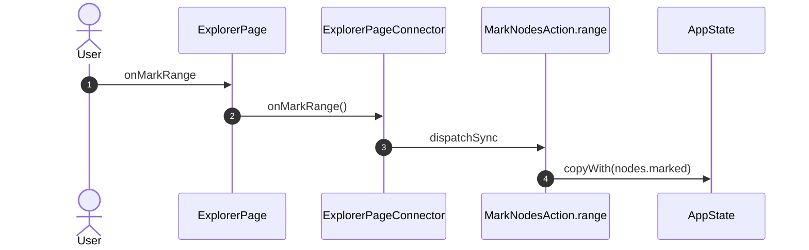

## onTreeFilter

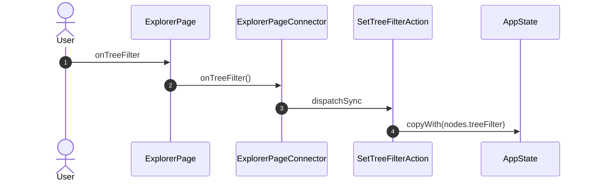

## onPointFilter

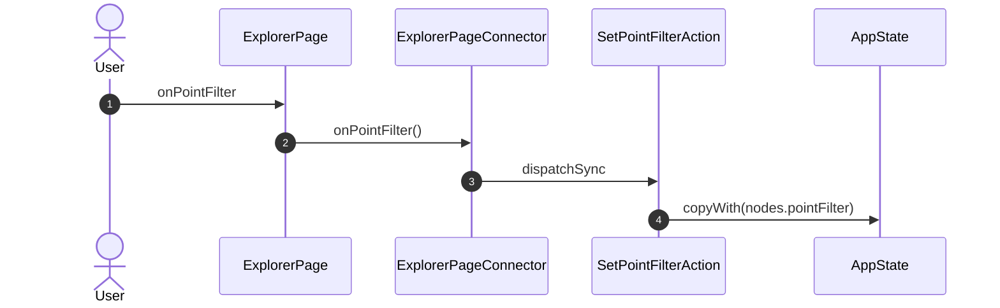

## onNoteLink

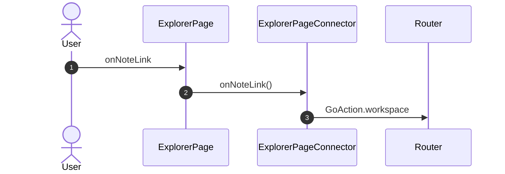

## onOpenMenu

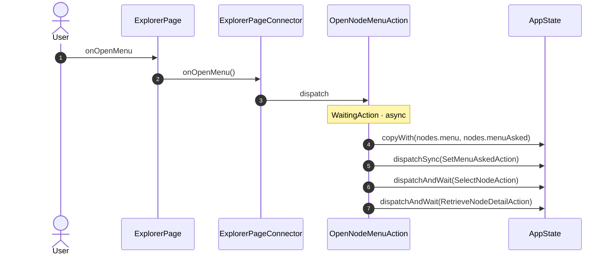

## onMenuShown

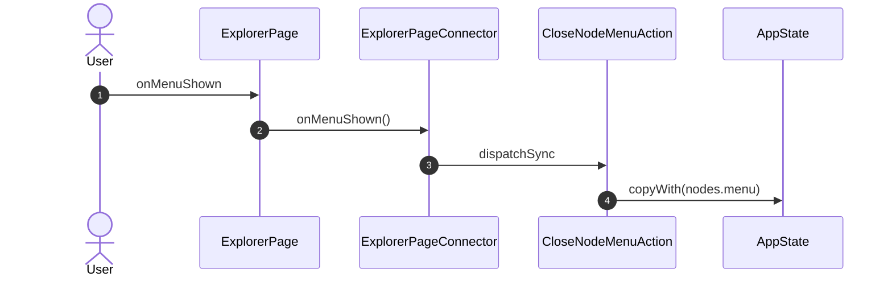

## onMenuPick

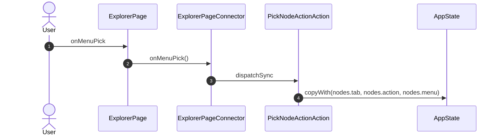

## onPoint

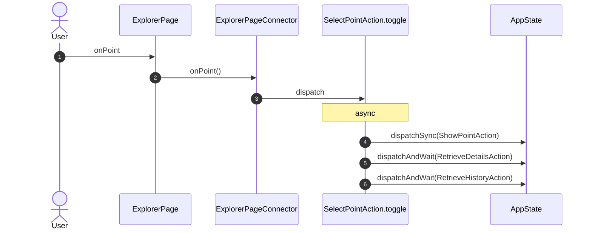

## onCheck

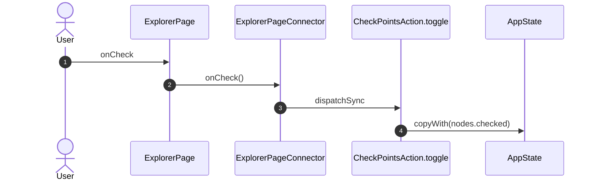

## onRange

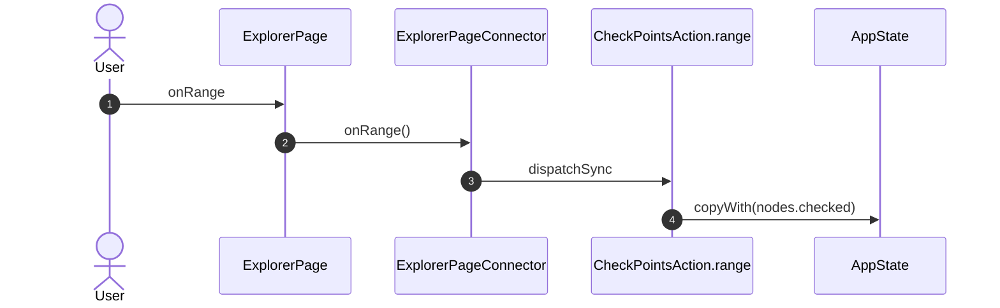

## onCheckAll

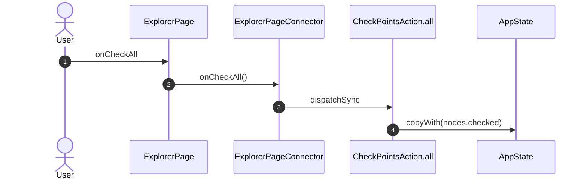

## onClear

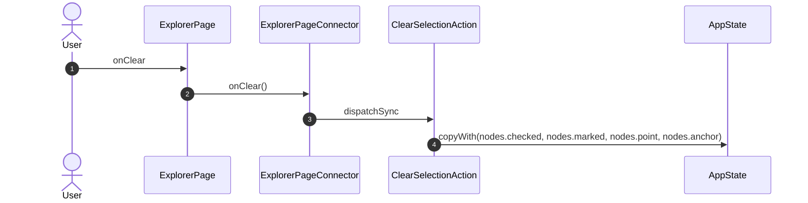

## onCopy

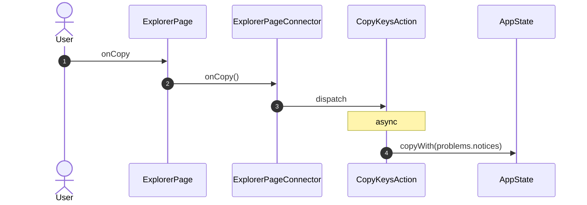

## onCopyValue

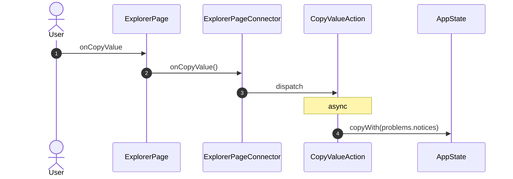

## onToggleAssistant

```mermaid
sequenceDiagram
    autonumber
    actor User
    participant UI as ExplorerPage
    participant VM as ExplorerPageConnector
    participant A1 as SetDrawerAction.toggle
    participant ST as AppState

    User->>UI: onToggleAssistant
    UI->>VM: onToggleAssistant()
    VM->>A1: dispatchSync
    A1->>ST: copyWith(assistant.drawer)
    A1->>ST: dispatchSync(SetChipAction)
```

## onTab

```mermaid
sequenceDiagram
    autonumber
    actor User
    participant UI as ExplorerPage
    participant VM as ExplorerPageConnector
    participant A1 as OpenExplorerTabAction
    participant ST as AppState

    User->>UI: onTab
    UI->>VM: onTab()
    VM->>A1: dispatch
    Note over A1: async
    A1->>ST: dispatchSync(SetTabAction)
    A1->>ST: dispatchAndWait(RetrieveHistoryAction)
    A1->>ST: dispatchAndWait(RetrieveAuditAction)
```

## onAction

```mermaid
sequenceDiagram
    autonumber
    actor User
    participant UI as ExplorerPage
    participant VM as ExplorerPageConnector
    participant A1 as SetActionAction
    participant ST as AppState

    User->>UI: onAction
    UI->>VM: onAction()
    VM->>A1: dispatchSync
    A1->>ST: copyWith(nodes.action)
```

## onHistoryRange

```mermaid
sequenceDiagram
    autonumber
    actor User
    participant UI as ExplorerPage
    participant VM as ExplorerPageConnector
    participant A1 as PickHistoryRangeAction
    participant ST as AppState

    User->>UI: onHistoryRange
    UI->>VM: onHistoryRange()
    VM->>A1: dispatch
    Note over A1: async
    A1->>ST: dispatchSync(SetHistoryRangeAction)
    A1->>ST: dispatchAndWait(RetrieveHistoryAction)
```

## onTrendWindow

```mermaid
sequenceDiagram
    autonumber
    actor User
    participant UI as ExplorerPage
    participant VM as ExplorerPageConnector
    participant A1 as ZoomHistoryAction
    participant ST as AppState

    User->>UI: onTrendWindow
    UI->>VM: onTrendWindow()
    VM->>A1: dispatchSync
    A1->>ST: dispatchSync(SetHistoryWindowAction)
```

## onTrendReset

```mermaid
sequenceDiagram
    autonumber
    actor User
    participant UI as ExplorerPage
    participant VM as ExplorerPageConnector
    participant A1 as SetHistoryWindowAction
    participant ST as AppState

    User->>UI: onTrendReset
    UI->>VM: onTrendReset()
    VM->>A1: dispatchSync
    A1->>ST: copyWith(nodes.historyWindow)
```

## onCloseInspector

```mermaid
sequenceDiagram
    autonumber
    actor User
    participant UI as ExplorerPage
    participant VM as ExplorerPageConnector
    participant A1 as SetActionAction
    participant ST as AppState

    User->>UI: onCloseInspector
    UI->>VM: onCloseInspector()
    VM->>A1: dispatchSync
    A1->>ST: copyWith(nodes.action)
```

## onReadAgain

```mermaid
sequenceDiagram
    autonumber
    actor User
    participant UI as ExplorerPage
    participant VM as ExplorerPageConnector
    participant A1 as RetryReadAction
    participant ST as AppState

    User->>UI: onReadAgain
    UI->>VM: onReadAgain()
    VM->>A1: dispatch
    Note over A1: async
    A1->>ST: dispatchAndWait(RetrieveNodeDetailAction)
```

## onTool

```mermaid
sequenceDiagram
    autonumber
    actor User
    participant UI as ExplorerPage
    participant VM as ExplorerPageConnector
    participant A1 as InvokeNodeAction
    participant A2 as SetActionAction
    participant A3 as RemoveCheckedAction
    participant ST as AppState

    User->>UI: onTool
    UI->>VM: onTool()
    VM->>A1: dispatch
    Note over A1: WaitingAction · async
    A1->>ST: copyWith(nodes.answers)
    VM->>A2: dispatchSync
    A2->>ST: copyWith(nodes.action)
    VM->>A2: dispatchSync
    A2->>ST: copyWith(nodes.action)
    VM->>A3: dispatchSync
    A3->>ST: copyWith(nodes.checked, nodes.marked, nodes.point, nodes.anchor)
    A3->>ST: dispatchSync(StageInvokeAction)
```

## onSetPoll

```mermaid
sequenceDiagram
    autonumber
    actor User
    participant UI as ExplorerPage
    participant VM as ExplorerPageConnector
    participant A1 as StagePollAction

    User->>UI: onSetPoll
    UI->>VM: onSetPoll()
    VM->>A1: dispatchSync
```

## onParam

```mermaid
sequenceDiagram
    autonumber
    actor User
    participant UI as ExplorerPage
    participant VM as ExplorerPageConnector
    participant A1 as StagePointEditAction
    participant ST as AppState

    User->>UI: onParam
    UI->>VM: onParam()
    VM->>A1: dispatchSync
    A1->>ST: copyWith(changes)
```

## onPanelWidth

```mermaid
sequenceDiagram
    autonumber
    actor User
    participant UI as ExplorerPage
    participant VM as ExplorerPageConnector
    participant A1 as SetPanelWidthAction
    participant ST as AppState

    User->>UI: onPanelWidth
    UI->>VM: onPanelWidth()
    VM->>A1: dispatchSync
    A1->>ST: copyWith(panels.widths)
```

## onTapFlowEditor

```mermaid
sequenceDiagram
    autonumber
    actor User
    participant UI as ExplorerPage
    participant VM as ExplorerPageConnector
    participant NAV as Router

    User->>UI: onTapFlowEditor
    UI->>VM: onTapFlowEditor()
    VM->>NAV: GoAction.push FlowEditorRoute(id: id)
```

## onViewPoint

```mermaid
sequenceDiagram
    autonumber
    actor User
    participant UI as ExplorerPage
    participant VM as ExplorerPageConnector
    participant A1 as SetViewedPointAction
    participant ST as AppState

    User->>UI: onViewPoint
    UI->>VM: onViewPoint()
    VM->>A1: dispatchSync
    A1->>ST: copyWith(nodes.viewedPoint)
```

## onCloseViewer

```mermaid
sequenceDiagram
    autonumber
    actor User
    participant UI as ExplorerPage
    participant VM as ExplorerPageConnector
    participant A1 as SetViewedPointAction
    participant ST as AppState

    User->>UI: onCloseViewer
    UI->>VM: onCloseViewer()
    VM->>A1: dispatchSync
    A1->>ST: copyWith(nodes.viewedPoint)
```

## AssistantDrawer ▸ ticks.onToggle

```mermaid
sequenceDiagram
    autonumber
    actor User
    participant UI as ExplorerPage
    participant R1 as AssistantDrawerConnector
    participant A1 as SetStepTickAction
    participant ST as AppState

    User->>UI: AssistantDrawer ▸ ticks.onToggle
    UI->>R1: ticks()
    R1->>A1: dispatchSync
    A1->>ST: copyWith(assistant.unticked, assistant.refusals)
```

## AssistantDrawer ▸ onPick

```mermaid
sequenceDiagram
    autonumber
    actor User
    participant UI as ExplorerPage
    participant R1 as AssistantDrawerConnector
    participant A1 as SetOptionPickAction.of
    participant ST as AppState

    User->>UI: AssistantDrawer ▸ onPick
    UI->>R1: onPick()
    R1->>A1: dispatchSync
    A1->>ST: copyWith(assistant.picks)
```

## AssistantDrawer ▸ onAnswer

```mermaid
sequenceDiagram
    autonumber
    actor User
    participant UI as ExplorerPage
    participant R1 as AssistantDrawerConnector
    participant A1 as AnswerTaskAction
    participant ST as AppState

    User->>UI: AssistantDrawer ▸ onAnswer
    UI->>R1: onAnswer()
    R1->>A1: dispatch
    Note over A1: TaskRows · NonReentrant · WaitingAction · async
    A1->>ST: copyWith(assistant.picks, assistant.draft)
    A1->>ST: dispatchAndWait(RetrieveTaskRecordAction)
    A1->>ST: dispatchAndWait(RetrieveTaskRecordAction)
    A1->>ST: dispatchSync(AddTaskEventAction)
    A1->>ST: dispatchSync(AddTaskEventAction)
```

## AssistantDrawer ▸ onPickSuggestion

```mermaid
sequenceDiagram
    autonumber
    actor User
    participant UI as ExplorerPage
    participant R1 as AssistantDrawerConnector
    participant A1 as PickSuggestionAction
    participant ST as AppState

    User->>UI: AssistantDrawer ▸ onPickSuggestion
    UI->>R1: onPickSuggestion()
    R1->>A1: dispatch
    Note over A1: async
    A1->>ST: copyWith(assistant.rowPicks)
    A1->>ST: dispatchAndWait(AskAgentAction)
```

## AssistantDrawer ▸ rows.onToggle

```mermaid
sequenceDiagram
    autonumber
    actor User
    participant UI as ExplorerPage
    participant R1 as AssistantDrawerConnector
    participant A1 as SetRowPickAction
    participant ST as AppState

    User->>UI: AssistantDrawer ▸ rows.onToggle
    UI->>R1: rows()
    R1->>A1: dispatchSync
    A1->>ST: copyWith(assistant.rowPicks)
```

## AssistantDrawer ▸ onReveal

```mermaid
sequenceDiagram
    autonumber
    actor User
    participant UI as ExplorerPage
    participant R1 as AssistantDrawerConnector
    participant A1 as SetStepRevealAction.toggle
    participant ST as AppState

    User->>UI: AssistantDrawer ▸ onReveal
    UI->>R1: onReveal()
    R1->>A1: dispatchSync
    A1->>ST: copyWith(assistant.revealed, assistant.refusals)
```

## AssistantDrawer ▸ buttons

```mermaid
sequenceDiagram
    autonumber
    actor User
    participant UI as ExplorerPage
    participant R1 as AssistantDrawerConnector
    participant A1 as ApproveTaskAction
    participant A2 as OpenTaskAction
    participant A3 as GoAfterAction
    participant A4 as AskAgentAction
    participant ST as AppState

    User->>UI: AssistantDrawer ▸ buttons
    UI->>R1: buttons()
    R1->>A1: dispatch
    Note over A1: NonReentrant · WaitingAction · async
    A1->>ST: copyWith(assistant.refusals)
    A1->>ST: dispatchSync(_Refused)
    A1->>ST: dispatchAndWait(RetrieveTaskRecordAction)
    A1->>ST: dispatchAndWait(RetrieveTaskRecordAction)
    R1->>A2: dispatch
    Note over A2: async
    A2->>ST: dispatchSync(SetSelectedTaskAction)
    A2->>ST: dispatchAndWait(RetrieveTaskRecordAction)
    R1->>A3: dispatch
    Note over A3: async
    A3->>ST: dispatchAndWait(a)
    A3->>ST: dispatchSync(GoAction.navigate)
    R1->>A3: dispatch
    Note over A3: async
    A3->>ST: dispatchAndWait(a)
    A3->>ST: dispatchSync(GoAction.navigate)
    R1->>A4: dispatch
    Note over A4: TaskRows · NonReentrant · WaitingAction · async
    A4->>ST: dispatchSync(AddTasksAction)
    A4->>ST: dispatchSync(AddTaskEventAction)
    A4->>ST: dispatchSync(_Taken)
    A4->>ST: dispatchSync(AddTaskEventAction)
    A4->>ST: dispatchAndWait(RetrieveTaskRecordAction)
```

## AssistantDrawer ▸ onTimelineWindow

```mermaid
sequenceDiagram
    autonumber
    actor User
    participant UI as ExplorerPage
    participant R1 as AssistantDrawerConnector
    participant A1 as SetHistoryWindowAction
    participant ST as AppState

    User->>UI: AssistantDrawer ▸ onTimelineWindow
    UI->>R1: onTimelineWindow()
    R1->>A1: dispatchSync
    A1->>ST: copyWith(nodes.historyWindow)
```

## AssistantDrawer ▸ onTimelineReset

```mermaid
sequenceDiagram
    autonumber
    actor User
    participant UI as ExplorerPage
    participant R1 as AssistantDrawerConnector
    participant A1 as SetHistoryWindowAction
    participant ST as AppState

    User->>UI: AssistantDrawer ▸ onTimelineReset
    UI->>R1: onTimelineReset()
    R1->>A1: dispatchSync
    A1->>ST: copyWith(nodes.historyWindow)
```

## AssistantDrawer ▸ onDraft

```mermaid
sequenceDiagram
    autonumber
    actor User
    participant UI as ExplorerPage
    participant R1 as AssistantDrawerConnector
    participant A1 as SetDraftAction
    participant ST as AppState

    User->>UI: AssistantDrawer ▸ onDraft
    UI->>R1: onDraft()
    R1->>A1: dispatchSync
    A1->>ST: copyWith(assistant.draft)
```

## AssistantDrawer ▸ onAsk

```mermaid
sequenceDiagram
    autonumber
    actor User
    participant UI as ExplorerPage
    participant R1 as AssistantDrawerConnector
    participant A1 as SendAskAction
    participant ST as AppState

    User->>UI: AssistantDrawer ▸ onAsk
    UI->>R1: onAsk()
    R1->>A1: dispatch
    Note over A1: async
    A1->>ST: dispatchAndWait(AnswerTaskAction)
    A1->>ST: dispatchAndWait(AskAgentAction)
```

## AssistantDrawer ▸ onChipRemove

```mermaid
sequenceDiagram
    autonumber
    actor User
    participant UI as ExplorerPage
    participant R1 as AssistantDrawerConnector
    participant A1 as SetChipAction
    participant ST as AppState

    User->>UI: AssistantDrawer ▸ onChipRemove
    UI->>R1: onChipRemove()
    R1->>A1: dispatchSync
    A1->>ST: copyWith(assistant.chips)
```

## AssistantDrawer ▸ onPanel

```mermaid
sequenceDiagram
    autonumber
    actor User
    participant UI as ExplorerPage
    participant R1 as AssistantDrawerConnector
    participant A1 as SetPanelAction
    participant ST as AppState

    User->>UI: AssistantDrawer ▸ onPanel
    UI->>R1: onPanel()
    R1->>A1: dispatch
    Note over A1: async
    A1->>ST: dispatchSync(_Panel)
    A1->>ST: dispatchAndWait(RetrieveAgentSecretsAction)
```

## AssistantDrawer ▸ onMode

```mermaid
sequenceDiagram
    autonumber
    actor User
    participant UI as ExplorerPage
    participant R1 as AssistantDrawerConnector
    participant A1 as StageAgentParamAction.mode
    participant ST as AppState

    User->>UI: AssistantDrawer ▸ onMode
    UI->>R1: onMode()
    R1->>A1: dispatch
    Note over A1: WaitingAction · async
    A1->>ST: copyWith(changes.table, changes.view)
    A1->>ST: dispatchAndWait(RetrieveLinkHistoryAction)
```

## AssistantDrawer ▸ onRemovePrefix

```mermaid
sequenceDiagram
    autonumber
    actor User
    participant UI as ExplorerPage
    participant R1 as AssistantDrawerConnector
    participant A1 as StageAgentParamAction.removePrefix
    participant ST as AppState

    User->>UI: AssistantDrawer ▸ onRemovePrefix
    UI->>R1: onRemovePrefix()
    R1->>A1: dispatch
    Note over A1: WaitingAction · async
    A1->>ST: copyWith(changes.table, changes.view)
    A1->>ST: dispatchAndWait(RetrieveLinkHistoryAction)
```

## AssistantDrawer ▸ onAddAgent

```mermaid
sequenceDiagram
    autonumber
    actor User
    participant UI as ExplorerPage
    participant R1 as AssistantDrawerConnector
    participant NAV as Router

    User->>UI: AssistantDrawer ▸ onAddAgent
    UI->>R1: onAddAgent()
    R1->>NAV: GoAction.push LinkInstallRoute
```

## AssistantDrawer ▸ onShow

```mermaid
sequenceDiagram
    autonumber
    actor User
    participant UI as ExplorerPage
    participant R1 as AssistantDrawerConnector
    participant A1 as drawer ? ShowDrawerAction(shown: true) : ShowAssistantAction(shown: true)

    User->>UI: AssistantDrawer ▸ onShow
    UI->>R1: onShow()
    R1->>A1: dispatch
```

## AssistantDrawer ▸ onHide

```mermaid
sequenceDiagram
    autonumber
    actor User
    participant UI as ExplorerPage
    participant R1 as AssistantDrawerConnector
    participant A1 as drawer ? ShowDrawerAction(shown: false) : ShowAssistantAction(shown: false)

    User->>UI: AssistantDrawer ▸ onHide
    UI->>R1: onHide()
    R1->>A1: dispatch
```

## AssistantDrawer ▸ onNew

```mermaid
sequenceDiagram
    autonumber
    actor User
    participant UI as ExplorerPage
    participant R1 as AssistantDrawerConnector
    participant A1 as NewTaskAction
    participant ST as AppState

    User->>UI: AssistantDrawer ▸ onNew
    UI->>R1: onNew()
    R1->>A1: dispatchSync
    A1->>ST: copyWith(tasks.selectedTask)
```

## AssistantDrawer ▸ onNewTask

```mermaid
sequenceDiagram
    autonumber
    actor User
    participant UI as ExplorerPage
    participant R1 as AssistantDrawerConnector
    participant A1 as SetSelectedTaskAction
    participant ST as AppState

    User->>UI: AssistantDrawer ▸ onNewTask
    UI->>R1: onNewTask()
    R1->>A1: dispatchSync
    A1->>ST: copyWith(tasks.selectedTask)
```

## AssistantDrawer ▸ onTask

```mermaid
sequenceDiagram
    autonumber
    actor User
    participant UI as ExplorerPage
    participant R1 as AssistantDrawerConnector
    participant A1 as OpenTaskAction
    participant ST as AppState

    User->>UI: AssistantDrawer ▸ onTask
    UI->>R1: onTask()
    R1->>A1: dispatch
    Note over A1: async
    A1->>ST: dispatchSync(SetSelectedTaskAction)
    A1->>ST: dispatchAndWait(RetrieveTaskRecordAction)
```

## AssistantDrawer ▸ onOpenFull

```mermaid
sequenceDiagram
    autonumber
    actor User
    participant UI as ExplorerPage
    participant R1 as AssistantDrawerConnector
    participant A1 as GoAfterAction
    participant ST as AppState

    User->>UI: AssistantDrawer ▸ onOpenFull
    UI->>R1: onOpenFull()
    R1->>A1: dispatch
    Note over A1: async
    A1->>ST: dispatchAndWait(a)
    A1->>ST: dispatchSync(GoAction.navigate)
```

## AssistantDrawer ▸ onCloseDrawer

```mermaid
sequenceDiagram
    autonumber
    actor User
    participant UI as ExplorerPage
    participant R1 as AssistantDrawerConnector
    participant A1 as SetDrawerAction
    participant ST as AppState

    User->>UI: AssistantDrawer ▸ onCloseDrawer
    UI->>R1: onCloseDrawer()
    R1->>A1: dispatchSync
    A1->>ST: copyWith(assistant.drawer)
    A1->>ST: dispatchSync(SetChipAction)
```

_Not drawn — these files dispatch outside any interaction:_

- `ExplorerPageConnector` — 1 dispatch
- `AssistantDrawerConnector` — 3 dispatches

| Interaction | Dispatches | Writes |
| --- | --- | --- |
| `submit` | `StageInvokeAction`, `InvokeNodeAction`, `StageValueAction.entered` ? | `nodes.answers` |
| `onShow` | `ShowExplorerAction` | — |
| `onHide` | `HideExplorerAction` | `nodes.watching` |
| `onSelect` | `SelectNodeAction` | — |
| `onToggle` | `ToggleNodeAction` | `nodes.expanded` |
| `onMark` | `MarkNodesAction.toggle` | `nodes.marked` |
| `onMarkRange` | `MarkNodesAction.range` | `nodes.marked` |
| `onTreeFilter` | `SetTreeFilterAction` | `nodes.treeFilter` |
| `onPointFilter` | `SetPointFilterAction` | `nodes.pointFilter` |
| `onNoteLink` | `GoAction.workspace` | — |
| `onOpenMenu` | `OpenNodeMenuAction` | `nodes.menu, nodes.menuAsked` |
| `onMenuShown` | `CloseNodeMenuAction` | `nodes.menu` |
| `onMenuPick` | `PickNodeActionAction` | `nodes.tab, nodes.action, nodes.menu` |
| `onPoint` | `SelectPointAction.toggle` | — |
| `onCheck` | `CheckPointsAction.toggle` | `nodes.checked` |
| `onRange` | `CheckPointsAction.range` | `nodes.checked` |
| `onCheckAll` | `CheckPointsAction.all` | `nodes.checked` |
| `onClear` | `ClearSelectionAction` | `nodes.checked, nodes.marked, nodes.point, nodes.anchor` |
| `onCopy` | `CopyKeysAction` | `problems.notices` |
| `onCopyValue` | `CopyValueAction` | `problems.notices` |
| `onToggleAssistant` | `SetDrawerAction.toggle` | `assistant.drawer` |
| `onTab` | `OpenExplorerTabAction` | — |
| `onAction` | `SetActionAction` | `nodes.action` |
| `onHistoryRange` | `PickHistoryRangeAction` | — |
| `onTrendWindow` | `ZoomHistoryAction` | — |
| `onTrendReset` | `SetHistoryWindowAction` | `nodes.historyWindow` |
| `onCloseInspector` | `SetActionAction` | `nodes.action` |
| `onReadAgain` | `RetryReadAction` | — |
| `onTool` | `InvokeNodeAction`, `SetActionAction`, `SetActionAction`, `RemoveCheckedAction` | `nodes.answers`, `nodes.action`, `nodes.checked, nodes.marked, nodes.point, nodes.anchor` |
| `onSetPoll` | `StagePollAction` | — |
| `onParam` | `StagePointEditAction` | `changes` |
| `onPanelWidth` | `SetPanelWidthAction` | `panels.widths` |
| `onTapFlowEditor` | `GoAction.push` | — |
| `onViewPoint` | `SetViewedPointAction` | `nodes.viewedPoint` |
| `onCloseViewer` | `SetViewedPointAction` | `nodes.viewedPoint` |
| `AssistantDrawer ▸ ticks.onToggle` | `SetStepTickAction` | `assistant.unticked, assistant.refusals` |
| `AssistantDrawer ▸ onPick` | `SetOptionPickAction.of` | `assistant.picks` |
| `AssistantDrawer ▸ onAnswer` | `AnswerTaskAction` | `assistant.picks, assistant.draft` |
| `AssistantDrawer ▸ onPickSuggestion` | `PickSuggestionAction` | `assistant.rowPicks` |
| `AssistantDrawer ▸ rows.onToggle` | `SetRowPickAction` | `assistant.rowPicks` |
| `AssistantDrawer ▸ onReveal` | `SetStepRevealAction.toggle` | `assistant.revealed, assistant.refusals` |
| `AssistantDrawer ▸ buttons` | `ApproveTaskAction`, `OpenTaskAction`, `GoAfterAction`, `GoAfterAction`, `AskAgentAction` | `assistant.refusals` |
| `AssistantDrawer ▸ onTimelineWindow` | `SetHistoryWindowAction` | `nodes.historyWindow` |
| `AssistantDrawer ▸ onTimelineReset` | `SetHistoryWindowAction` | `nodes.historyWindow` |
| `AssistantDrawer ▸ onDraft` | `SetDraftAction` | `assistant.draft` |
| `AssistantDrawer ▸ onAsk` | `SendAskAction` | — |
| `AssistantDrawer ▸ onChipRemove` | `SetChipAction` | `assistant.chips` |
| `AssistantDrawer ▸ onPanel` | `SetPanelAction` | — |
| `AssistantDrawer ▸ onMode` | `StageAgentParamAction.mode` | `changes.table, changes.view` |
| `AssistantDrawer ▸ onRemovePrefix` | `StageAgentParamAction.removePrefix` | `changes.table, changes.view` |
| `AssistantDrawer ▸ onAddAgent` | `GoAction.push` | — |
| `AssistantDrawer ▸ onShow` | `drawer ? ShowDrawerAction(shown: true) : ShowAssistantAction(shown: true)` | — |
| `AssistantDrawer ▸ onHide` | `drawer ? ShowDrawerAction(shown: false) : ShowAssistantAction(shown: false)` | — |
| `AssistantDrawer ▸ onNew` | `NewTaskAction` | `tasks.selectedTask` |
| `AssistantDrawer ▸ onNewTask` | `SetSelectedTaskAction` | `tasks.selectedTask` |
| `AssistantDrawer ▸ onTask` | `OpenTaskAction` | — |
| `AssistantDrawer ▸ onOpenFull` | `GoAfterAction` | — |
| `AssistantDrawer ▸ onCloseDrawer` | `SetDrawerAction` | `assistant.drawer` |

`?` marks a dispatch that only runs under a condition.

[← all flows](README.md)
