<!-- generated by `frx flow --md` — do not edit, re-run it -->

# ExplorerPage

`app/lib/connectors/explorer_page_connector.dart`

## params.onChanged

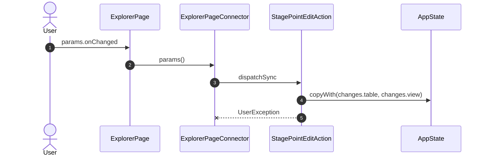

## inspector

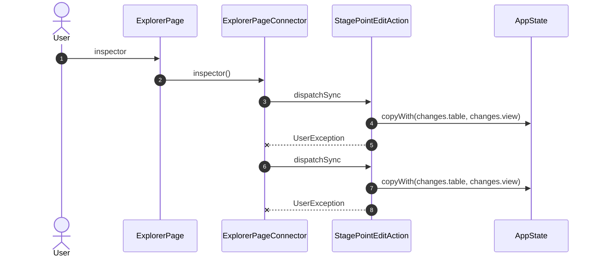

## onShow

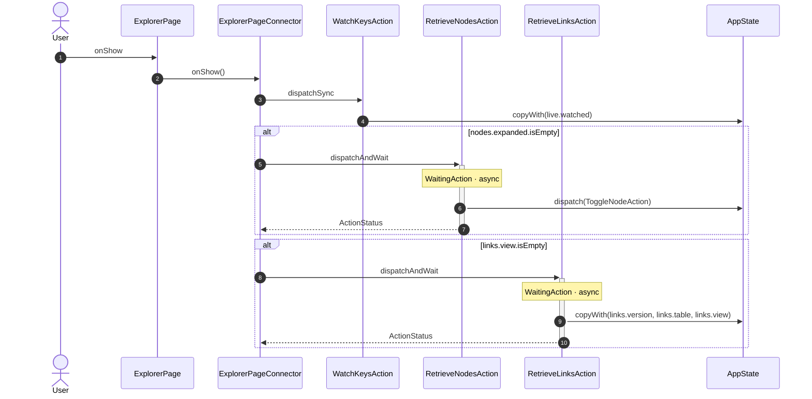

## onHide

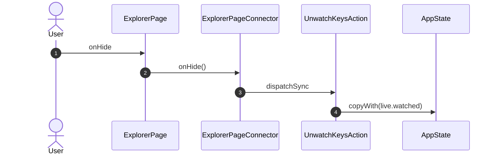

## onSelect

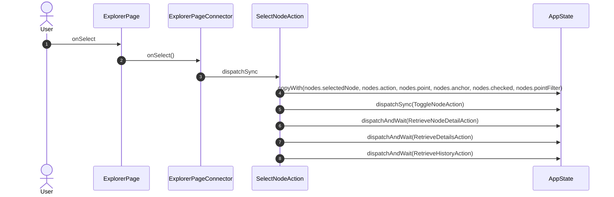

## onToggle

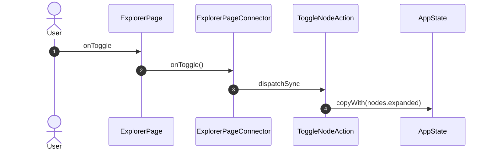

## onMark

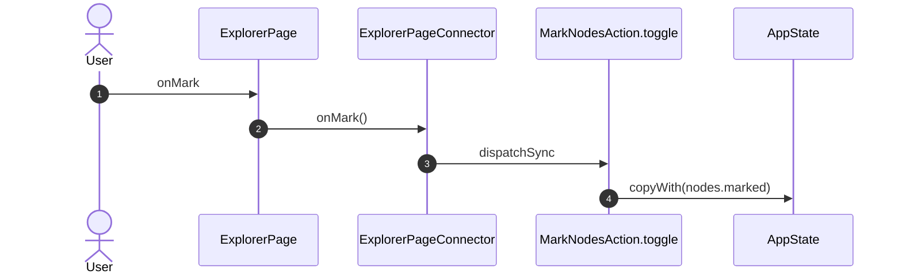

## onMarkRange

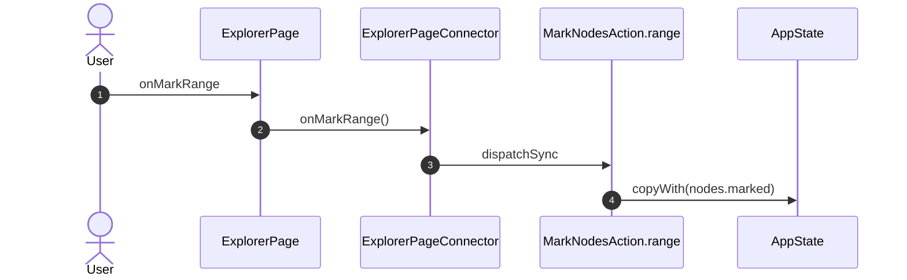

## onTreeFilter

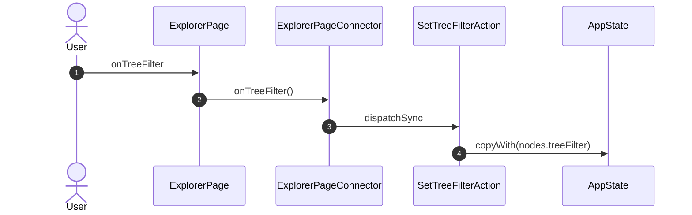

## onPointFilter

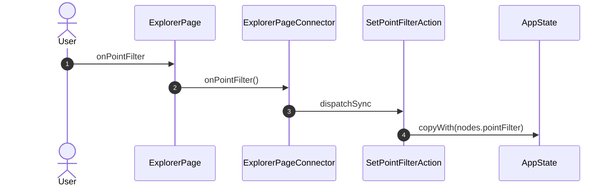

## onPoint

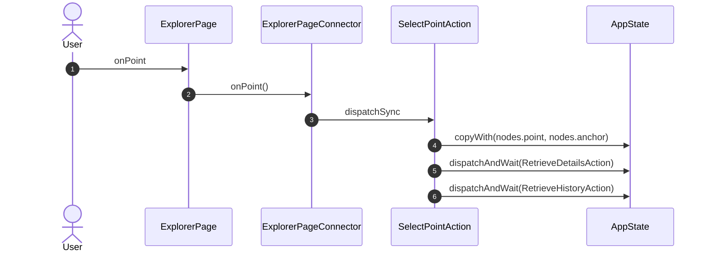

## onCheck

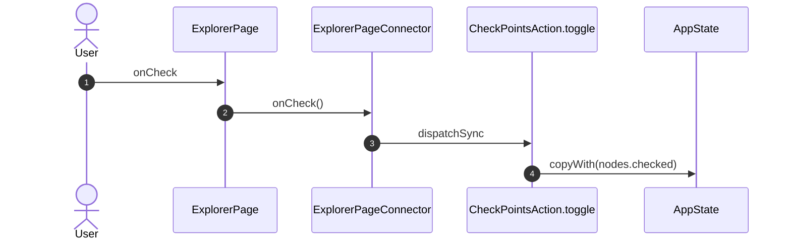

## onRange

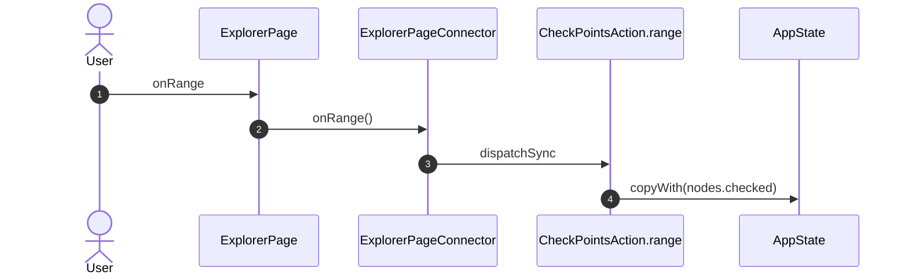

## onCheckAll

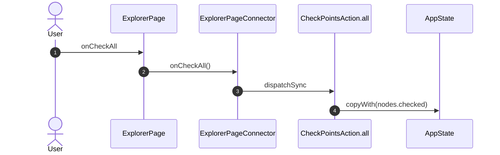

## onClear

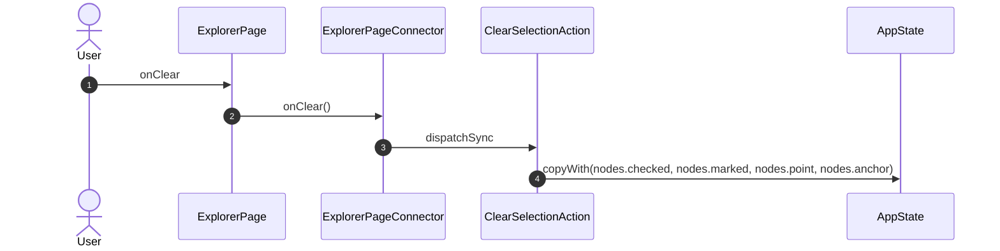

## onTab


## onAudit

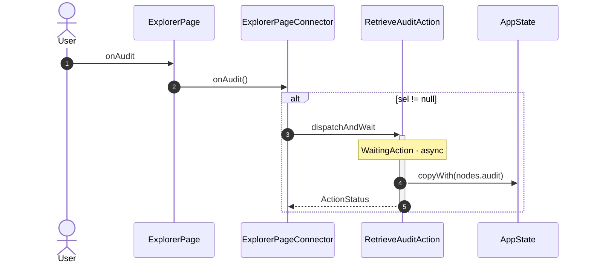

## onAction

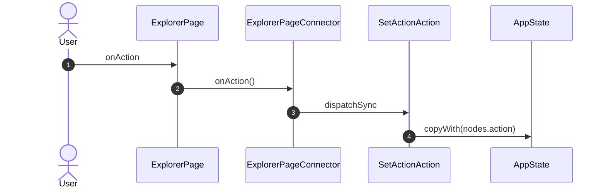

## onPickAction

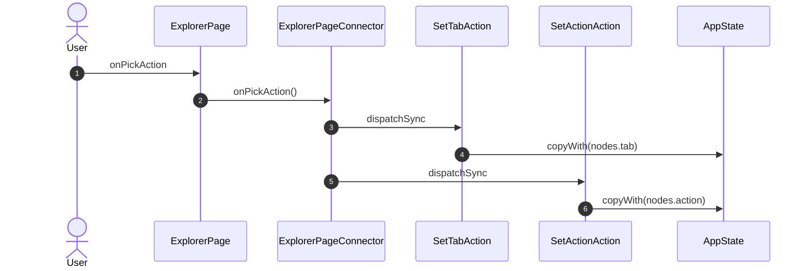

## onHistoryRange

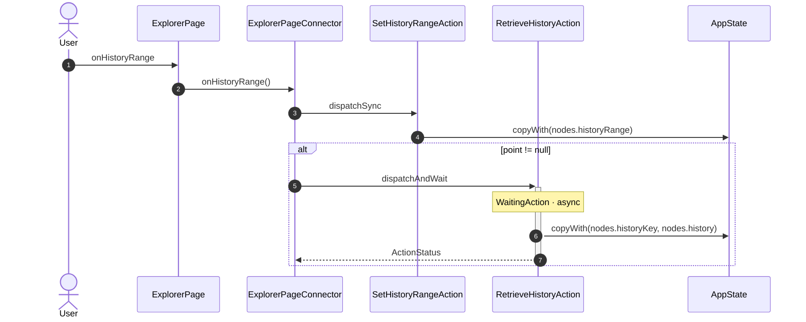

## onCloseInspector

```mermaid
sequenceDiagram
    autonumber
    actor User
    participant UI as ExplorerPage
    participant VM as ExplorerPageConnector
    participant A1 as SetActionAction
    participant ST as AppState

    User->>UI: onCloseInspector
    UI->>VM: onCloseInspector()
    VM->>A1: dispatchSync
    A1->>ST: copyWith(nodes.action)
```

## onSubmit

```mermaid
sequenceDiagram
    autonumber
    actor User
    participant UI as ExplorerPage
    participant VM as ExplorerPageConnector
    participant A1 as StageInvokeAction
    participant A2 as InvokeNodeAction
    participant A3 as StageValueAction
    participant ST as AppState

    User->>UI: onSubmit
    UI->>VM: onSubmit()
    alt act.level == 'config'
        VM->>A1: dispatchSync
        A1->>ST: dispatchSync(AddChangesAction)
        VM->>+A2: dispatchAndWait
        Note over A2: WaitingAction · async
        A2->>ST: copyWith(nodes.results)
        A2-->>-VM: ActionStatus
    end
    alt point != null && values.containsKey('value')
        VM->>A3: dispatchSync
        A3->>ST: dispatchSync(AddChangesAction)
    end
```

## onTool

```mermaid
sequenceDiagram
    autonumber
    actor User
    participant UI as ExplorerPage
    participant VM as ExplorerPageConnector
    participant A1 as StageInvokeAction
    participant A2 as ClearSelectionAction
    participant A3 as InvokeNodeAction
    participant A4 as SetActionAction
    participant ST as AppState

    User->>UI: onTool
    UI->>VM: onTool()
    VM->>A1: dispatchSync
    A1->>ST: dispatchSync(AddChangesAction)
    VM->>A2: dispatchSync
    A2->>ST: copyWith(nodes.checked, nodes.marked, nodes.point, nodes.anchor)
    VM->>+A3: dispatchAndWait
    Note over A3: WaitingAction · async
    A3->>ST: copyWith(nodes.results)
    A3-->>-VM: ActionStatus
    VM->>A4: dispatchSync
    A4->>ST: copyWith(nodes.action)
```

## onSetPoll

```mermaid
sequenceDiagram
    autonumber
    actor User
    participant UI as ExplorerPage
    participant VM as ExplorerPageConnector
    participant A1 as StagePointEditAction
    participant ST as AppState

    User->>UI: onSetPoll
    UI->>VM: onSetPoll()
    alt _actionOf(k, 'edit') != null
        VM->>A1: dispatchSync
        A1->>ST: copyWith(changes.table, changes.view)
        A1--xVM: UserException
    end
```

## onTapFlowEditor

```mermaid
sequenceDiagram
    autonumber
    actor User
    participant UI as ExplorerPage
    participant VM as ExplorerPageConnector
    participant NAV as Router

    User->>UI: onTapFlowEditor
    UI->>VM: onTapFlowEditor()
    VM->>NAV: GoAction.push FlowEditorRoute(id: id)
```

_Not drawn — these files dispatch outside any interaction:_

- `ExplorerPageConnector` — 2 dispatches

| Interaction | Dispatches | Writes |
| --- | --- | --- |
| `params.onChanged` | `StagePointEditAction` | `changes.table, changes.view` |
| `inspector` | `StagePointEditAction`, `StagePointEditAction` | `changes.table, changes.view` |
| `onShow` | `WatchKeysAction`, `RetrieveNodesAction` ?, `RetrieveLinksAction` ? | `live.watched`, `links.version, links.table, links.view` |
| `onHide` | `UnwatchKeysAction` | `live.watched` |
| `onSelect` | `SelectNodeAction` | `nodes.selectedNode, nodes.action, nodes.point, nodes.anchor, nodes.checked, nodes.pointFilter` |
| `onToggle` | `ToggleNodeAction` | `nodes.expanded` |
| `onMark` | `MarkNodesAction.toggle` | `nodes.marked` |
| `onMarkRange` | `MarkNodesAction.range` | `nodes.marked` |
| `onTreeFilter` | `SetTreeFilterAction` | `nodes.treeFilter` |
| `onPointFilter` | `SetPointFilterAction` | `nodes.pointFilter` |
| `onPoint` | `SelectPointAction` | `nodes.point, nodes.anchor` |
| `onCheck` | `CheckPointsAction.toggle` | `nodes.checked` |
| `onRange` | `CheckPointsAction.range` | `nodes.checked` |
| `onCheckAll` | `CheckPointsAction.all` | `nodes.checked` |
| `onClear` | `ClearSelectionAction` | `nodes.checked, nodes.marked, nodes.point, nodes.anchor` |
| `onTab` | `SetTabAction`, `RetrieveHistoryAction` ? | `nodes.tab`, `nodes.historyKey, nodes.history` |
| `onAudit` | `RetrieveAuditAction` ? | `nodes.audit` |
| `onAction` | `SetActionAction` | `nodes.action` |
| `onPickAction` | `SetTabAction`, `SetActionAction` | `nodes.tab`, `nodes.action` |
| `onHistoryRange` | `SetHistoryRangeAction`, `RetrieveHistoryAction` ? | `nodes.historyRange`, `nodes.historyKey, nodes.history` |
| `onCloseInspector` | `SetActionAction` | `nodes.action` |
| `onSubmit` | `StageInvokeAction` ?, `InvokeNodeAction` ?, `StageValueAction` ? | `nodes.results` |
| `onTool` | `StageInvokeAction`, `ClearSelectionAction`, `InvokeNodeAction`, `SetActionAction` | `nodes.checked, nodes.marked, nodes.point, nodes.anchor`, `nodes.results`, `nodes.action` |
| `onSetPoll` | `StagePointEditAction` ? | `changes.table, changes.view` |
| `onTapFlowEditor` | `GoAction.push` | — |

`?` marks a dispatch that only runs under a condition.

[← all flows](README.md)
