<!-- generated by `frx flow --md` — do not edit, re-run it -->

# FlowEditorPage

`app/lib/connectors/flow_editor_page_connector.dart`

## onBack

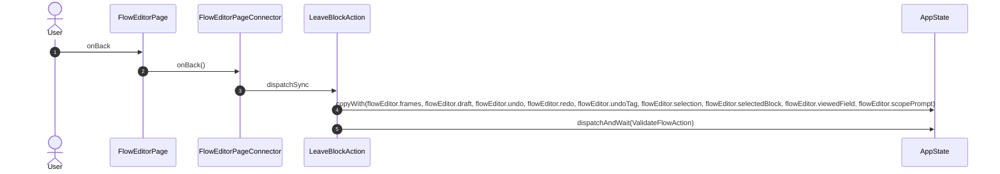

## onTreeToggle

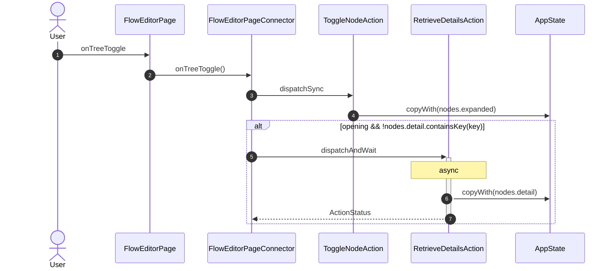

## onTreeQuery

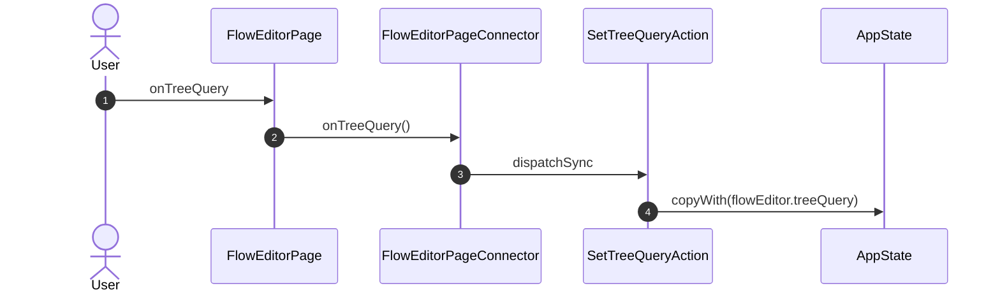

## onPaletteMenu

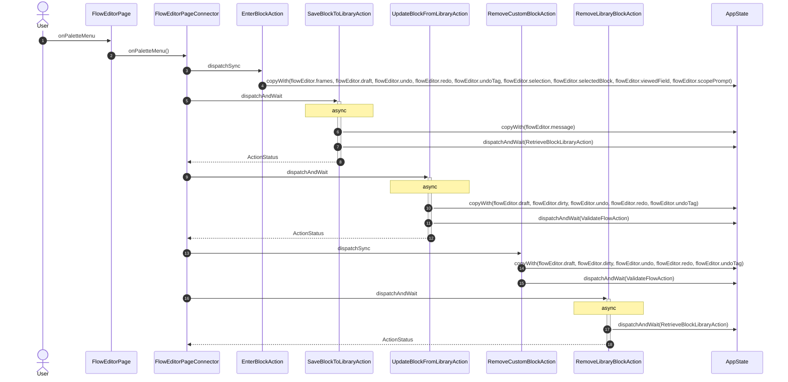

## onRenameBlock

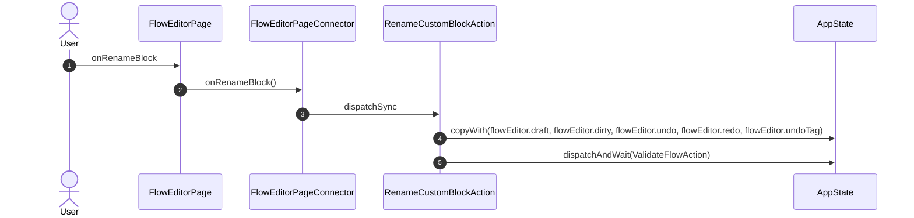

## onCreateBlock

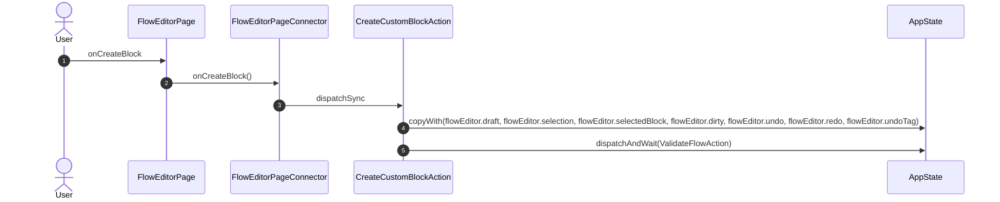

## onPromptSave

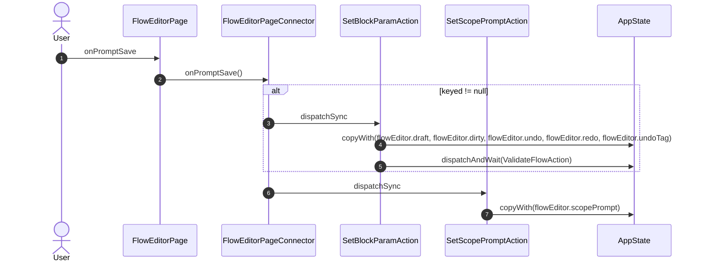

## onPromptCancel

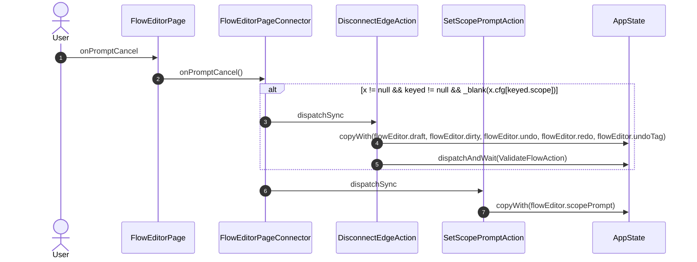

## onRowAction

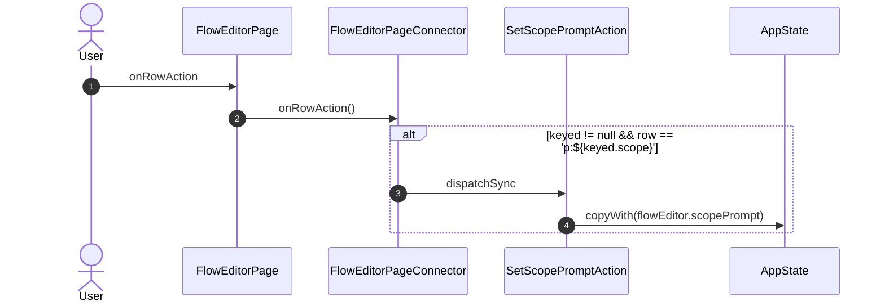

## onOpen

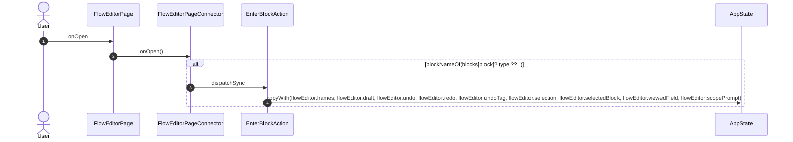

## onRun

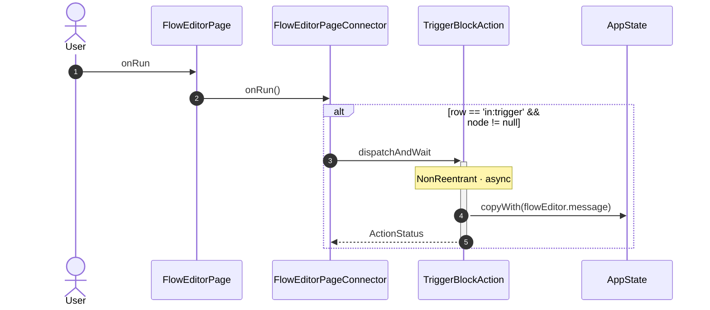

## onOpenInside

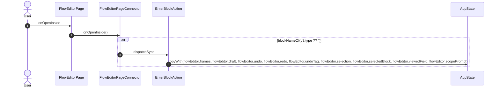

## nameField.onChanged

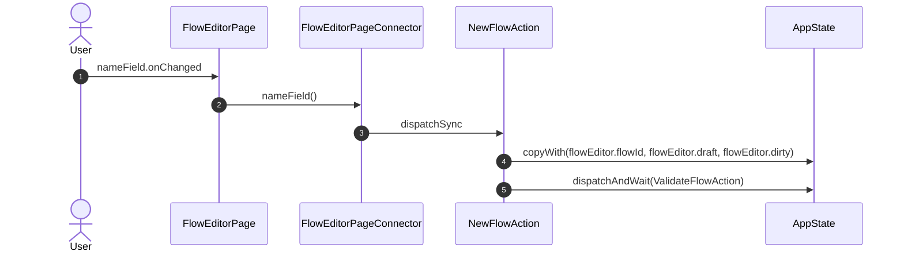

## onView

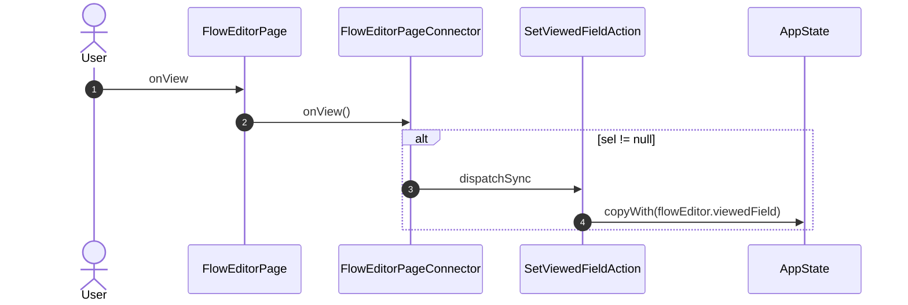

## onCloseViewer

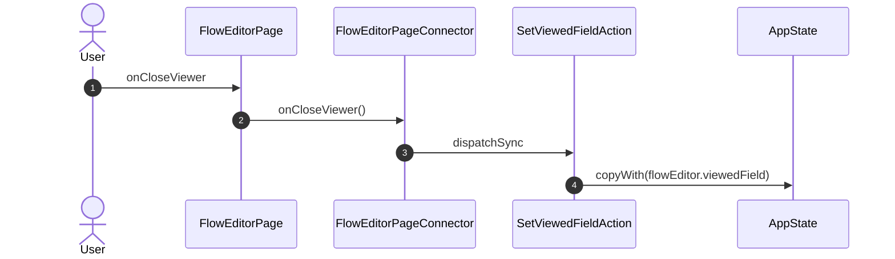

## onDeploy

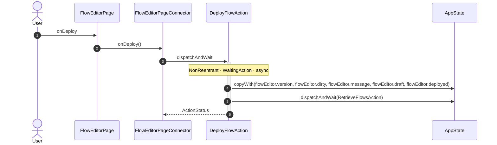

## onValidate

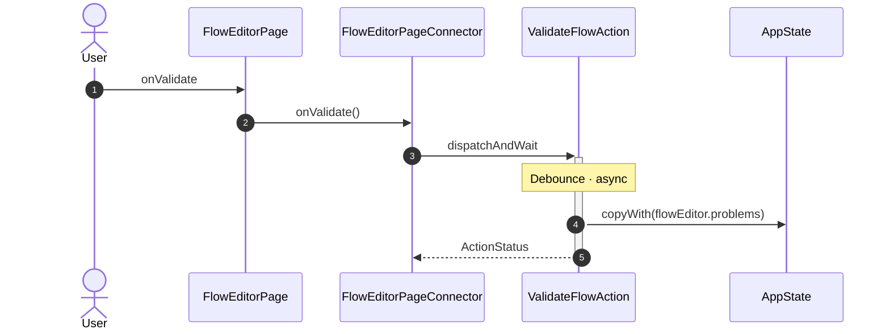

## onClose

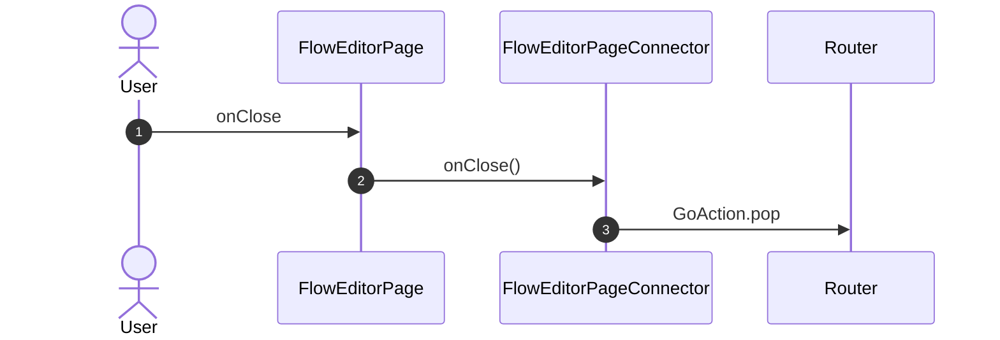

## onPaletteTab

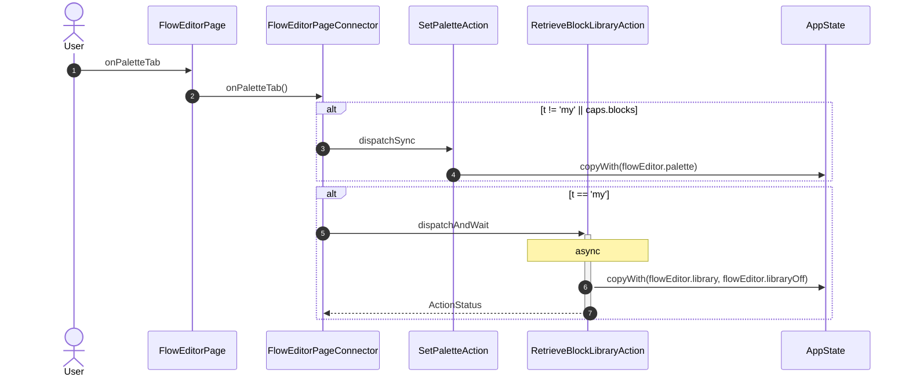

## onPick

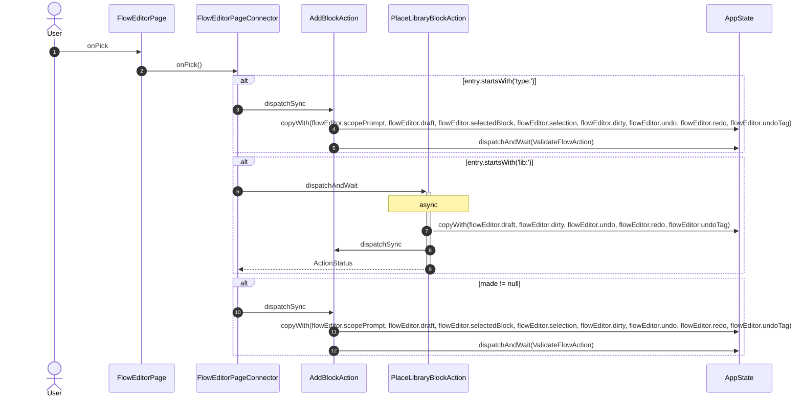

## onDrop

```mermaid
sequenceDiagram
    autonumber
    actor User
    participant UI as FlowEditorPage
    participant VM as FlowEditorPageConnector
    participant A1 as AddBlockAction
    participant A2 as PlaceLibraryBlockAction
    participant ST as AppState

    User->>UI: onDrop
    UI->>VM: onDrop()
    alt entry.startsWith('type:')
        VM->>A1: dispatchSync
        A1->>ST: copyWith(flowEditor.scopePrompt, flowEditor.draft, flowEditor.selectedBlock, flowEditor.selection, flowEditor.dirty, flowEditor.undo, flowEditor.redo, flowEditor.undoTag)
        A1->>ST: dispatchAndWait(ValidateFlowAction)
    end
    alt entry.startsWith('lib:')
        VM->>+A2: dispatchAndWait
        Note over A2: async
        A2->>ST: copyWith(flowEditor.draft, flowEditor.dirty, flowEditor.undo, flowEditor.redo, flowEditor.undoTag)
        A2->>A1: dispatchSync
        A2-->>-VM: ActionStatus
    end
    alt made != null
        VM->>A1: dispatchSync
        A1->>ST: copyWith(flowEditor.scopePrompt, flowEditor.draft, flowEditor.selectedBlock, flowEditor.selection, flowEditor.dirty, flowEditor.undo, flowEditor.redo, flowEditor.undoTag)
        A1->>ST: dispatchAndWait(ValidateFlowAction)
    end
```

## onClear

```mermaid
sequenceDiagram
    autonumber
    actor User
    participant UI as FlowEditorPage
    participant VM as FlowEditorPageConnector
    participant A1 as SetSelectedBlockAction
    participant ST as AppState

    User->>UI: onClear
    UI->>VM: onClear()
    VM->>A1: dispatchSync
    A1->>ST: copyWith(flowEditor.selectedBlock, flowEditor.selection)
```

## onMove

```mermaid
sequenceDiagram
    autonumber
    actor User
    participant UI as FlowEditorPage
    participant VM as FlowEditorPageConnector
    participant A1 as MoveBlocksAction
    participant ST as AppState

    User->>UI: onMove
    UI->>VM: onMove()
    VM->>A1: dispatchSync
    A1->>ST: copyWith(flowEditor.draft, flowEditor.dirty, flowEditor.undo, flowEditor.redo, flowEditor.undoTag)
```

## onSelect

```mermaid
sequenceDiagram
    autonumber
    actor User
    participant UI as FlowEditorPage
    participant VM as FlowEditorPageConnector
    participant A1 as SetSelectedBlockAction
    participant ST as AppState

    User->>UI: onSelect
    UI->>VM: onSelect()
    VM->>A1: dispatchSync
    A1->>ST: copyWith(flowEditor.selectedBlock, flowEditor.selection)
```

## onSelectMany

```mermaid
sequenceDiagram
    autonumber
    actor User
    participant UI as FlowEditorPage
    participant VM as FlowEditorPageConnector
    participant A1 as SelectBlocksAction
    participant ST as AppState

    User->>UI: onSelectMany
    UI->>VM: onSelectMany()
    VM->>A1: dispatchSync
    A1->>ST: copyWith(flowEditor.selection, flowEditor.selectedBlock)
```

## onCommand

```mermaid
sequenceDiagram
    autonumber
    actor User
    participant UI as FlowEditorPage
    participant VM as FlowEditorPageConnector
    participant A1 as SetClipboardAction
    participant A2 as RemoveBlocksAction
    participant A3 as PasteBlocksAction
    participant A4 as UndoFlowAction
    participant A5 as RedoFlowAction
    participant A6 as SetViewedFieldAction
    participant A7 as SetSelectedBlockAction
    participant A8 as EnterBlockAction
    participant ST as AppState

    User->>UI: onCommand
    UI->>VM: onCommand()
    VM->>A1: dispatchSync
    A1->>ST: copyWith(flowEditor.clipboard)
    alt _copy(d, ids)
        VM->>A2: dispatchSync
        A2->>ST: copyWith(flowEditor.draft, flowEditor.selection, flowEditor.selectedBlock, flowEditor.dirty, flowEditor.undo, flowEditor.redo, flowEditor.undoTag)
        A2->>ST: dispatchAndWait(ValidateFlowAction)
    end
    VM->>A3: dispatchSync
    A3->>ST: copyWith(flowEditor.draft, flowEditor.selection, flowEditor.selectedBlock, flowEditor.dirty, flowEditor.undo, flowEditor.redo, flowEditor.undoTag)
    A3->>ST: dispatchAndWait(ValidateFlowAction)
    alt picked.isNotEmpty
        VM->>A3: dispatchSync
        A3->>ST: copyWith(flowEditor.draft, flowEditor.selection, flowEditor.selectedBlock, flowEditor.dirty, flowEditor.undo, flowEditor.redo, flowEditor.undoTag)
        A3->>ST: dispatchAndWait(ValidateFlowAction)
    end
    VM->>A2: dispatchSync
    A2->>ST: copyWith(flowEditor.draft, flowEditor.selection, flowEditor.selectedBlock, flowEditor.dirty, flowEditor.undo, flowEditor.redo, flowEditor.undoTag)
    A2->>ST: dispatchAndWait(ValidateFlowAction)
    VM->>A4: dispatchSync
    A4->>ST: copyWith(flowEditor.draft, flowEditor.undo, flowEditor.redo, flowEditor.undoTag, flowEditor.selection, flowEditor.selectedBlock, flowEditor.dirty)
    A4->>ST: dispatchAndWait(ValidateFlowAction)
    VM->>A5: dispatchSync
    A5->>ST: copyWith(flowEditor.draft, flowEditor.redo, flowEditor.undo, flowEditor.undoTag, flowEditor.selection, flowEditor.selectedBlock, flowEditor.dirty)
    A5->>ST: dispatchAndWait(ValidateFlowAction)
    alt ed.viewedField != null
        VM->>A6: dispatchSync
        A6->>ST: copyWith(flowEditor.viewedField)
        VM->>A7: dispatchSync
        A7->>ST: copyWith(flowEditor.selectedBlock, flowEditor.selection)
    end
    alt blockNameOf(one?.type ?? '')
        VM->>A8: dispatchSync
        A8->>ST: copyWith(flowEditor.frames, flowEditor.draft, flowEditor.undo, flowEditor.redo, flowEditor.undoTag, flowEditor.selection, flowEditor.selectedBlock, flowEditor.viewedField, flowEditor.scopePrompt)
    end
```

## onPin

```mermaid
sequenceDiagram
    autonumber
    actor User
    participant UI as FlowEditorPage
    participant VM as FlowEditorPageConnector
    participant A1 as SetFieldPinAction
    participant ST as AppState

    User->>UI: onPin
    UI->>VM: onPin()
    VM->>A1: dispatchSync
    A1->>ST: copyWith(flowEditor.draft, flowEditor.dirty, flowEditor.undo, flowEditor.redo, flowEditor.undoTag)
```

## onFieldPin

```mermaid
sequenceDiagram
    autonumber
    actor User
    participant UI as FlowEditorPage
    participant VM as FlowEditorPageConnector
    participant A1 as SetFieldPinAction
    participant ST as AppState

    User->>UI: onFieldPin
    UI->>VM: onFieldPin()
    alt sel != null
        VM->>A1: dispatchSync
        A1->>ST: copyWith(flowEditor.draft, flowEditor.dirty, flowEditor.undo, flowEditor.redo, flowEditor.undoTag)
    end
```

## onViewField

```mermaid
sequenceDiagram
    autonumber
    actor User
    participant UI as FlowEditorPage
    participant VM as FlowEditorPageConnector
    participant A1 as SetViewedFieldAction
    participant ST as AppState

    User->>UI: onViewField
    UI->>VM: onViewField()
    VM->>A1: dispatchSync
    A1->>ST: copyWith(flowEditor.viewedField)
```

## onSaveViewer

```mermaid
sequenceDiagram
    autonumber
    actor User
    participant UI as FlowEditorPage
    participant VM as FlowEditorPageConnector
    participant A1 as SetBlockParamAction
    participant A2 as SetOperandValueAction
    participant ST as AppState

    User->>UI: onSaveViewer
    UI->>VM: onSaveViewer()
    alt b.id == blockInputsId
        VM->>A1: dispatchSync
        A1->>ST: copyWith(flowEditor.draft, flowEditor.dirty, flowEditor.undo, flowEditor.redo, flowEditor.undoTag)
        A1->>ST: dispatchAndWait(ValidateFlowAction)
    end
    alt f.operand
        VM->>A2: dispatchSync
        A2->>ST: copyWith(flowEditor.draft, flowEditor.dirty, flowEditor.undo, flowEditor.redo, flowEditor.undoTag)
        A2->>ST: dispatchAndWait(ValidateFlowAction)
    end
    alt f.kind == FieldKind.arg
        VM->>A1: dispatchSync
        A1->>ST: copyWith(flowEditor.draft, flowEditor.dirty, flowEditor.undo, flowEditor.redo, flowEditor.undoTag)
        A1->>ST: dispatchAndWait(ValidateFlowAction)
    end
    alt f.spec
        VM->>A1: dispatchSync
        A1->>ST: copyWith(flowEditor.draft, flowEditor.dirty, flowEditor.undo, flowEditor.redo, flowEditor.undoTag)
        A1->>ST: dispatchAndWait(ValidateFlowAction)
    end
```

## onBind

```mermaid
sequenceDiagram
    autonumber
    actor User
    participant UI as FlowEditorPage
    participant VM as FlowEditorPageConnector
    participant A1 as ConnectPortsAction
    participant ST as AppState

    User->>UI: onBind
    UI->>VM: onBind()
    VM->>A1: dispatchSync
    A1->>ST: copyWith(flowEditor.scopePrompt, flowEditor.draft, flowEditor.dirty, flowEditor.undo, flowEditor.redo, flowEditor.undoTag)
    A1->>ST: dispatchAndWait(ValidateFlowAction)
```

## onUnbind

```mermaid
sequenceDiagram
    autonumber
    actor User
    participant UI as FlowEditorPage
    participant VM as FlowEditorPageConnector
    participant A1 as DisconnectEdgeAction
    participant ST as AppState

    User->>UI: onUnbind
    UI->>VM: onUnbind()
    VM->>A1: dispatchSync
    A1->>ST: copyWith(flowEditor.draft, flowEditor.dirty, flowEditor.undo, flowEditor.redo, flowEditor.undoTag)
    A1->>ST: dispatchAndWait(ValidateFlowAction)
```

## onRebind

```mermaid
sequenceDiagram
    autonumber
    actor User
    participant UI as FlowEditorPage
    participant VM as FlowEditorPageConnector
    participant A1 as RebindEdgeAction
    participant ST as AppState

    User->>UI: onRebind
    UI->>VM: onRebind()
    VM->>A1: dispatchSync
    A1->>ST: copyWith(flowEditor.scopePrompt, flowEditor.draft, flowEditor.dirty, flowEditor.undo, flowEditor.redo, flowEditor.undoTag)
    A1->>ST: dispatchAndWait(ValidateFlowAction)
```

## onDropEntry

```mermaid
sequenceDiagram
    autonumber
    actor User
    participant UI as FlowEditorPage
    participant VM as FlowEditorPageConnector
    participant A1 as AddBlockAction
    participant ST as AppState

    User->>UI: onDropEntry
    UI->>VM: onDropEntry()
    VM->>A1: dispatchSync
    A1->>ST: copyWith(flowEditor.scopePrompt, flowEditor.draft, flowEditor.selectedBlock, flowEditor.selection, flowEditor.dirty, flowEditor.undo, flowEditor.redo, flowEditor.undoTag)
    A1->>ST: dispatchAndWait(ValidateFlowAction)
```

## onResize

```mermaid
sequenceDiagram
    autonumber
    actor User
    participant UI as FlowEditorPage
    participant VM as FlowEditorPageConnector
    participant A1 as isBoundary(block) ? ResizeBlockPortsAction(input: block == blockInputsId, add: add) : ResizeInputsAction(block, add: add)

    User->>UI: onResize
    UI->>VM: onResize()
    VM->>A1: dispatchSync
```

## onFieldChanged

```mermaid
sequenceDiagram
    autonumber
    actor User
    participant UI as FlowEditorPage
    participant VM as FlowEditorPageConnector
    participant A1 as SetBlockFormAction
    participant A2 as SetBlockParamAction
    participant A3 as SetOperandValueAction
    participant ST as AppState

    User->>UI: onFieldChanged
    UI->>VM: onFieldChanged()
    alt form != null
        VM->>A1: dispatchSync
        A1->>ST: copyWith(flowEditor.draft, flowEditor.dirty, flowEditor.undo, flowEditor.redo, flowEditor.undoTag)
        A1->>ST: dispatchAndWait(ValidateFlowAction)
    end
    alt b.id == blockInputsId
        VM->>A2: dispatchSync
        A2->>ST: copyWith(flowEditor.draft, flowEditor.dirty, flowEditor.undo, flowEditor.redo, flowEditor.undoTag)
        A2->>ST: dispatchAndWait(ValidateFlowAction)
    end
    alt f.operand
        VM->>A3: dispatchSync
        A3->>ST: copyWith(flowEditor.draft, flowEditor.dirty, flowEditor.undo, flowEditor.redo, flowEditor.undoTag)
        A3->>ST: dispatchAndWait(ValidateFlowAction)
    end
    alt f.kind == FieldKind.arg
        VM->>A2: dispatchSync
        A2->>ST: copyWith(flowEditor.draft, flowEditor.dirty, flowEditor.undo, flowEditor.redo, flowEditor.undoTag)
        A2->>ST: dispatchAndWait(ValidateFlowAction)
    end
    alt f.spec
        VM->>A2: dispatchSync
        A2->>ST: copyWith(flowEditor.draft, flowEditor.dirty, flowEditor.undo, flowEditor.redo, flowEditor.undoTag)
        A2->>ST: dispatchAndWait(ValidateFlowAction)
    end
```

## onFieldUnbind

```mermaid
sequenceDiagram
    autonumber
    actor User
    participant UI as FlowEditorPage
    participant VM as FlowEditorPageConnector
    participant A1 as DisconnectEdgeAction
    participant ST as AppState

    User->>UI: onFieldUnbind
    UI->>VM: onFieldUnbind()
    VM->>A1: dispatchSync
    A1->>ST: copyWith(flowEditor.draft, flowEditor.dirty, flowEditor.undo, flowEditor.redo, flowEditor.undoTag)
    A1->>ST: dispatchAndWait(ValidateFlowAction)
```

## onFieldBind

```mermaid
sequenceDiagram
    autonumber
    actor User
    participant UI as FlowEditorPage
    participant VM as FlowEditorPageConnector
    participant A1 as SetBlockParamAction
    participant A2 as ConnectPortsAction
    participant ST as AppState

    User->>UI: onFieldBind
    UI->>VM: onFieldBind()
    alt f.kind == FieldKind.arg && !_args(b).containsKey(f.name)
        VM->>A1: dispatchSync
        A1->>ST: copyWith(flowEditor.draft, flowEditor.dirty, flowEditor.undo, flowEditor.redo, flowEditor.undoTag)
        A1->>ST: dispatchAndWait(ValidateFlowAction)
    end
    alt b != null && f != null && port != null && from.block != b.id
        VM->>A2: dispatchSync
        A2->>ST: copyWith(flowEditor.scopePrompt, flowEditor.draft, flowEditor.dirty, flowEditor.undo, flowEditor.redo, flowEditor.undoTag)
        A2->>ST: dispatchAndWait(ValidateFlowAction)
    end
```

## onProblem

```mermaid
sequenceDiagram
    autonumber
    actor User
    participant UI as FlowEditorPage
    participant VM as FlowEditorPageConnector
    participant A1 as SetSelectedBlockAction
    participant ST as AppState

    User->>UI: onProblem
    UI->>VM: onProblem()
    VM->>A1: dispatchSync
    A1->>ST: copyWith(flowEditor.selectedBlock, flowEditor.selection)
```

## onRemove

```mermaid
sequenceDiagram
    autonumber
    actor User
    participant UI as FlowEditorPage
    participant VM as FlowEditorPageConnector
    participant A1 as RemoveBlocksAction
    participant ST as AppState

    User->>UI: onRemove
    UI->>VM: onRemove()
    VM->>A1: dispatchSync
    A1->>ST: copyWith(flowEditor.draft, flowEditor.selection, flowEditor.selectedBlock, flowEditor.dirty, flowEditor.undo, flowEditor.redo, flowEditor.undoTag)
    A1->>ST: dispatchAndWait(ValidateFlowAction)
```

## onLogo

```mermaid
sequenceDiagram
    autonumber
    actor User
    participant UI as FlowEditorPage
    participant VM as FlowEditorPageConnector
    participant NAV as Router

    User->>UI: onLogo
    UI->>VM: onLogo()
    VM->>NAV: GoAction.navigate ExplorerRoute
```

## onPanelWidth

```mermaid
sequenceDiagram
    autonumber
    actor User
    participant UI as FlowEditorPage
    participant VM as FlowEditorPageConnector
    participant A1 as SetPanelWidthAction
    participant ST as AppState

    User->>UI: onPanelWidth
    UI->>VM: onPanelWidth()
    VM->>A1: dispatchSync
    A1->>ST: copyWith(panels.widths)
```

_Not drawn — these files dispatch outside any interaction:_

- `FlowEditorPageConnector` — 15 dispatches

| Interaction | Dispatches | Writes |
| --- | --- | --- |
| `onBack` | `LeaveBlockAction` | `flowEditor.frames, flowEditor.draft, flowEditor.undo, flowEditor.redo, flowEditor.undoTag, flowEditor.selection, flowEditor.selectedBlock, flowEditor.viewedField, flowEditor.scopePrompt` |
| `onTreeToggle` | `ToggleNodeAction`, `RetrieveDetailsAction` ? | `nodes.expanded`, `nodes.detail` |
| `onTreeQuery` | `SetTreeQueryAction` | `flowEditor.treeQuery` |
| `onPaletteMenu` | `EnterBlockAction`, `SaveBlockToLibraryAction`, `UpdateBlockFromLibraryAction`, `RemoveCustomBlockAction`, `RemoveLibraryBlockAction` | `flowEditor.frames, flowEditor.draft, flowEditor.undo, flowEditor.redo, flowEditor.undoTag, flowEditor.selection, flowEditor.selectedBlock, flowEditor.viewedField, flowEditor.scopePrompt`, `flowEditor.message`, `flowEditor.draft, flowEditor.dirty, flowEditor.undo, flowEditor.redo, flowEditor.undoTag` |
| `onRenameBlock` | `RenameCustomBlockAction` | `flowEditor.draft, flowEditor.dirty, flowEditor.undo, flowEditor.redo, flowEditor.undoTag` |
| `onCreateBlock` | `CreateCustomBlockAction` | `flowEditor.draft, flowEditor.selection, flowEditor.selectedBlock, flowEditor.dirty, flowEditor.undo, flowEditor.redo, flowEditor.undoTag` |
| `onPromptSave` | `SetBlockParamAction` ?, `SetScopePromptAction` | `flowEditor.draft, flowEditor.dirty, flowEditor.undo, flowEditor.redo, flowEditor.undoTag`, `flowEditor.scopePrompt` |
| `onPromptCancel` | `DisconnectEdgeAction` ?, `SetScopePromptAction` | `flowEditor.draft, flowEditor.dirty, flowEditor.undo, flowEditor.redo, flowEditor.undoTag`, `flowEditor.scopePrompt` |
| `onRowAction` | `SetScopePromptAction` ? | `flowEditor.scopePrompt` |
| `onOpen` | `EnterBlockAction` ? | `flowEditor.frames, flowEditor.draft, flowEditor.undo, flowEditor.redo, flowEditor.undoTag, flowEditor.selection, flowEditor.selectedBlock, flowEditor.viewedField, flowEditor.scopePrompt` |
| `onRun` | `TriggerBlockAction` ? | `flowEditor.message` |
| `onOpenInside` | `EnterBlockAction` ? | `flowEditor.frames, flowEditor.draft, flowEditor.undo, flowEditor.redo, flowEditor.undoTag, flowEditor.selection, flowEditor.selectedBlock, flowEditor.viewedField, flowEditor.scopePrompt` |
| `nameField.onChanged` | `NewFlowAction` | `flowEditor.flowId, flowEditor.draft, flowEditor.dirty` |
| `onView` | `SetViewedFieldAction` ? | `flowEditor.viewedField` |
| `onCloseViewer` | `SetViewedFieldAction` | `flowEditor.viewedField` |
| `onDeploy` | `DeployFlowAction` | `flowEditor.version, flowEditor.dirty, flowEditor.message, flowEditor.draft, flowEditor.deployed` |
| `onValidate` | `ValidateFlowAction` | `flowEditor.problems` |
| `onClose` | `GoAction.pop` | — |
| `onPaletteTab` | `SetPaletteAction` ?, `RetrieveBlockLibraryAction` ? | `flowEditor.palette`, `flowEditor.library, flowEditor.libraryOff` |
| `onPick` | `AddBlockAction` ?, `PlaceLibraryBlockAction` ?, `AddBlockAction` ? | `flowEditor.scopePrompt, flowEditor.draft, flowEditor.selectedBlock, flowEditor.selection, flowEditor.dirty, flowEditor.undo, flowEditor.redo, flowEditor.undoTag`, `flowEditor.draft, flowEditor.dirty, flowEditor.undo, flowEditor.redo, flowEditor.undoTag` |
| `onDrop` | `AddBlockAction` ?, `PlaceLibraryBlockAction` ?, `AddBlockAction` ? | `flowEditor.scopePrompt, flowEditor.draft, flowEditor.selectedBlock, flowEditor.selection, flowEditor.dirty, flowEditor.undo, flowEditor.redo, flowEditor.undoTag`, `flowEditor.draft, flowEditor.dirty, flowEditor.undo, flowEditor.redo, flowEditor.undoTag` |
| `onClear` | `SetSelectedBlockAction` | `flowEditor.selectedBlock, flowEditor.selection` |
| `onMove` | `MoveBlocksAction` | `flowEditor.draft, flowEditor.dirty, flowEditor.undo, flowEditor.redo, flowEditor.undoTag` |
| `onSelect` | `SetSelectedBlockAction` | `flowEditor.selectedBlock, flowEditor.selection` |
| `onSelectMany` | `SelectBlocksAction` | `flowEditor.selection, flowEditor.selectedBlock` |
| `onCommand` | `SetClipboardAction`, `RemoveBlocksAction` ?, `PasteBlocksAction`, `PasteBlocksAction` ?, `RemoveBlocksAction`, `UndoFlowAction`, `RedoFlowAction`, `SetViewedFieldAction` ?, `SetSelectedBlockAction` ?, `EnterBlockAction` ? | `flowEditor.clipboard`, `flowEditor.draft, flowEditor.selection, flowEditor.selectedBlock, flowEditor.dirty, flowEditor.undo, flowEditor.redo, flowEditor.undoTag`, `flowEditor.draft, flowEditor.undo, flowEditor.redo, flowEditor.undoTag, flowEditor.selection, flowEditor.selectedBlock, flowEditor.dirty`, `flowEditor.draft, flowEditor.redo, flowEditor.undo, flowEditor.undoTag, flowEditor.selection, flowEditor.selectedBlock, flowEditor.dirty`, `flowEditor.viewedField`, `flowEditor.selectedBlock, flowEditor.selection`, `flowEditor.frames, flowEditor.draft, flowEditor.undo, flowEditor.redo, flowEditor.undoTag, flowEditor.selection, flowEditor.selectedBlock, flowEditor.viewedField, flowEditor.scopePrompt` |
| `onPin` | `SetFieldPinAction` | `flowEditor.draft, flowEditor.dirty, flowEditor.undo, flowEditor.redo, flowEditor.undoTag` |
| `onFieldPin` | `SetFieldPinAction` ? | `flowEditor.draft, flowEditor.dirty, flowEditor.undo, flowEditor.redo, flowEditor.undoTag` |
| `onViewField` | `SetViewedFieldAction` | `flowEditor.viewedField` |
| `onSaveViewer` | `SetBlockParamAction` ?, `SetOperandValueAction` ?, `SetBlockParamAction` ?, `SetBlockParamAction` ? | `flowEditor.draft, flowEditor.dirty, flowEditor.undo, flowEditor.redo, flowEditor.undoTag` |
| `onBind` | `ConnectPortsAction` | `flowEditor.scopePrompt, flowEditor.draft, flowEditor.dirty, flowEditor.undo, flowEditor.redo, flowEditor.undoTag` |
| `onUnbind` | `DisconnectEdgeAction` | `flowEditor.draft, flowEditor.dirty, flowEditor.undo, flowEditor.redo, flowEditor.undoTag` |
| `onRebind` | `RebindEdgeAction` | `flowEditor.scopePrompt, flowEditor.draft, flowEditor.dirty, flowEditor.undo, flowEditor.redo, flowEditor.undoTag` |
| `onDropEntry` | `AddBlockAction` | `flowEditor.scopePrompt, flowEditor.draft, flowEditor.selectedBlock, flowEditor.selection, flowEditor.dirty, flowEditor.undo, flowEditor.redo, flowEditor.undoTag` |
| `onResize` | `isBoundary(block) ? ResizeBlockPortsAction(input: block == blockInputsId, add: add) : ResizeInputsAction(block, add: add)` | — |
| `onFieldChanged` | `SetBlockFormAction` ?, `SetBlockParamAction` ?, `SetOperandValueAction` ?, `SetBlockParamAction` ?, `SetBlockParamAction` ? | `flowEditor.draft, flowEditor.dirty, flowEditor.undo, flowEditor.redo, flowEditor.undoTag` |
| `onFieldUnbind` | `DisconnectEdgeAction` | `flowEditor.draft, flowEditor.dirty, flowEditor.undo, flowEditor.redo, flowEditor.undoTag` |
| `onFieldBind` | `SetBlockParamAction` ?, `ConnectPortsAction` ? | `flowEditor.draft, flowEditor.dirty, flowEditor.undo, flowEditor.redo, flowEditor.undoTag`, `flowEditor.scopePrompt, flowEditor.draft, flowEditor.dirty, flowEditor.undo, flowEditor.redo, flowEditor.undoTag` |
| `onProblem` | `SetSelectedBlockAction` | `flowEditor.selectedBlock, flowEditor.selection` |
| `onRemove` | `RemoveBlocksAction` | `flowEditor.draft, flowEditor.selection, flowEditor.selectedBlock, flowEditor.dirty, flowEditor.undo, flowEditor.redo, flowEditor.undoTag` |
| `onLogo` | `GoAction.navigate` | — |
| `onPanelWidth` | `SetPanelWidthAction` | `panels.widths` |

`?` marks a dispatch that only runs under a condition.

[← all flows](README.md)
