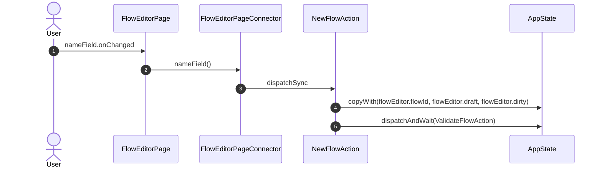
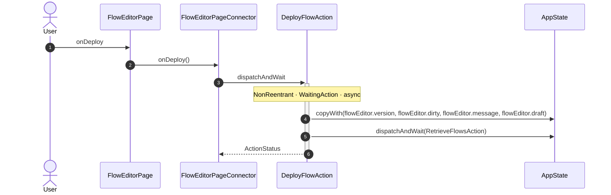
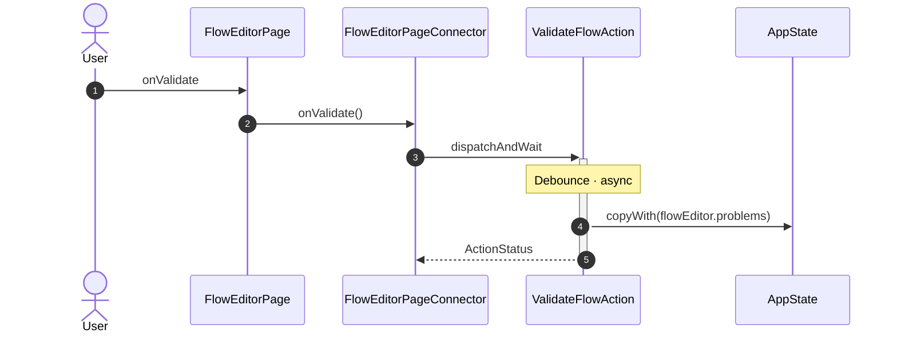
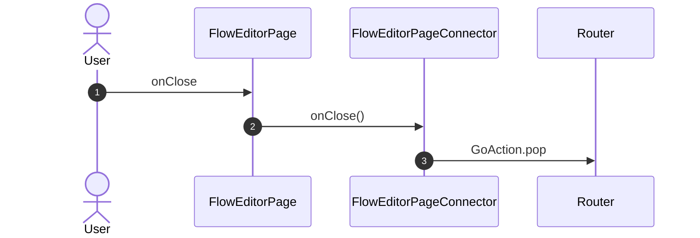
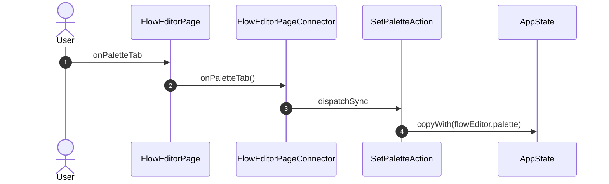
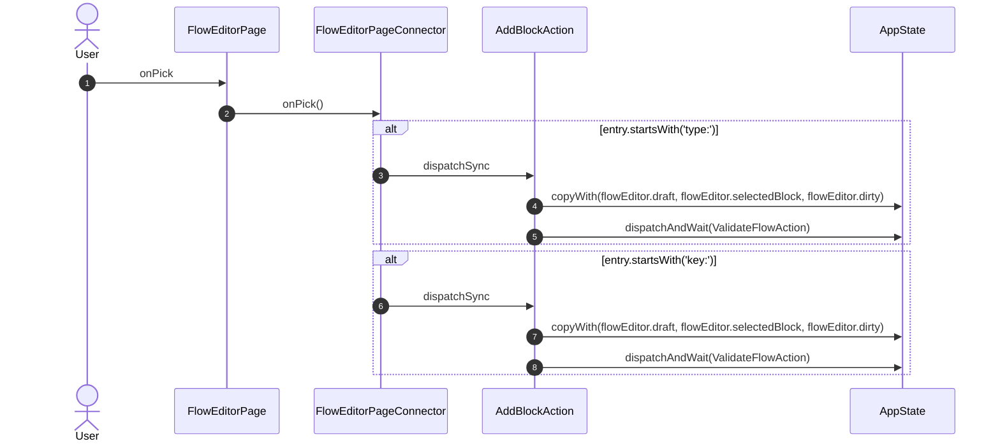
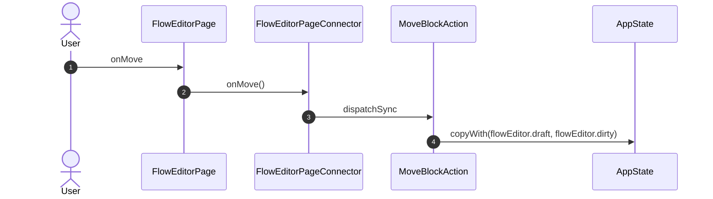
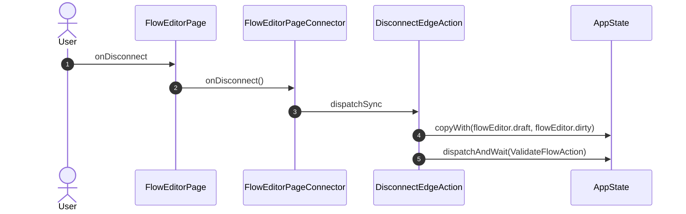

<!-- generated by `frx flow --md` — do not edit, re-run it -->

# FlowEditorPage

`app/lib/connectors/flow_editor_page_connector.dart`

## nameField.onChanged

## fields.onChanged

## onDeploy

## onValidate

## onClose

## onPaletteTab

## onPick

## onDrop

## onSelect

## onMove

## onConnect

## onDisconnect

## onRemove

_Not drawn — these files dispatch outside any interaction:_

- `FlowEditorPageConnector` — 4 dispatches

| Interaction | Dispatches | Writes |
| --- | --- | --- |
| `nameField.onChanged` | `NewFlowAction` | `flowEditor.flowId, flowEditor.draft, flowEditor.dirty` |
| `fields.onChanged` | `SetBlockParamAction` | `flowEditor.draft, flowEditor.dirty` |
| `onDeploy` | `DeployFlowAction` | `flowEditor.version, flowEditor.dirty, flowEditor.message, flowEditor.draft` |
| `onValidate` | `ValidateFlowAction` | `flowEditor.problems` |
| `onClose` | `GoAction.pop` | — |
| `onPaletteTab` | `SetPaletteAction` | `flowEditor.palette` |
| `onPick` | `AddBlockAction` ?, `AddBlockAction` ? | `flowEditor.draft, flowEditor.selectedBlock, flowEditor.dirty` |
| `onDrop` | `AddBlockAction` ?, `AddBlockAction` ? | `flowEditor.draft, flowEditor.selectedBlock, flowEditor.dirty` |
| `onSelect` | `SetSelectedBlockAction` | `flowEditor.selectedBlock` |
| `onMove` | `MoveBlockAction` | `flowEditor.draft, flowEditor.dirty` |
| `onConnect` | `ConnectPortsAction` | `flowEditor.draft, flowEditor.dirty` |
| `onDisconnect` | `DisconnectEdgeAction` | `flowEditor.draft, flowEditor.dirty` |
| `onRemove` | `RemoveBlockAction` | `flowEditor.draft, flowEditor.selectedBlock, flowEditor.dirty` |

`?` marks a dispatch that only runs under a condition.

[← all flows](README.md)
