<!-- generated by `frx flow --md` — do not edit, re-run it -->

# FlowEditorPage

`app/lib/connectors/flow_editor_page_connector.dart`

## onBack

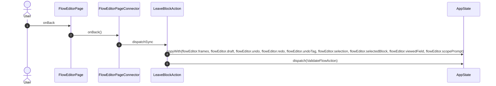

## onTreeToggle

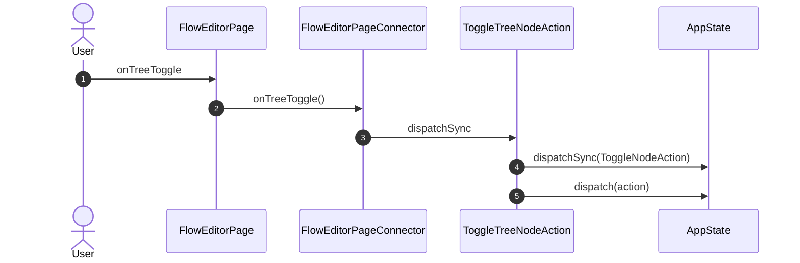

## onTreeQuery

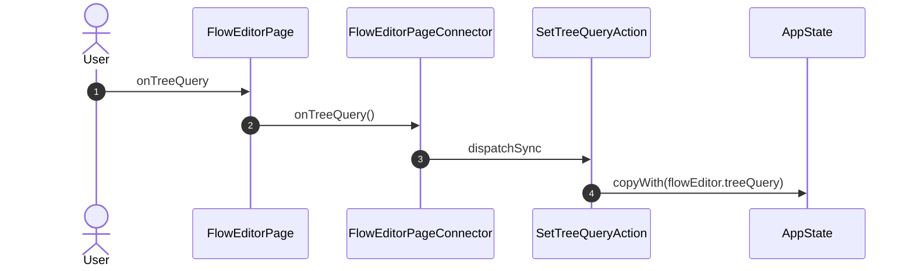

## onCreateBlock

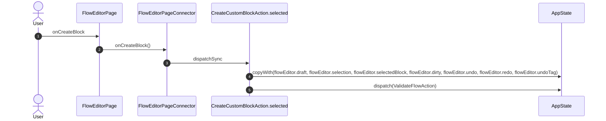

## onPromptSave

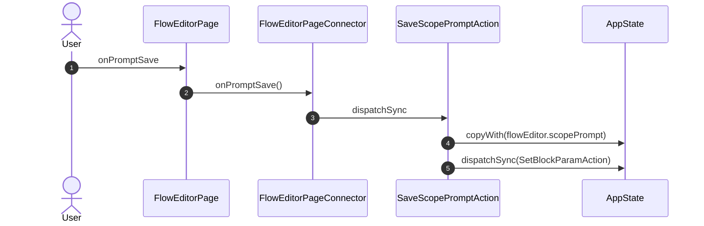

## onPromptCancel

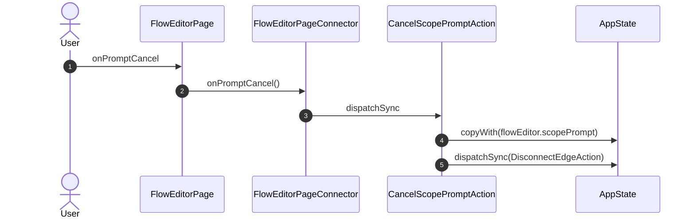

## onOpen

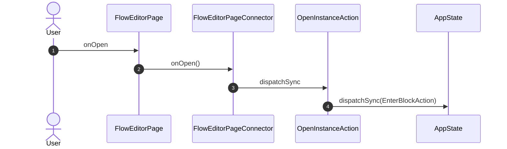

## onForm

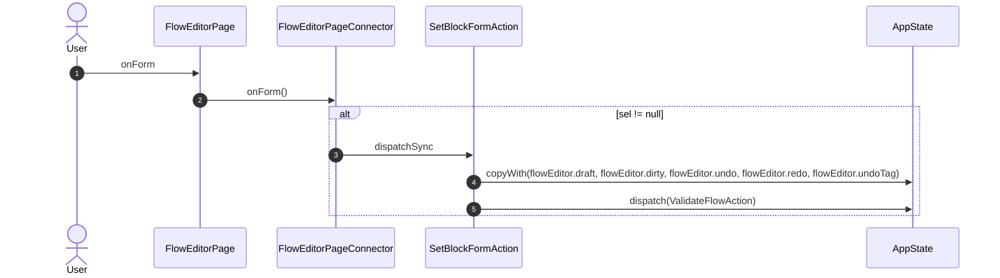

## onOpenInside

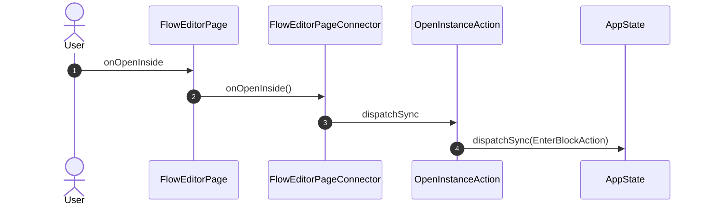

## newFlowName.onChanged

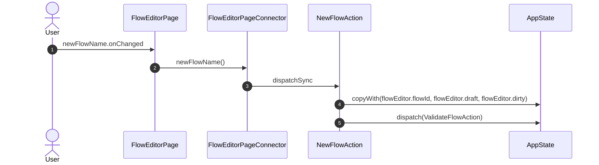

## onCloseViewer

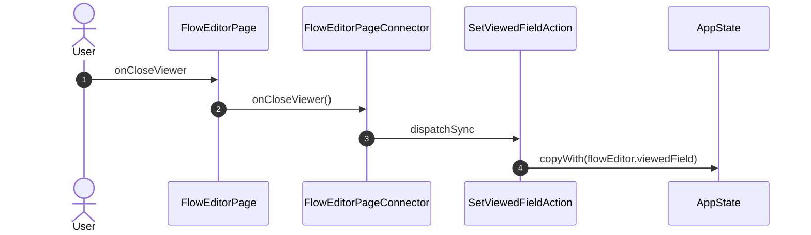

## onDeploy

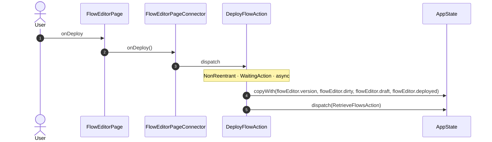

## onValidate

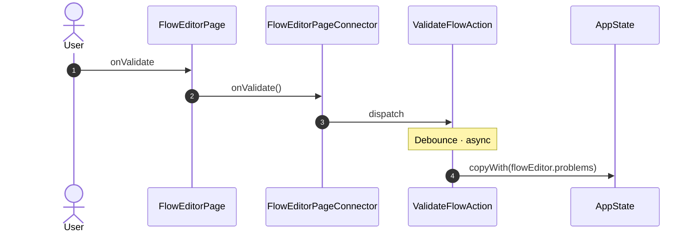

## onClose

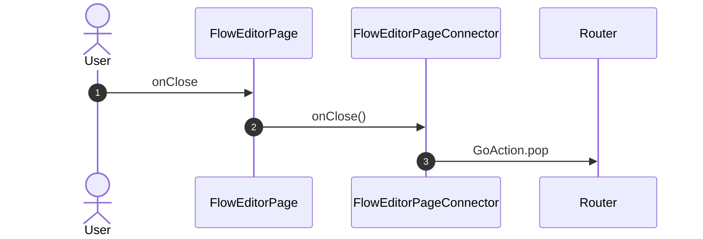

## onPaletteTab

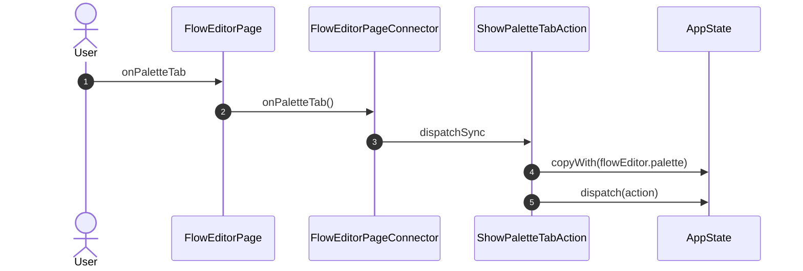

## onClear

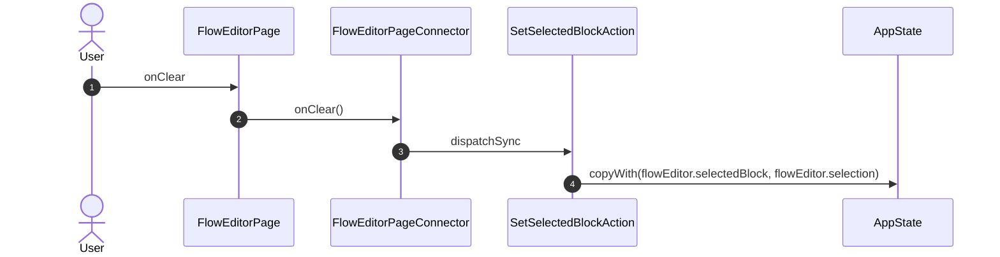

## onMove


## onSelect

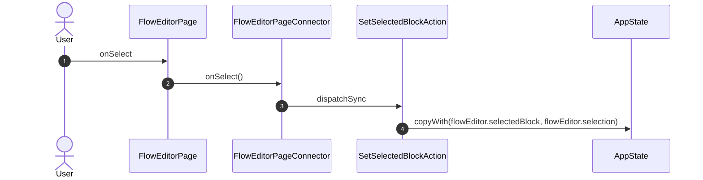

## onSelectMany

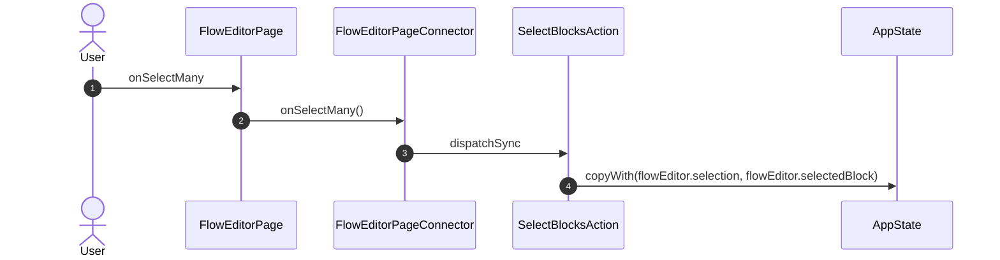

## onCommand

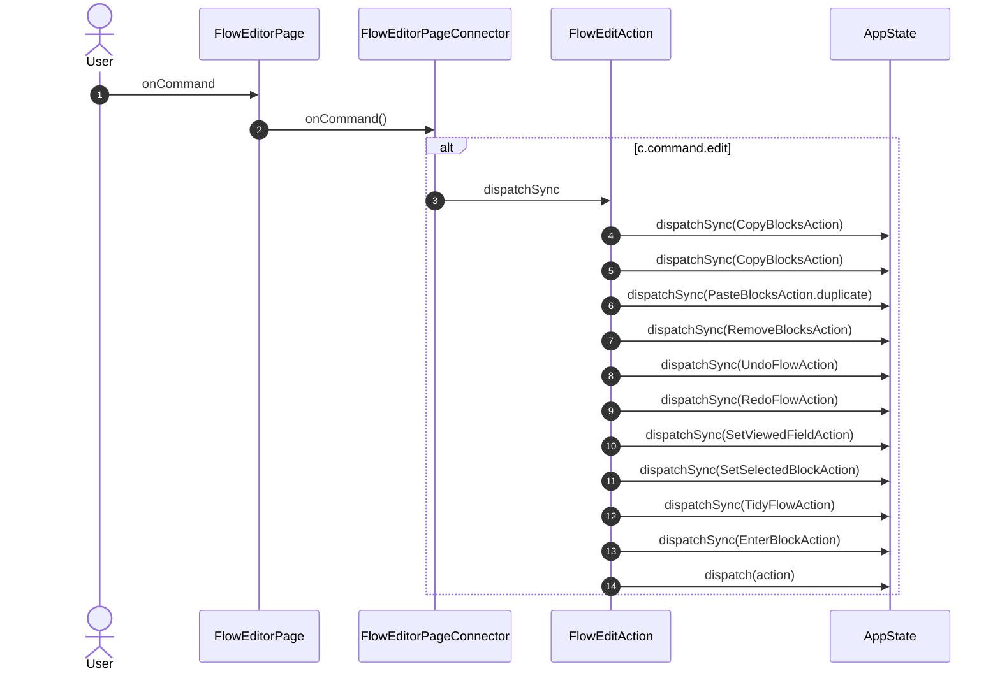

## menu

```mermaid
sequenceDiagram
    autonumber
    actor User
    participant UI as FlowEditorPage
    participant VM as FlowEditorPageConnector
    participant A1 as SetFieldPinAction
    participant ST as AppState

    User->>UI: menu
    UI->>VM: menu()
    alt block != null
        VM->>A1: dispatchSync
        A1->>ST: copyWith(flowEditor.draft, flowEditor.dirty, flowEditor.undo, flowEditor.redo, flowEditor.undoTag)
    end
```

## onFieldPin

```mermaid
sequenceDiagram
    autonumber
    actor User
    participant UI as FlowEditorPage
    participant VM as FlowEditorPageConnector
    participant A1 as SetFieldPinAction
    participant ST as AppState

    User->>UI: onFieldPin
    UI->>VM: onFieldPin()
    alt (sel, fieldAt(p.row))
        VM->>A1: dispatchSync
        A1->>ST: copyWith(flowEditor.draft, flowEditor.dirty, flowEditor.undo, flowEditor.redo, flowEditor.undoTag)
    end
```

## onSaveViewer

```mermaid
sequenceDiagram
    autonumber
    actor User
    participant UI as FlowEditorPage
    participant VM as FlowEditorPageConnector
    participant A1 as TypeFieldAction
    participant ST as AppState

    User->>UI: onSaveViewer
    UI->>VM: onSaveViewer()
    alt flowEditor.viewedField
        VM->>A1: dispatchSync
        A1->>ST: dispatchSync(SetBlockFormAction)
        A1->>ST: dispatchSync(SetBlockParamAction)
        A1->>ST: dispatchSync(SetOperandValueAction)
        A1->>ST: dispatchSync(SetBlockParamAction)
        A1->>ST: dispatchSync(SetBlockParamAction)
    end
```

## onBind

```mermaid
sequenceDiagram
    autonumber
    actor User
    participant UI as FlowEditorPage
    participant VM as FlowEditorPageConnector
    participant A1 as ConnectPortsAction
    participant ST as AppState

    User->>UI: onBind
    UI->>VM: onBind()
    VM->>A1: dispatchSync
    A1->>ST: copyWith(flowEditor.scopePrompt, flowEditor.draft, flowEditor.dirty, flowEditor.undo, flowEditor.redo, flowEditor.undoTag)
    A1->>ST: dispatch(ValidateFlowAction)
```

## onRebind

```mermaid
sequenceDiagram
    autonumber
    actor User
    participant UI as FlowEditorPage
    participant VM as FlowEditorPageConnector
    participant A1 as RebindFieldAction
    participant ST as AppState

    User->>UI: onRebind
    UI->>VM: onRebind()
    VM->>A1: dispatchSync
    A1->>ST: dispatchSync(RebindEdgeAction)
```

## onResize

```mermaid
sequenceDiagram
    autonumber
    actor User
    participant UI as FlowEditorPage
    participant VM as FlowEditorPageConnector
    participant A1 as ResizeBlockAction
    participant ST as AppState

    User->>UI: onResize
    UI->>VM: onResize()
    VM->>A1: dispatchSync
    A1->>ST: dispatchSync(isBoundary(block) ? ResizeBlockPortsAction(input: block == blockInputsId, add: add) : ResizeInputsAction(block, add: add))
```

## onFieldChanged

```mermaid
sequenceDiagram
    autonumber
    actor User
    participant UI as FlowEditorPage
    participant VM as FlowEditorPageConnector
    participant A1 as TypeFieldAction
    participant ST as AppState

    User->>UI: onFieldChanged
    UI->>VM: onFieldChanged()
    alt (sel, fieldAt(t.row))
        VM->>A1: dispatchSync
        A1->>ST: dispatchSync(SetBlockFormAction)
        A1->>ST: dispatchSync(SetBlockParamAction)
        A1->>ST: dispatchSync(SetOperandValueAction)
        A1->>ST: dispatchSync(SetBlockParamAction)
        A1->>ST: dispatchSync(SetBlockParamAction)
    end
```

## onFieldBind

```mermaid
sequenceDiagram
    autonumber
    actor User
    participant UI as FlowEditorPage
    participant VM as FlowEditorPageConnector
    participant A1 as BindFieldAction
    participant ST as AppState

    User->>UI: onFieldBind
    UI->>VM: onFieldBind()
    alt (sel, fieldAt(b.row))
        VM->>A1: dispatchSync
        A1->>ST: dispatchSync(SetBlockParamAction)
        A1->>ST: dispatchSync(ConnectPortsAction)
    end
```

## onRemove

```mermaid
sequenceDiagram
    autonumber
    actor User
    participant UI as FlowEditorPage
    participant VM as FlowEditorPageConnector
    participant A1 as RemoveBlocksAction
    participant ST as AppState

    User->>UI: onRemove
    UI->>VM: onRemove()
    VM->>A1: dispatchSync
    A1->>ST: copyWith(flowEditor.draft, flowEditor.selection, flowEditor.selectedBlock, flowEditor.dirty, flowEditor.undo, flowEditor.redo, flowEditor.undoTag)
    A1->>ST: dispatch(ValidateFlowAction)
```

## onLogo

```mermaid
sequenceDiagram
    autonumber
    actor User
    participant UI as FlowEditorPage
    participant VM as FlowEditorPageConnector
    participant NAV as Router

    User->>UI: onLogo
    UI->>VM: onLogo()
    VM->>NAV: GoAction.navigate ExplorerRoute
```

## onPanelWidth

```mermaid
sequenceDiagram
    autonumber
    actor User
    participant UI as FlowEditorPage
    participant VM as FlowEditorPageConnector
    participant A1 as SetPanelWidthAction
    participant ST as AppState

    User->>UI: onPanelWidth
    UI->>VM: onPanelWidth()
    VM->>A1: dispatchSync
    A1->>ST: copyWith(panels.widths)
```

_Not drawn — these files dispatch outside any interaction:_

- `FlowEditorPageConnector` — 5 dispatches

| Interaction | Dispatches | Writes |
| --- | --- | --- |
| `onBack` | `LeaveBlockAction` | `flowEditor.frames, flowEditor.draft, flowEditor.undo, flowEditor.redo, flowEditor.undoTag, flowEditor.selection, flowEditor.selectedBlock, flowEditor.viewedField, flowEditor.scopePrompt` |
| `onTreeToggle` | `ToggleTreeNodeAction` | — |
| `onTreeQuery` | `SetTreeQueryAction` | `flowEditor.treeQuery` |
| `onCreateBlock` | `CreateCustomBlockAction.selected` | `flowEditor.draft, flowEditor.selection, flowEditor.selectedBlock, flowEditor.dirty, flowEditor.undo, flowEditor.redo, flowEditor.undoTag` |
| `onPromptSave` | `SaveScopePromptAction` | `flowEditor.scopePrompt` |
| `onPromptCancel` | `CancelScopePromptAction` | `flowEditor.scopePrompt` |
| `onOpen` | `OpenInstanceAction` | — |
| `onForm` | `SetBlockFormAction` ? | `flowEditor.draft, flowEditor.dirty, flowEditor.undo, flowEditor.redo, flowEditor.undoTag` |
| `onOpenInside` | `OpenInstanceAction` | — |
| `newFlowName.onChanged` | `NewFlowAction` | `flowEditor.flowId, flowEditor.draft, flowEditor.dirty` |
| `onCloseViewer` | `SetViewedFieldAction` | `flowEditor.viewedField` |
| `onDeploy` | `DeployFlowAction` | `flowEditor.version, flowEditor.dirty, flowEditor.draft, flowEditor.deployed` |
| `onValidate` | `ValidateFlowAction` | `flowEditor.problems` |
| `onClose` | `GoAction.pop` | — |
| `onPaletteTab` | `ShowPaletteTabAction` | `flowEditor.palette` |
| `onClear` | `SetSelectedBlockAction` | `flowEditor.selectedBlock, flowEditor.selection` |
| `onMove` | `m.action` | — |
| `onSelect` | `SetSelectedBlockAction` | `flowEditor.selectedBlock, flowEditor.selection` |
| `onSelectMany` | `SelectBlocksAction` | `flowEditor.selection, flowEditor.selectedBlock` |
| `onCommand` | `FlowEditAction` ? | — |
| `menu` | `SetFieldPinAction` ? | `flowEditor.draft, flowEditor.dirty, flowEditor.undo, flowEditor.redo, flowEditor.undoTag` |
| `onFieldPin` | `SetFieldPinAction` ? | `flowEditor.draft, flowEditor.dirty, flowEditor.undo, flowEditor.redo, flowEditor.undoTag` |
| `onSaveViewer` | `TypeFieldAction` ? | — |
| `onBind` | `ConnectPortsAction` | `flowEditor.scopePrompt, flowEditor.draft, flowEditor.dirty, flowEditor.undo, flowEditor.redo, flowEditor.undoTag` |
| `onRebind` | `RebindFieldAction` | — |
| `onResize` | `ResizeBlockAction` | — |
| `onFieldChanged` | `TypeFieldAction` ? | — |
| `onFieldBind` | `BindFieldAction` ? | — |
| `onRemove` | `RemoveBlocksAction` | `flowEditor.draft, flowEditor.selection, flowEditor.selectedBlock, flowEditor.dirty, flowEditor.undo, flowEditor.redo, flowEditor.undoTag` |
| `onLogo` | `GoAction.navigate` | — |
| `onPanelWidth` | `SetPanelWidthAction` | `panels.widths` |

`?` marks a dispatch that only runs under a condition.

[← all flows](README.md)
