<!-- generated by `frx flow --md` — do not edit, re-run it -->

# FlowEditorPage

`app/lib/connectors/flow_editor_page_connector.dart`

## nameField.onChanged

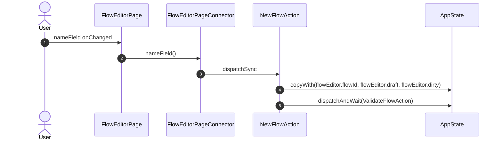

## onDeploy

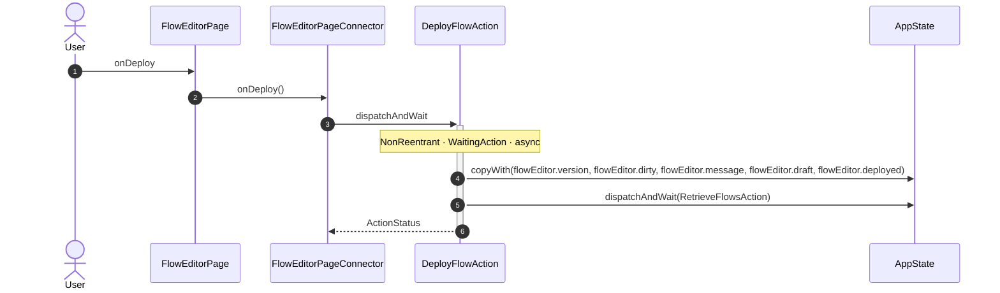

## onValidate

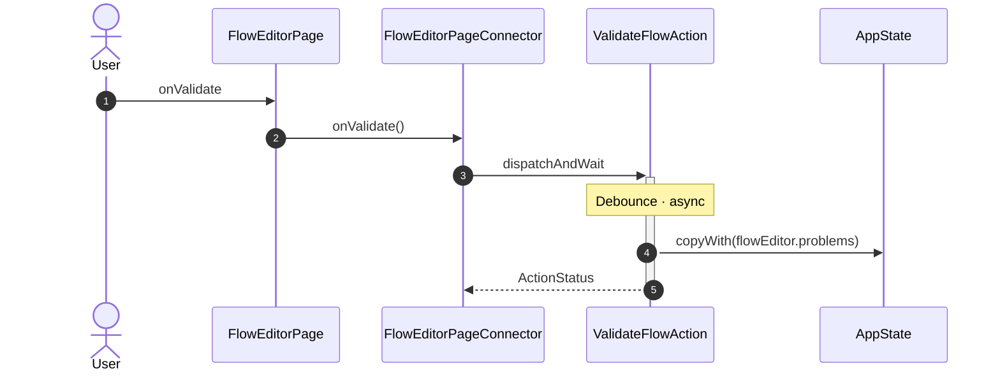

## onClose

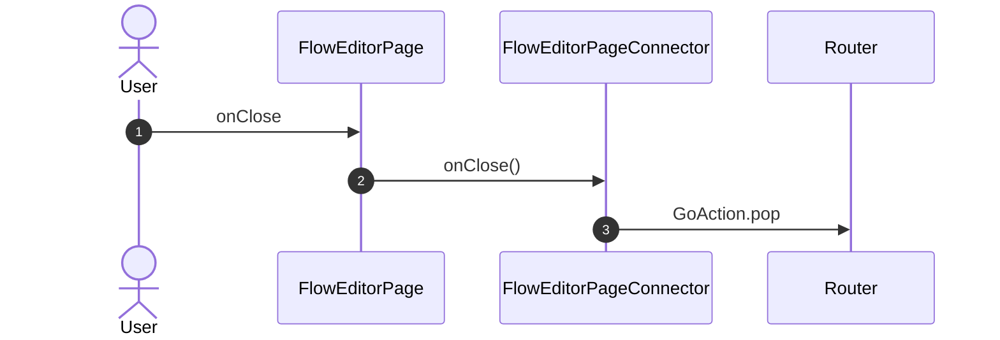

## onPaletteTab

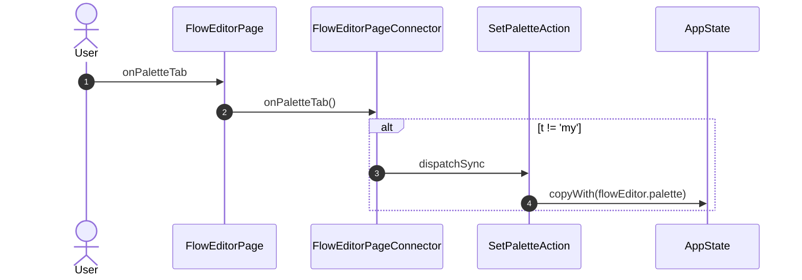

## onPick

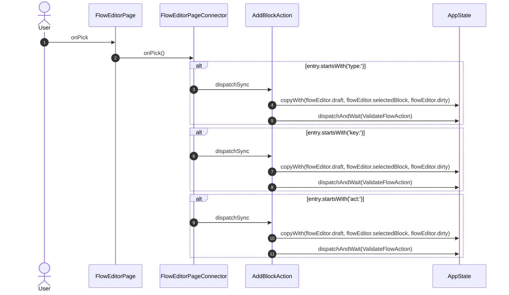

## onDrop

## onClear

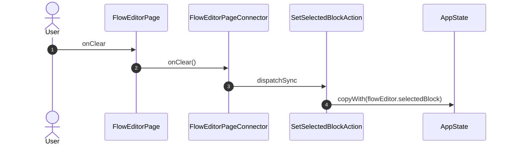

## onMove

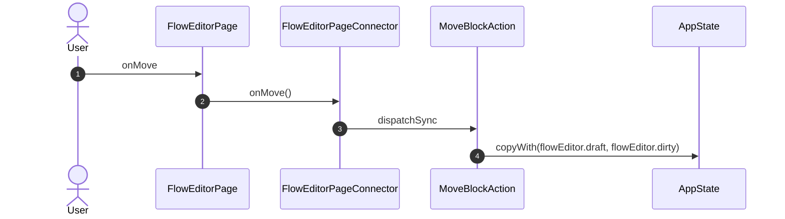

## onSelect

## onBind

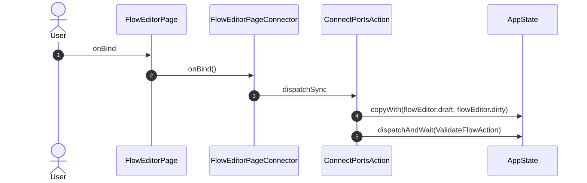

## onUnbind

## onDropEntry

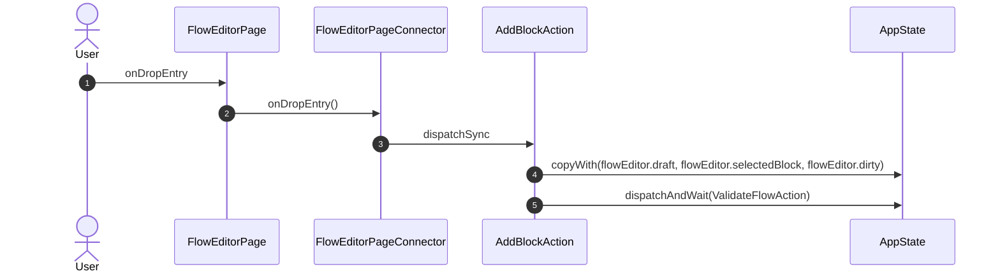

## onResize

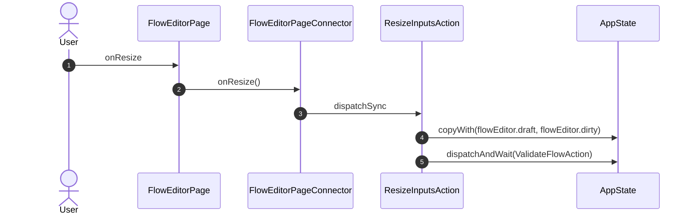

## onFieldChanged

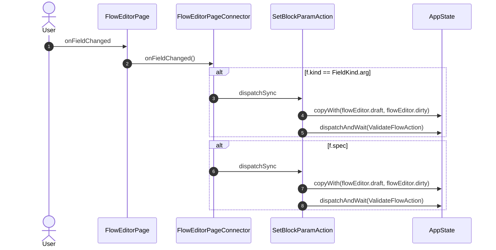

## onFieldUnbind

## onFieldBind

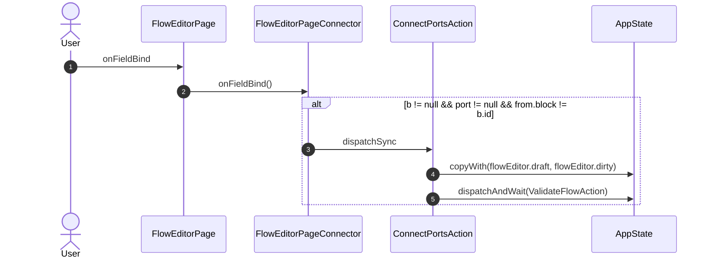

## onProblem

## onRemove

## onLogo

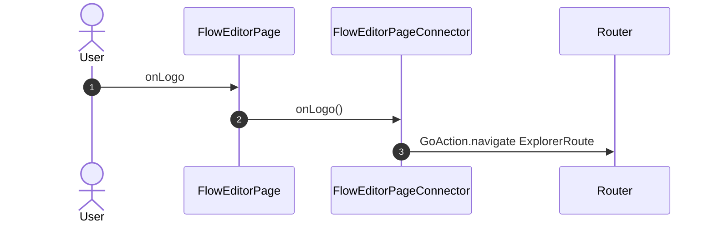

_Not drawn — these files dispatch outside any interaction:_

- `FlowEditorPageConnector` — 8 dispatches

| Interaction | Dispatches | Writes |
| --- | --- | --- |
| `nameField.onChanged` | `NewFlowAction` | `flowEditor.flowId, flowEditor.draft, flowEditor.dirty` |
| `onDeploy` | `DeployFlowAction` | `flowEditor.version, flowEditor.dirty, flowEditor.message, flowEditor.draft, flowEditor.deployed` |
| `onValidate` | `ValidateFlowAction` | `flowEditor.problems` |
| `onClose` | `GoAction.pop` | — |
| `onPaletteTab` | `SetPaletteAction` ? | `flowEditor.palette` |
| `onPick` | `AddBlockAction` ?, `AddBlockAction` ?, `AddBlockAction` ? | `flowEditor.draft, flowEditor.selectedBlock, flowEditor.dirty` |
| `onDrop` | `AddBlockAction` ?, `AddBlockAction` ?, `AddBlockAction` ? | `flowEditor.draft, flowEditor.selectedBlock, flowEditor.dirty` |
| `onClear` | `SetSelectedBlockAction` | `flowEditor.selectedBlock` |
| `onMove` | `MoveBlockAction` | `flowEditor.draft, flowEditor.dirty` |
| `onSelect` | `SetSelectedBlockAction` | `flowEditor.selectedBlock` |
| `onBind` | `ConnectPortsAction` | `flowEditor.draft, flowEditor.dirty` |
| `onUnbind` | `DisconnectEdgeAction` | `flowEditor.draft, flowEditor.dirty` |
| `onDropEntry` | `AddBlockAction` | `flowEditor.draft, flowEditor.selectedBlock, flowEditor.dirty` |
| `onResize` | `ResizeInputsAction` | `flowEditor.draft, flowEditor.dirty` |
| `onFieldChanged` | `SetBlockParamAction` ?, `SetBlockParamAction` ? | `flowEditor.draft, flowEditor.dirty` |
| `onFieldUnbind` | `DisconnectEdgeAction` | `flowEditor.draft, flowEditor.dirty` |
| `onFieldBind` | `ConnectPortsAction` ? | `flowEditor.draft, flowEditor.dirty` |
| `onProblem` | `SetSelectedBlockAction` | `flowEditor.selectedBlock` |
| `onRemove` | `RemoveBlockAction` | `flowEditor.draft, flowEditor.selectedBlock, flowEditor.dirty` |
| `onLogo` | `GoAction.navigate` | — |

`?` marks a dispatch that only runs under a condition.

[← all flows](README.md)
