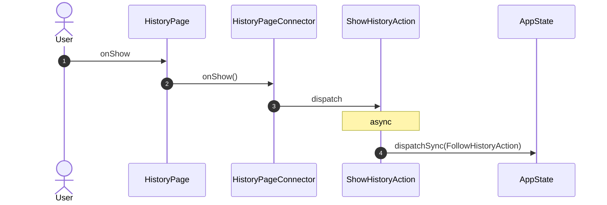
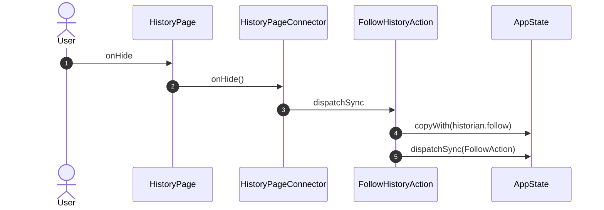
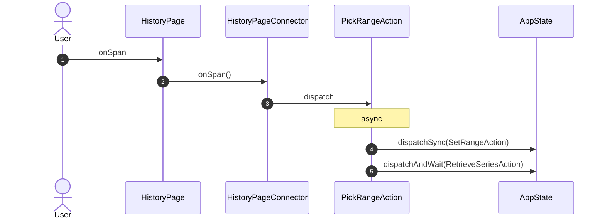
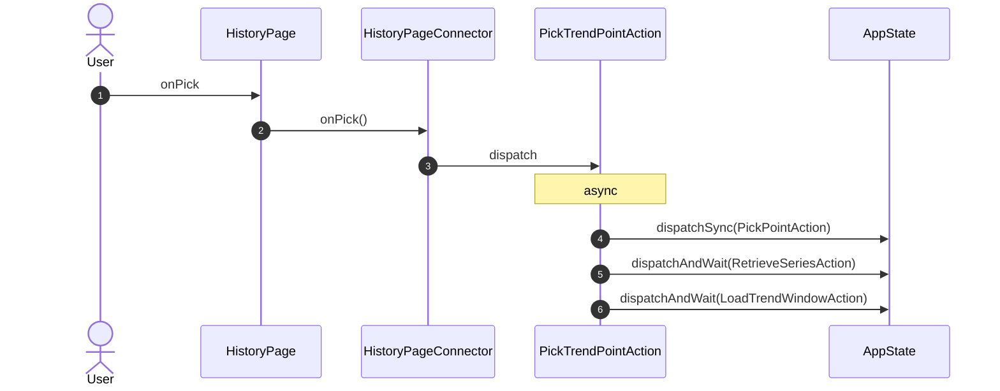
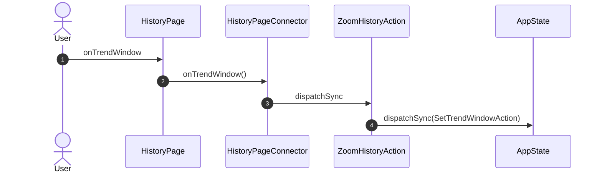
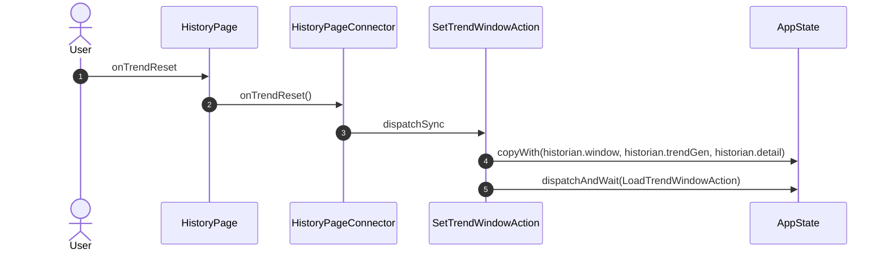
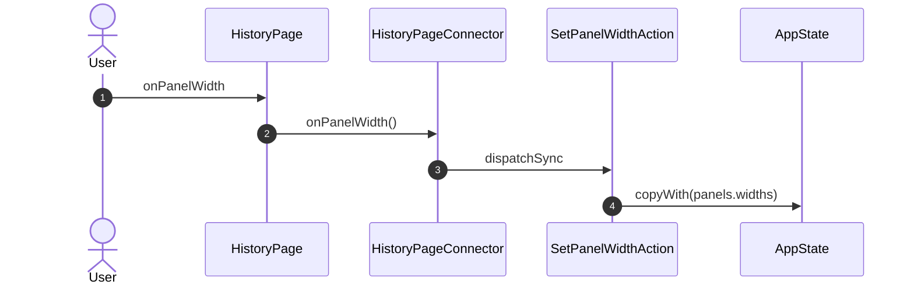

<!-- generated by `frx flow --md` — do not edit, re-run it -->

# HistoryPage

`app/lib/connectors/history_page_connector.dart`

## screen.onToggle

## onShow

## onHide

## onGroup

## onSpan

## onPick

## onTrendWindow

## onTrendToggle

## onTrendReset

## onPanelWidth

| Interaction | Dispatches | Writes |
| --- | --- | --- |
| `screen.onToggle` | `PickTrendPointAction` | — |
| `onShow` | `ShowHistoryAction` | — |
| `onHide` | `FollowHistoryAction` | `historian.follow` |
| `onGroup` | `SetSelectedAction` | `historian.selected, historian.points, historian.series` |
| `onSpan` | `PickRangeAction` | — |
| `onPick` | `PickTrendPointAction` | — |
| `onTrendWindow` | `ZoomHistoryAction` | — |
| `onTrendToggle` | `ToggleTrendSeriesAction` | `historian.hidden` |
| `onTrendReset` | `SetTrendWindowAction` | `historian.window, historian.trendGen, historian.detail` |
| `onPanelWidth` | `SetPanelWidthAction` | `panels.widths` |

`?` marks a dispatch that only runs under a condition.

[← all flows](README.md)
