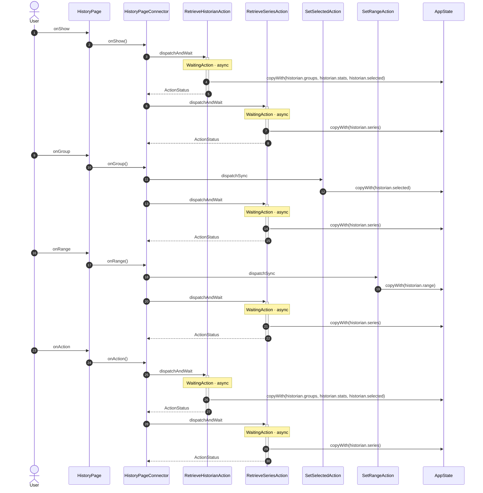

<!-- generated by `frx flow --md` — do not edit, re-run it -->

# HistoryPage

`app/lib/connectors/history_page_connector.dart`

| Interaction | Dispatches | Writes |
| --- | --- | --- |
| `onShow` | `RetrieveHistorianAction`, `RetrieveSeriesAction` | `historian.groups, historian.stats, historian.selected`, `historian.series` |
| `onGroup` | `SetSelectedAction`, `RetrieveSeriesAction` | `historian.selected`, `historian.series` |
| `onRange` | `SetRangeAction`, `RetrieveSeriesAction` | `historian.range`, `historian.series` |
| `onAction` | `RetrieveHistorianAction`, `RetrieveSeriesAction` | `historian.groups, historian.stats, historian.selected`, `historian.series` |

`?` marks a dispatch that only runs under a condition.

[← all flows](README.md)
