<!-- generated by `frx flow --md` — do not edit, re-run it -->

# LinkInstallPage

`app/lib/connectors/link_install_page_connector.dart`

## onClose

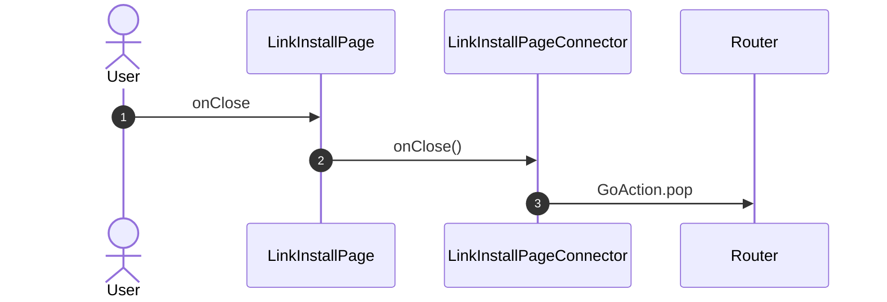

## onFrom

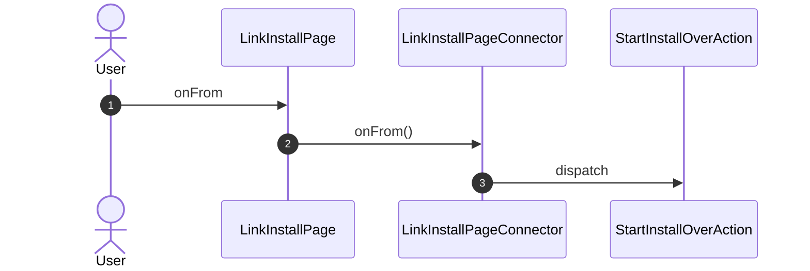

## onCategory

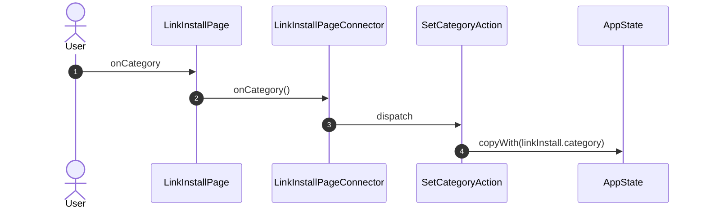

## onQuery

## onItem

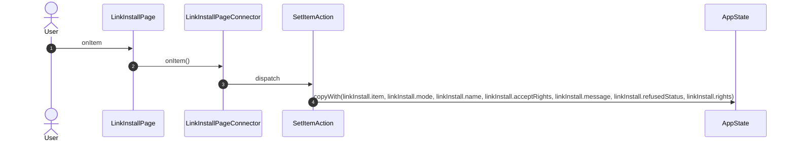

## onMethod

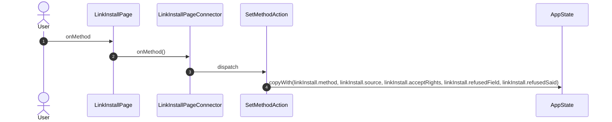

## onPickFile

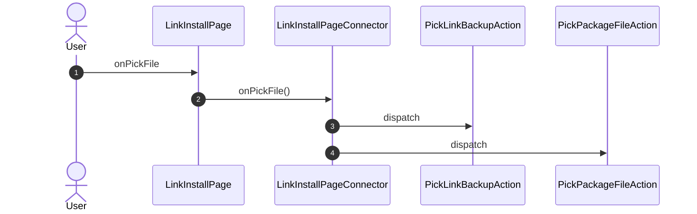

## onUrl

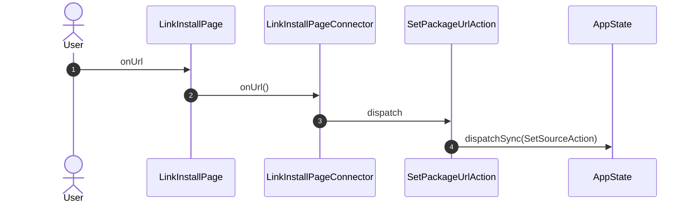

## onRef

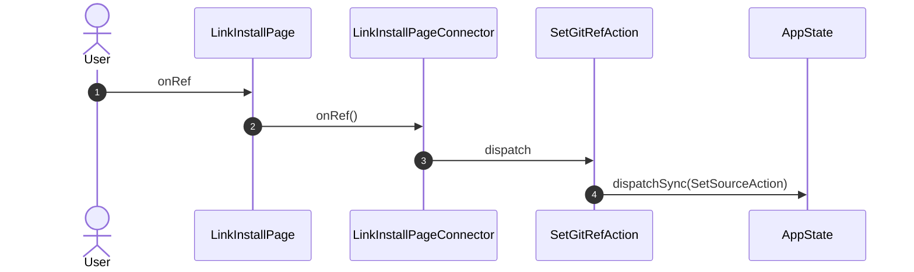

## onBroker

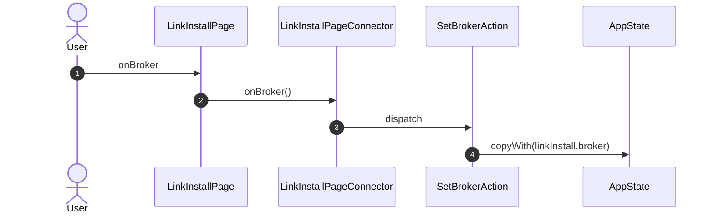

## onMode

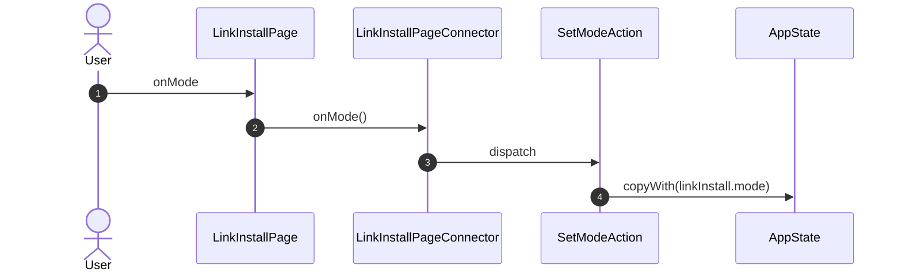

## onName

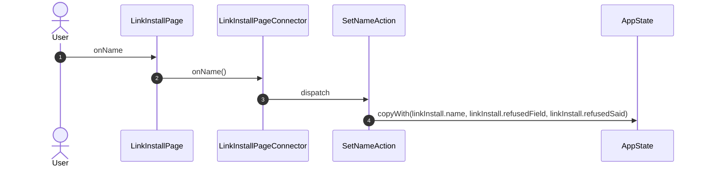

## onAccept

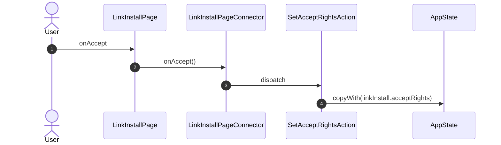

## onResult

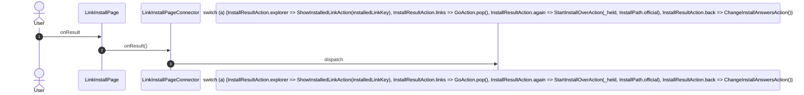

## onStep

## onBack

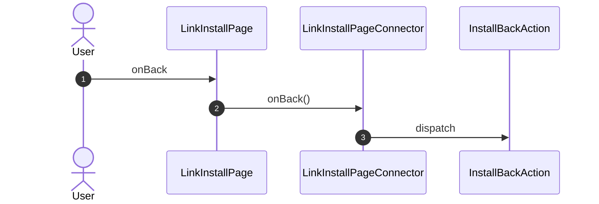

## onNext

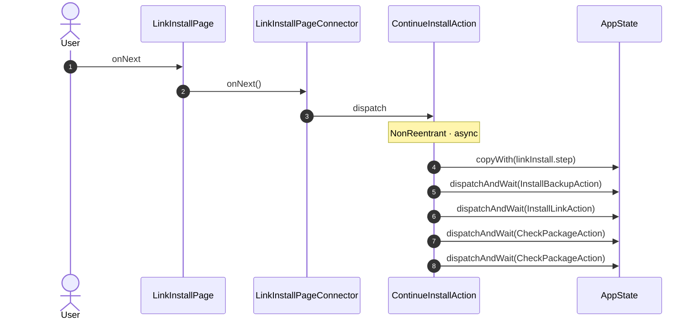

_Not drawn — these files dispatch outside any interaction:_

- `LinkInstallPageConnector` — 1 dispatch

| Interaction | Dispatches | Writes |
| --- | --- | --- |
| `onClose` | `GoAction.pop` | — |
| `onFrom` | `StartInstallOverAction` | — |
| `onCategory` | `SetCategoryAction` | `linkInstall.category` |
| `onQuery` | `SetQueryAction` | `linkInstall.query` |
| `onItem` | `SetItemAction` | `linkInstall.item, linkInstall.mode, linkInstall.name, linkInstall.acceptRights, linkInstall.message, linkInstall.refusedStatus, linkInstall.rights` |
| `onMethod` | `SetMethodAction` | `linkInstall.method, linkInstall.source, linkInstall.acceptRights, linkInstall.refusedField, linkInstall.refusedSaid` |
| `onPickFile` | `PickLinkBackupAction`, `PickPackageFileAction` | — |
| `onUrl` | `SetPackageUrlAction` | — |
| `onRef` | `SetGitRefAction` | — |
| `onBroker` | `SetBrokerAction` | `linkInstall.broker` |
| `onMode` | `SetModeAction` | `linkInstall.mode` |
| `onName` | `SetNameAction` | `linkInstall.name, linkInstall.refusedField, linkInstall.refusedSaid` |
| `onAccept` | `SetAcceptRightsAction` | `linkInstall.acceptRights` |
| `onResult` | `switch (a) {InstallResultAction.explorer => ShowInstalledLinkAction(installedLinkKey), InstallResultAction.links => GoAction.pop(), InstallResultAction.again => StartInstallOverAction(_held, InstallPath.official), InstallResultAction.back => ChangeInstallAnswersAction()}` | — |
| `onStep` | `InstallBackAction` | — |
| `onBack` | `InstallBackAction` | — |
| `onNext` | `ContinueInstallAction` | `linkInstall.step` |

`?` marks a dispatch that only runs under a condition.

[← all flows](README.md)
