<!-- generated by `frx flow --md` — do not edit, re-run it -->

# LinkInstallPage

`app/lib/connectors/link_install_page_connector.dart`

## catalog.onChanged

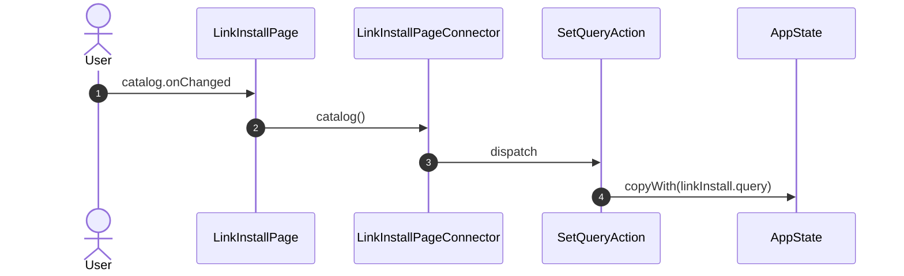

## bring.onChanged

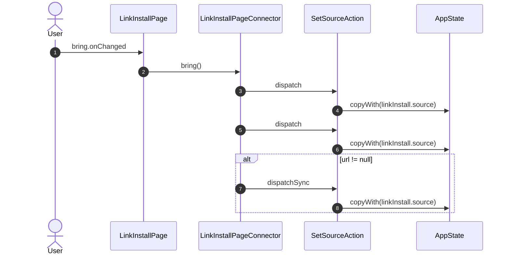

## target.onChanged

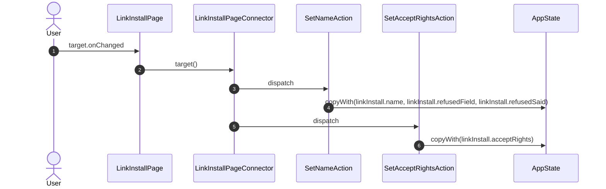

## onClose

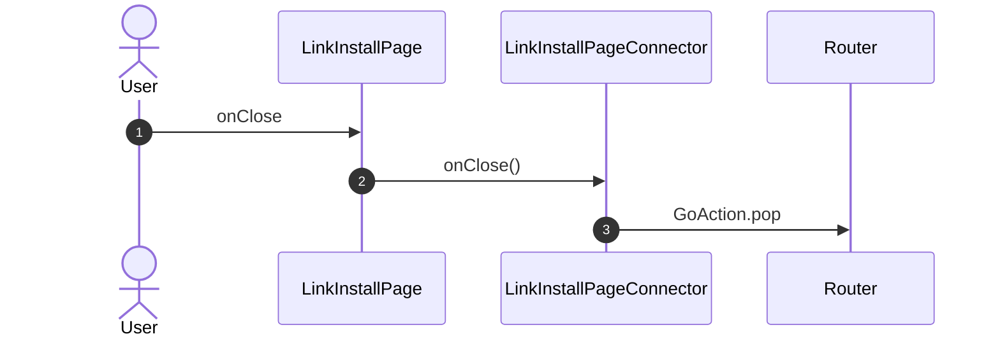

## onSource

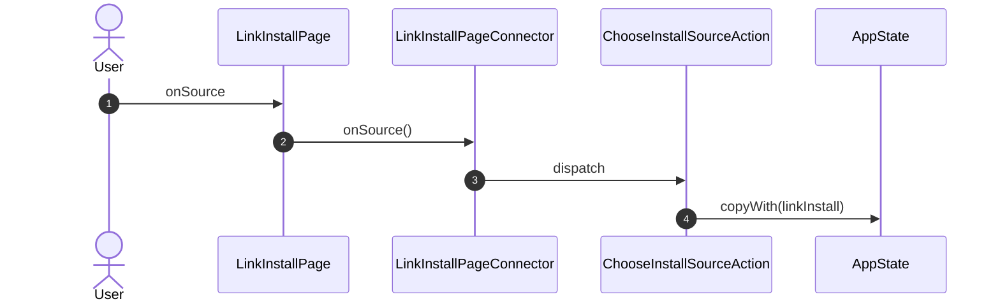

## onCategory

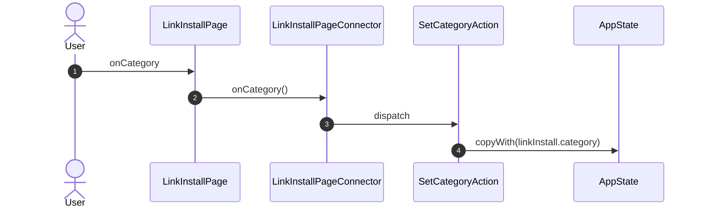

## onItem

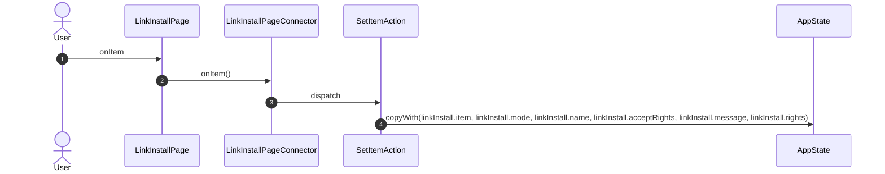

## onMethod

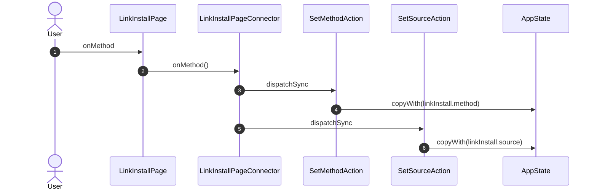

## onPickFile

## onBroker

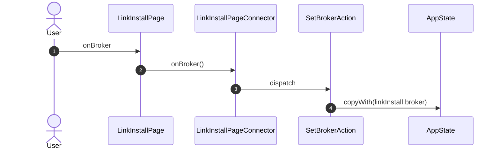

## onMode

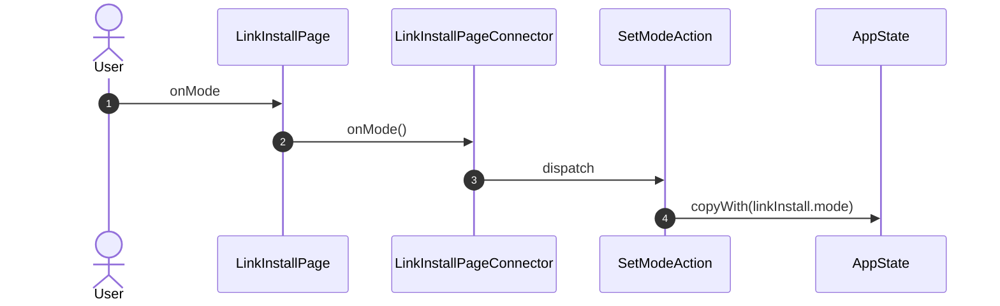

## onStep

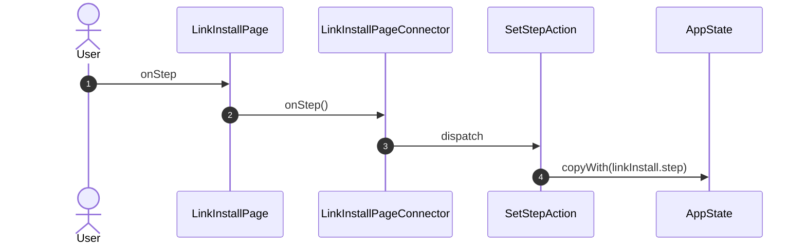

## onBack

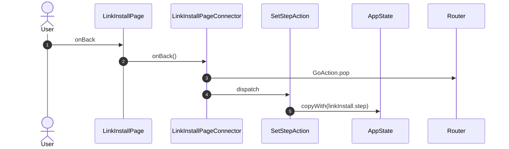

## onNext

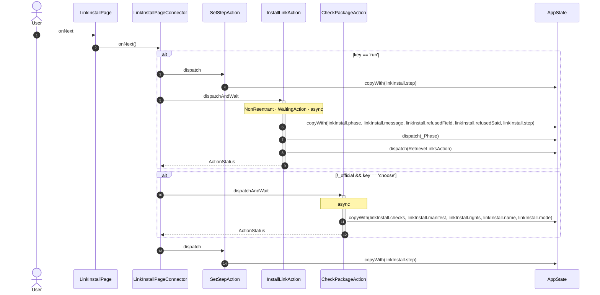

## onResultAction

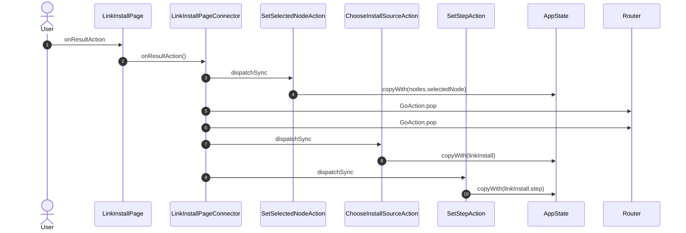

_Not drawn — these files dispatch outside any interaction:_

- `LinkInstallPageConnector` — 2 dispatches

| Interaction | Dispatches | Writes |
| --- | --- | --- |
| `catalog.onChanged` | `SetQueryAction` | `linkInstall.query` |
| `bring.onChanged` | `SetSourceAction`, `SetSourceAction`, `SetSourceAction` ? | `linkInstall.source` |
| `target.onChanged` | `SetNameAction`, `SetAcceptRightsAction` | `linkInstall.name, linkInstall.refusedField, linkInstall.refusedSaid`, `linkInstall.acceptRights` |
| `onClose` | `GoAction.pop` | — |
| `onSource` | `ChooseInstallSourceAction` | `linkInstall` |
| `onCategory` | `SetCategoryAction` | `linkInstall.category` |
| `onItem` | `SetItemAction` | `linkInstall.item, linkInstall.mode, linkInstall.name, linkInstall.acceptRights, linkInstall.message, linkInstall.rights` |
| `onMethod` | `SetMethodAction`, `SetSourceAction` | `linkInstall.method`, `linkInstall.source` |
| `onPickFile` | `SetSourceAction` | `linkInstall.source` |
| `onBroker` | `SetBrokerAction` | `linkInstall.broker` |
| `onMode` | `SetModeAction` | `linkInstall.mode` |
| `onStep` | `SetStepAction` | `linkInstall.step` |
| `onBack` | `GoAction.pop`, `SetStepAction` | `linkInstall.step` |
| `onNext` | `SetStepAction` ?, `InstallLinkAction` ?, `CheckPackageAction` ?, `SetStepAction` | `linkInstall.step`, `linkInstall.phase, linkInstall.message, linkInstall.refusedField, linkInstall.refusedSaid, linkInstall.step`, `linkInstall.checks, linkInstall.manifest, linkInstall.rights, linkInstall.name, linkInstall.mode` |
| `onResultAction` | `SetSelectedNodeAction`, `GoAction.pop`, `GoAction.pop`, `ChooseInstallSourceAction`, `SetStepAction` | `nodes.selectedNode`, `linkInstall`, `linkInstall.step` |

`?` marks a dispatch that only runs under a condition.

[← all flows](README.md)
