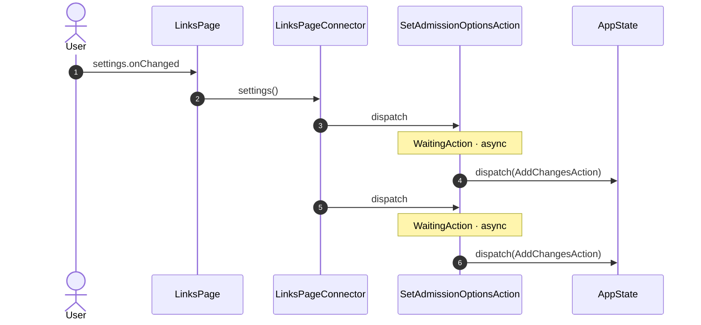
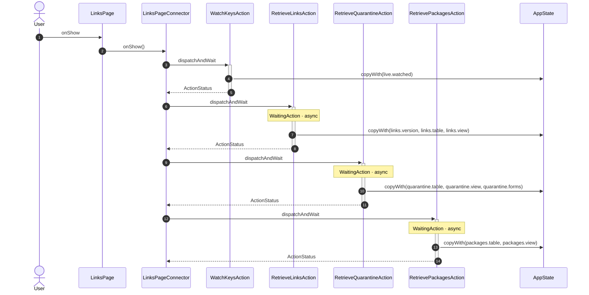
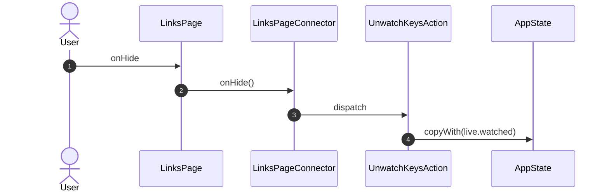
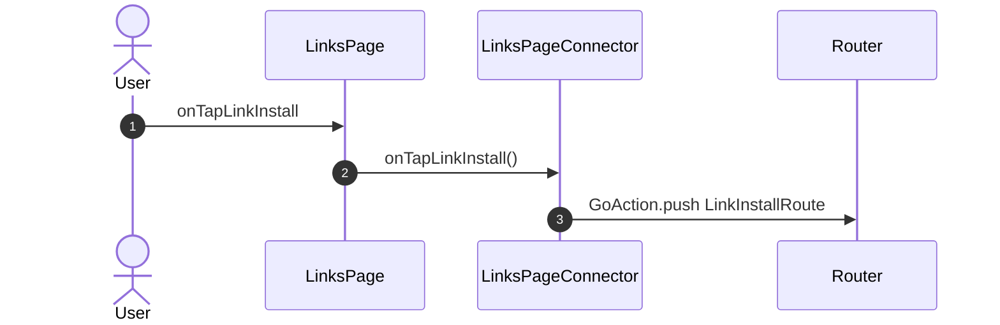
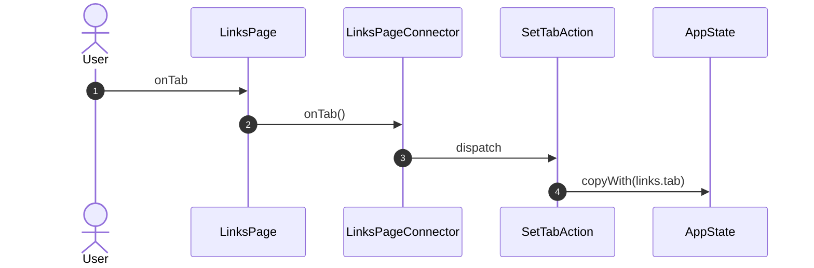
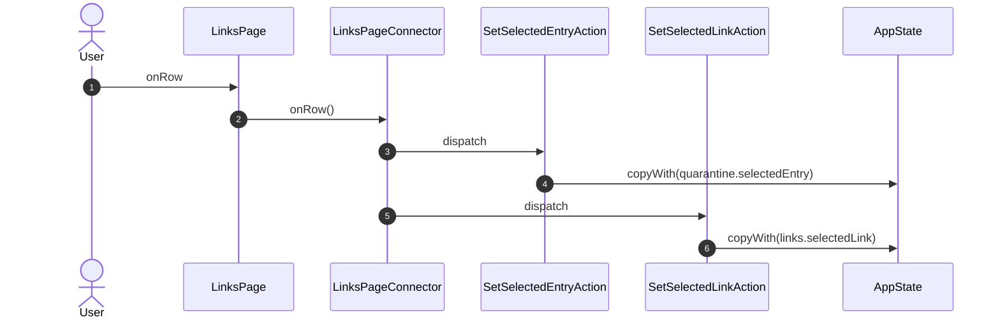
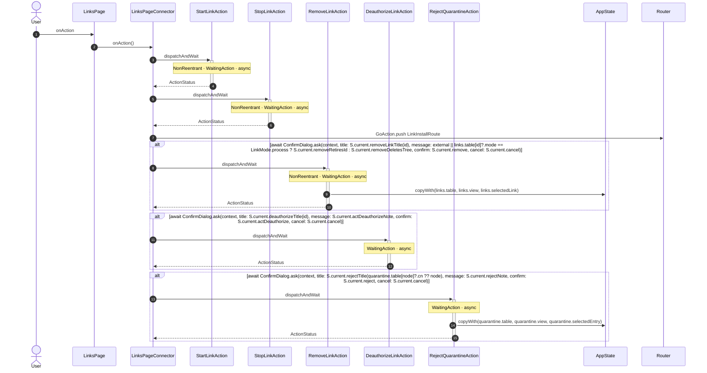
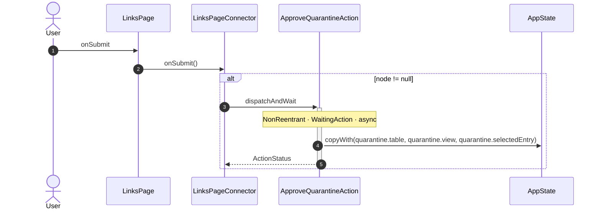

<!-- generated by `frx flow --md` — do not edit, re-run it -->

# LinksPage

`app/lib/connectors/links_page_connector.dart`

## settings.onChanged

## onShow

## onHide

## onTapLinkInstall

## onTab

## onRow

## onAction

## onSubmit

| Interaction | Dispatches | Writes |
| --- | --- | --- |
| `settings.onChanged` | `SetAdmissionOptionsAction`, `SetAdmissionOptionsAction` | — |
| `onShow` | `WatchKeysAction`, `RetrieveLinksAction`, `RetrieveQuarantineAction`, `RetrievePackagesAction` | `live.watched`, `links.version, links.table, links.view`, `quarantine.table, quarantine.view, quarantine.forms`, `packages.table, packages.view` |
| `onHide` | `UnwatchKeysAction` | `live.watched` |
| `onTapLinkInstall` | `GoAction.push` | — |
| `onTab` | `SetTabAction` | `links.tab` |
| `onRow` | `SetSelectedEntryAction`, `SetSelectedLinkAction` | `quarantine.selectedEntry`, `links.selectedLink` |
| `onAction` | `StartLinkAction`, `StopLinkAction`, `GoAction.push`, `RemoveLinkAction` ?, `DeauthorizeLinkAction` ?, `RejectQuarantineAction` ? | `links.table, links.view, links.selectedLink`, `quarantine.table, quarantine.view, quarantine.selectedEntry` |
| `onSubmit` | `ApproveQuarantineAction` ? | `quarantine.table, quarantine.view, quarantine.selectedEntry` |

`?` marks a dispatch that only runs under a condition.

[← all flows](README.md)
