<!-- generated by `frx flow --md` — do not edit, re-run it -->

# LinksPage

`app/lib/connectors/links_page_connector.dart`

## approve.onSubmit

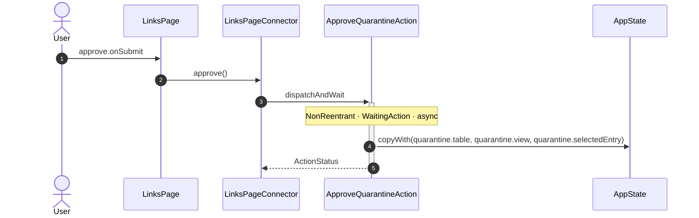

## onShow

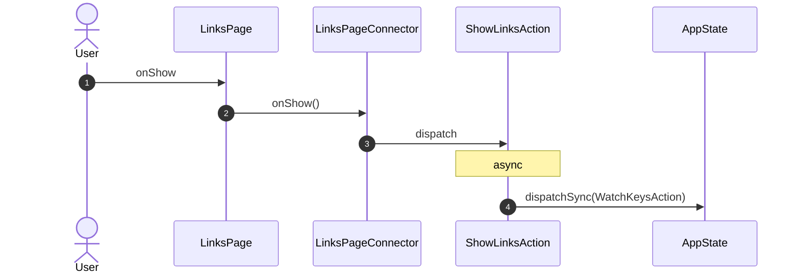

## onHide

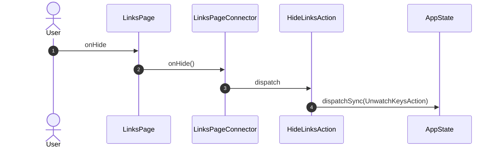

## onAdd

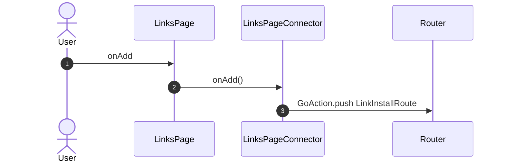

## onTab

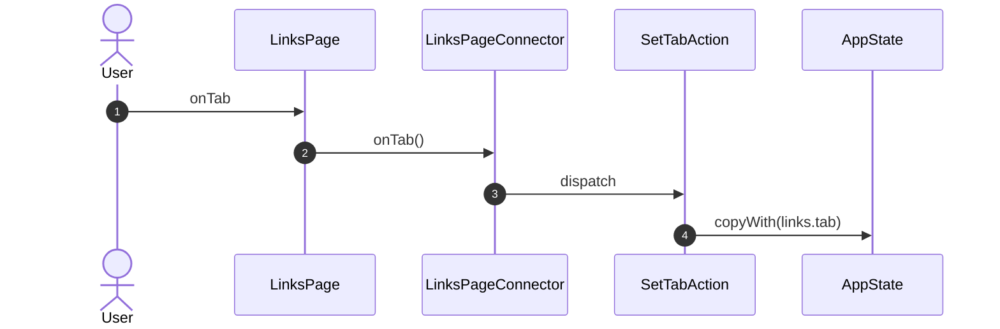

## onRow

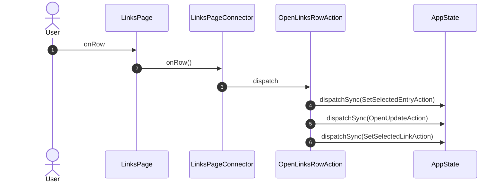

## onAct

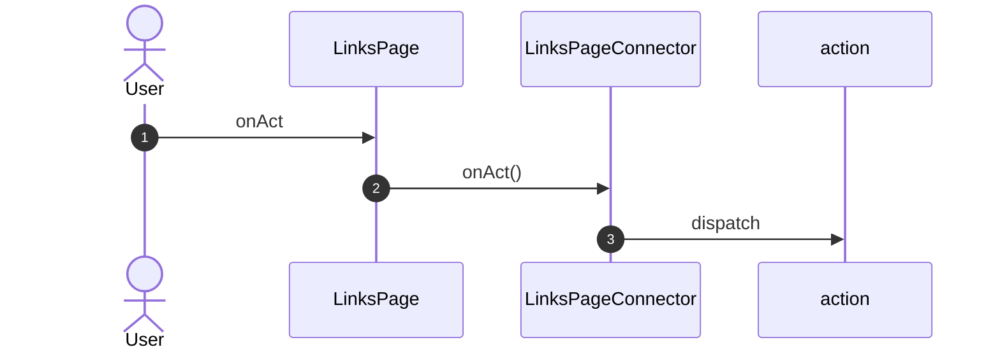

## onRemove

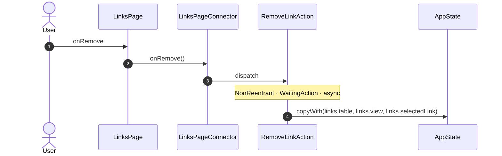

## onDeauthorize

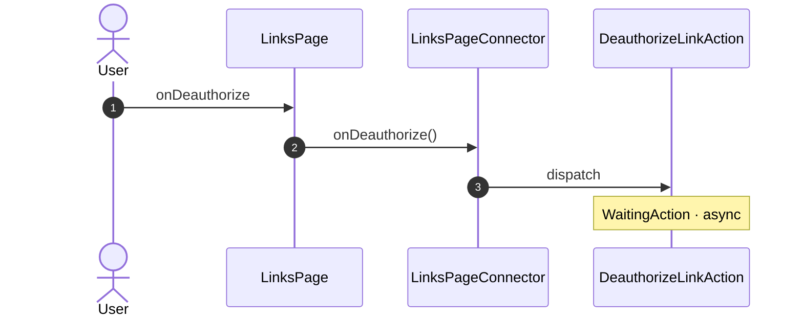

## onReject

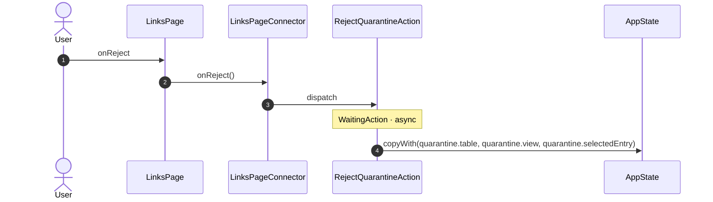

## onHoldUnknown

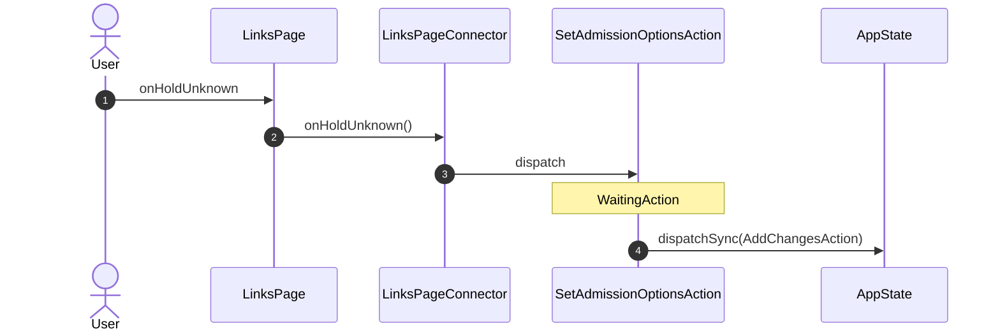

## onAllowAll

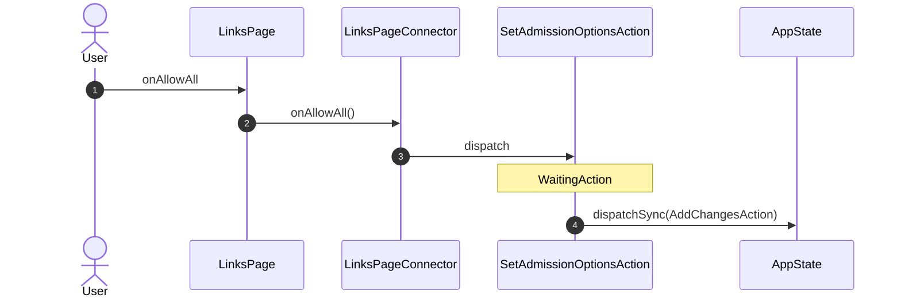

## onUpdateAll

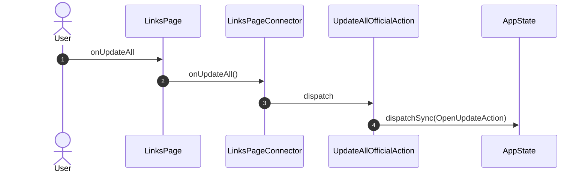

## onTakePoint

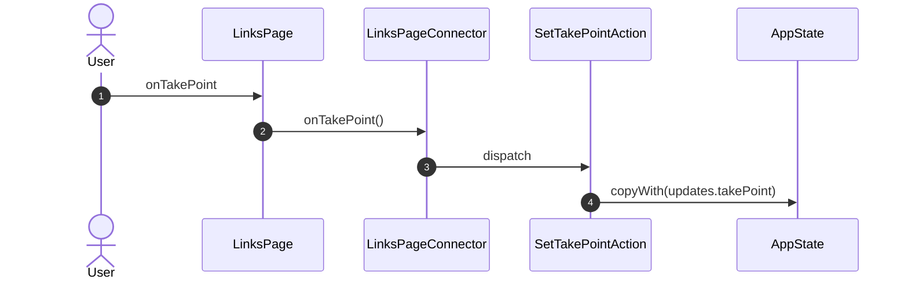

## onAutoRollback

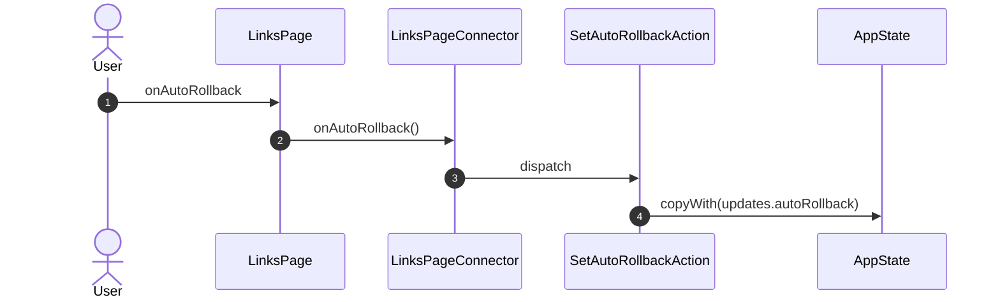

## onAcceptNew


## onUpdate

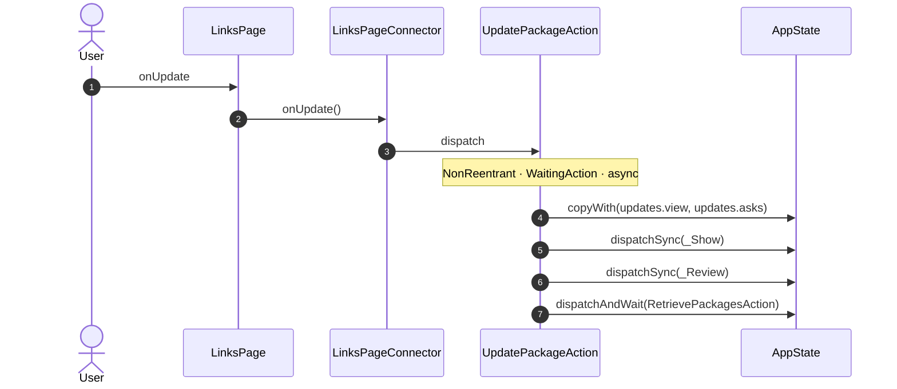

## onUpdateFromFile

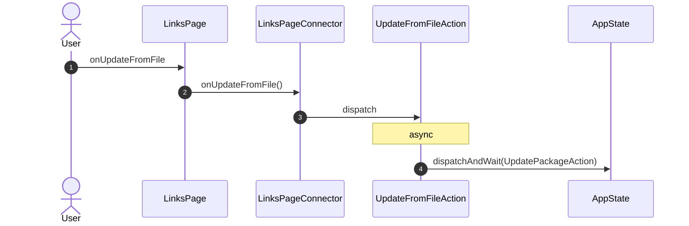

## onRollBack

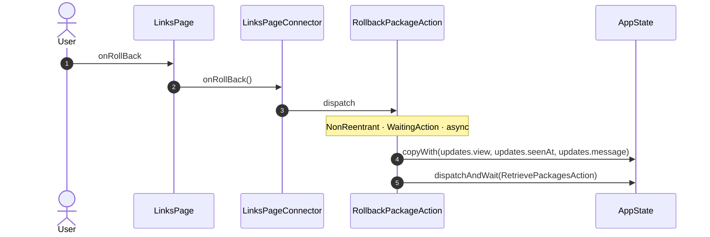

## onShowLink

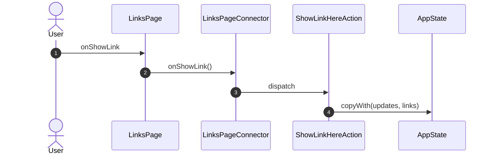

## onCloseSheet

```mermaid
sequenceDiagram
    autonumber
    actor User
    participant UI as LinksPage
    participant VM as LinksPageConnector
    participant A1 as CloseUpdateAction
    participant ST as AppState

    User->>UI: onCloseSheet
    UI->>VM: onCloseSheet()
    VM->>A1: dispatch
    A1->>ST: copyWith(updates)
```

| Interaction | Dispatches | Writes |
| --- | --- | --- |
| `approve.onSubmit` | `ApproveQuarantineAction` | `quarantine.table, quarantine.view, quarantine.selectedEntry` |
| `onShow` | `ShowLinksAction` | — |
| `onHide` | `HideLinksAction` | — |
| `onAdd` | `GoAction.push` | — |
| `onTab` | `SetTabAction` | `links.tab` |
| `onRow` | `OpenLinksRowAction` | — |
| `onAct` | `action` | — |
| `onRemove` | `RemoveLinkAction` | `links.table, links.view, links.selectedLink` |
| `onDeauthorize` | `DeauthorizeLinkAction` | — |
| `onReject` | `RejectQuarantineAction` | `quarantine.table, quarantine.view, quarantine.selectedEntry` |
| `onHoldUnknown` | `SetAdmissionOptionsAction` | — |
| `onAllowAll` | `SetAdmissionOptionsAction` | — |
| `onUpdateAll` | `UpdateAllOfficialAction` | — |
| `onTakePoint` | `SetTakePointAction` | `updates.takePoint` |
| `onAutoRollback` | `SetAutoRollbackAction` | `updates.autoRollback` |
| `onAcceptNew` | `SetAcceptNewAction` | `updates.acceptNew` |
| `onUpdate` | `UpdatePackageAction` | `updates.view, updates.asks` |
| `onUpdateFromFile` | `UpdateFromFileAction` | — |
| `onRollBack` | `RollbackPackageAction` | `updates.view, updates.seenAt, updates.message` |
| `onShowLink` | `ShowLinkHereAction` | `updates, links` |
| `onCloseSheet` | `CloseUpdateAction` | `updates` |

`?` marks a dispatch that only runs under a condition.

[← all flows](README.md)
