<!-- generated by `frx flow --md` — do not edit, re-run it -->

# LogInPage

`app/lib/connectors/log_in_page_connector.dart`

## screen.onChanged

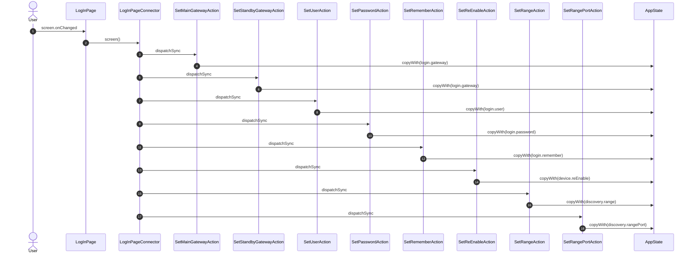

## onLogIn

## onGatewayLeave

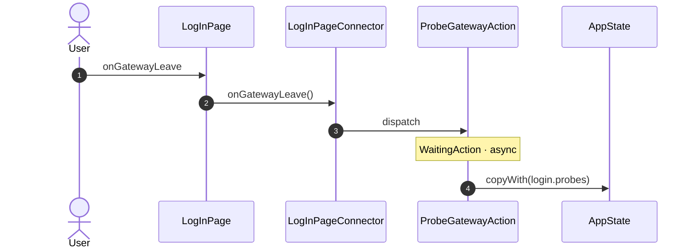

## onRecent

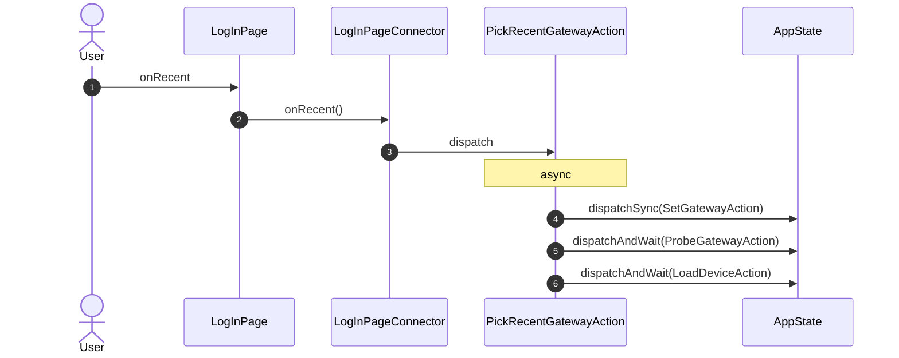

## onUseStandby

## onFind

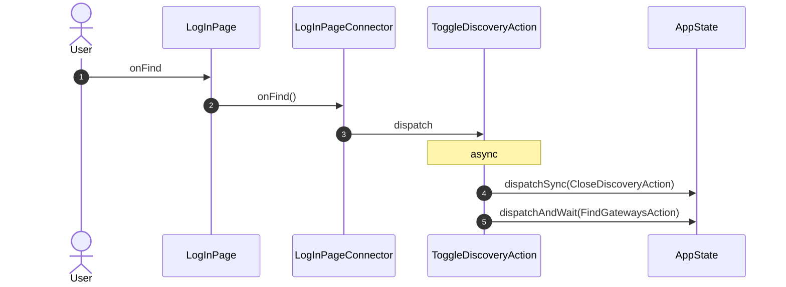

## onLookAgain

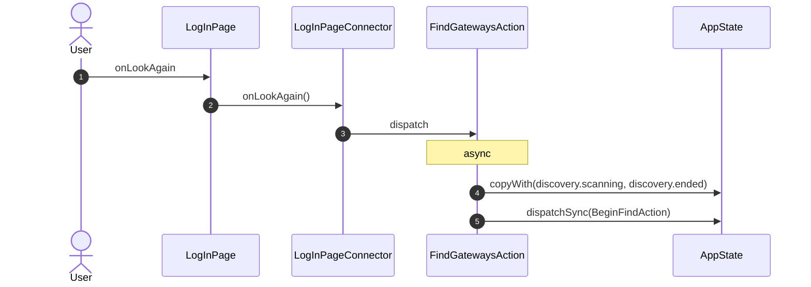

## onPick

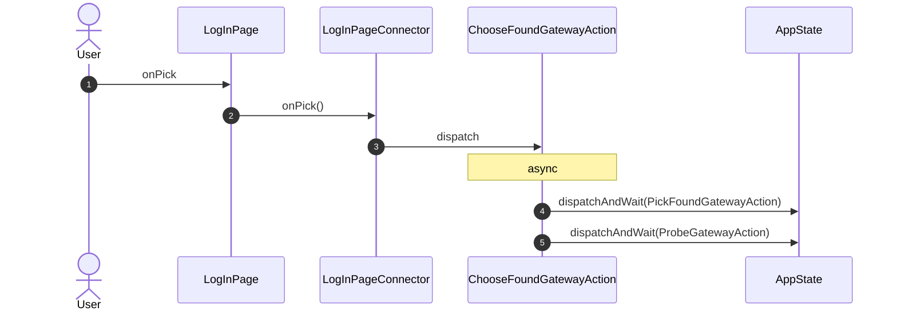

## onProbe

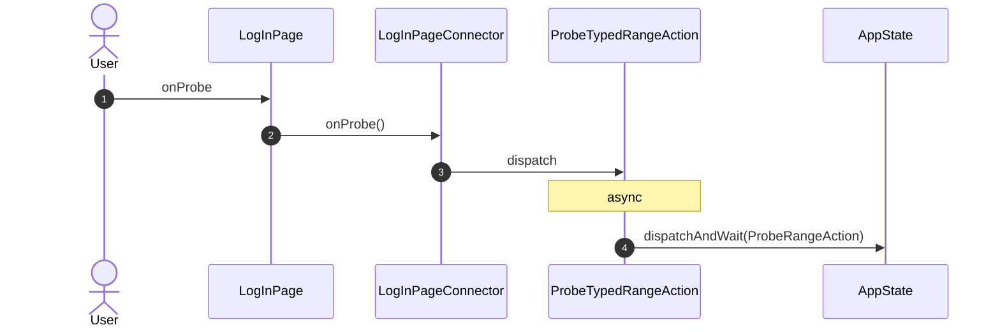

## onOpenSettings

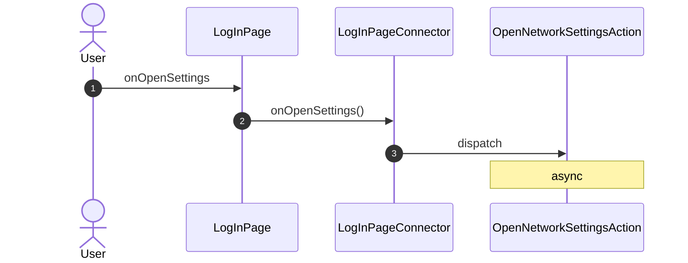

## onTrust

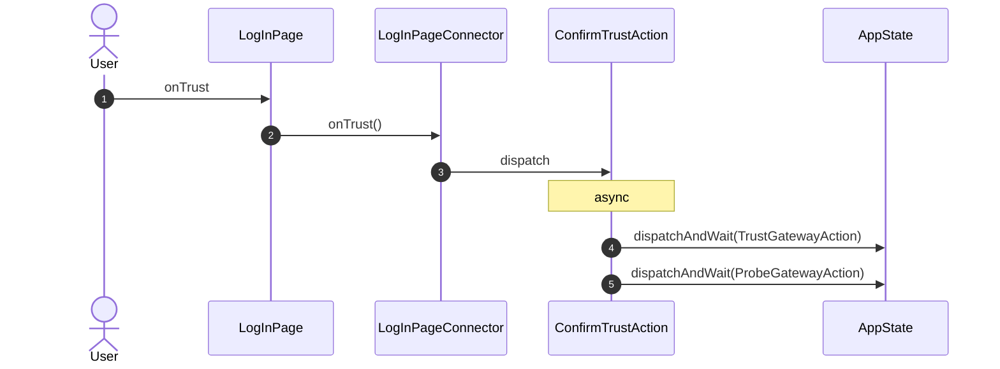

## onCancelTrust

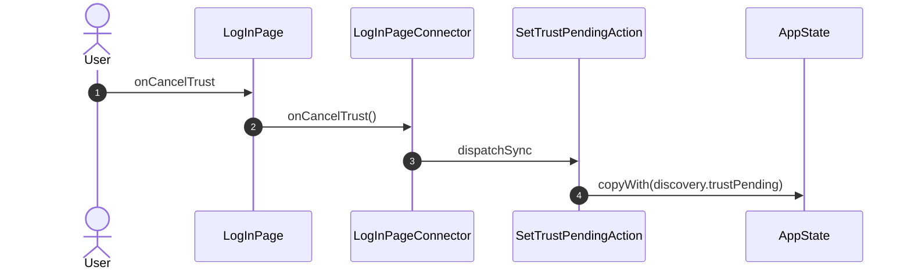

## onOfferUse

## onOfferNotNow

## onOfferDontAsk

## onUnlock

## onAutoUnlock

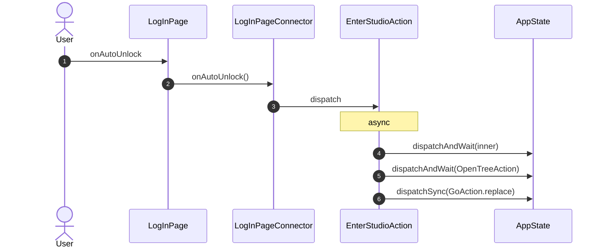

## onUsePassword

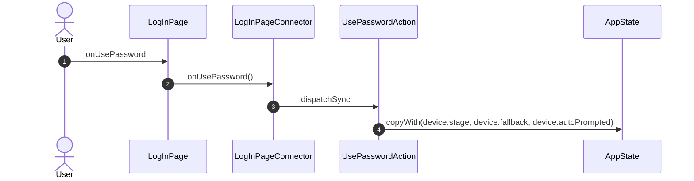

## onAnotherAccount

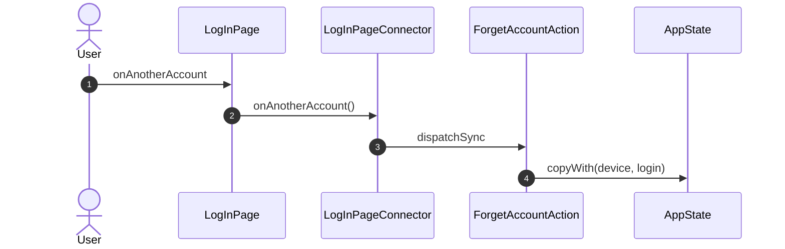

## onTick

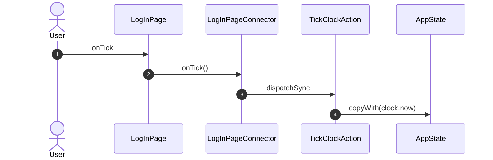

_Not drawn — these files dispatch outside any interaction:_

- `LogInPageConnector` — 1 dispatch

| Interaction | Dispatches | Writes |
| --- | --- | --- |
| `screen.onChanged` | `SetMainGatewayAction`, `SetStandbyGatewayAction`, `SetUserAction`, `SetPasswordAction`, `SetRememberAction`, `SetReEnableAction`, `SetRangeAction`, `SetRangePortAction` | `login.gateway`, `login.user`, `login.password`, `login.remember`, `device.reEnable`, `discovery.range`, `discovery.rangePort` |
| `onLogIn` | `EnterStudioAction` | — |
| `onGatewayLeave` | `ProbeGatewayAction` | `login.probes` |
| `onRecent` | `PickRecentGatewayAction` | — |
| `onUseStandby` | `EnterStudioAction` | — |
| `onFind` | `ToggleDiscoveryAction` | — |
| `onLookAgain` | `FindGatewaysAction` | `discovery.scanning, discovery.ended` |
| `onPick` | `ChooseFoundGatewayAction` | — |
| `onProbe` | `ProbeTypedRangeAction` | — |
| `onOpenSettings` | `OpenNetworkSettingsAction` | — |
| `onTrust` | `ConfirmTrustAction` | — |
| `onCancelTrust` | `SetTrustPendingAction` | `discovery.trustPending` |
| `onOfferUse` | `EnterStudioAction` | — |
| `onOfferNotNow` | `EnterStudioAction` | — |
| `onOfferDontAsk` | `EnterStudioAction` | — |
| `onUnlock` | `EnterStudioAction` | — |
| `onAutoUnlock` | `EnterStudioAction` | — |
| `onUsePassword` | `UsePasswordAction` | `device.stage, device.fallback, device.autoPrompted` |
| `onAnotherAccount` | `ForgetAccountAction` | `device, login` |
| `onTick` | `TickClockAction` | `clock.now` |

`?` marks a dispatch that only runs under a condition.

[← all flows](README.md)
