<!-- generated by `frx flow --md` — do not edit, re-run it -->

# LogInPage

`app/lib/connectors/log_in_page_connector.dart`

## gateway.onChanged

## standby.onChanged

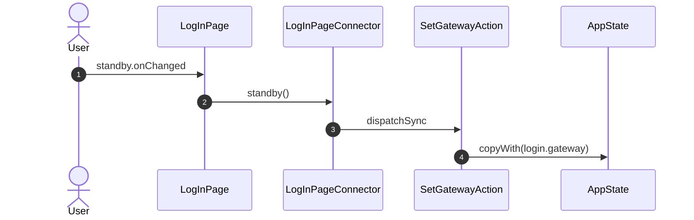

## user.onChanged

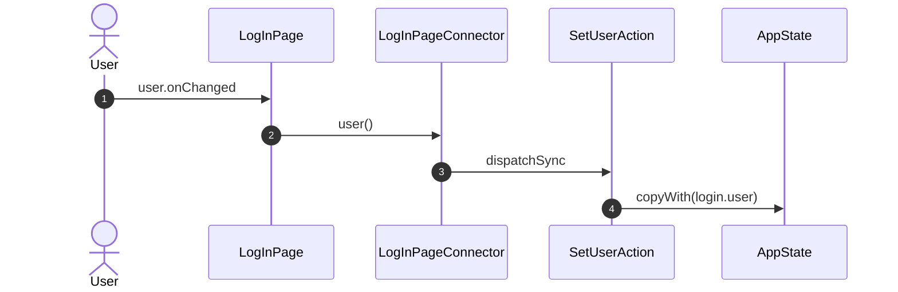

## password.onChanged

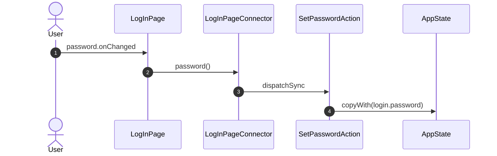

## onGatewayLeave

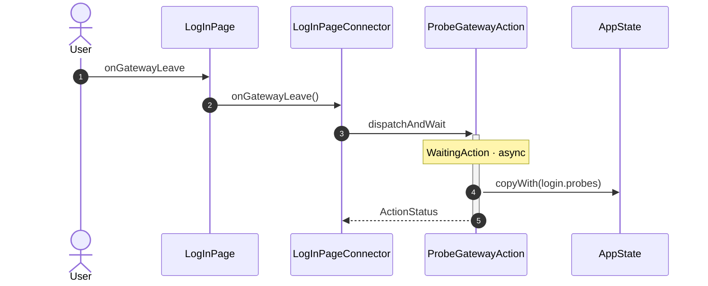

## onRecent

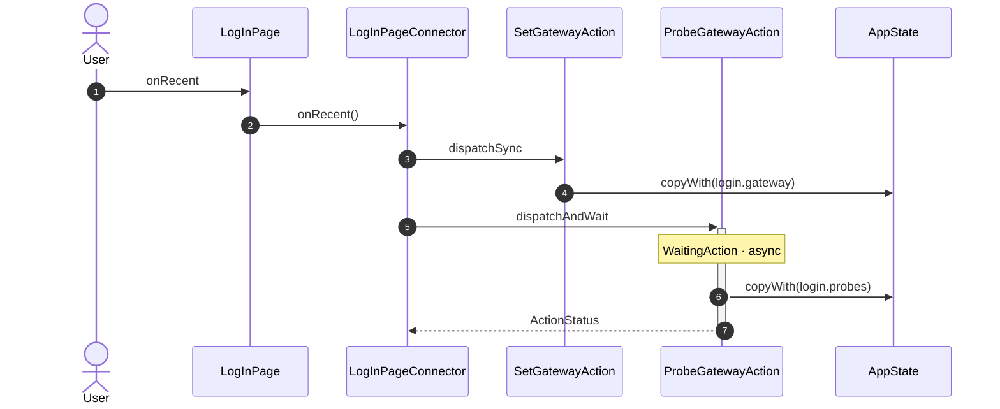

## remember.onChanged

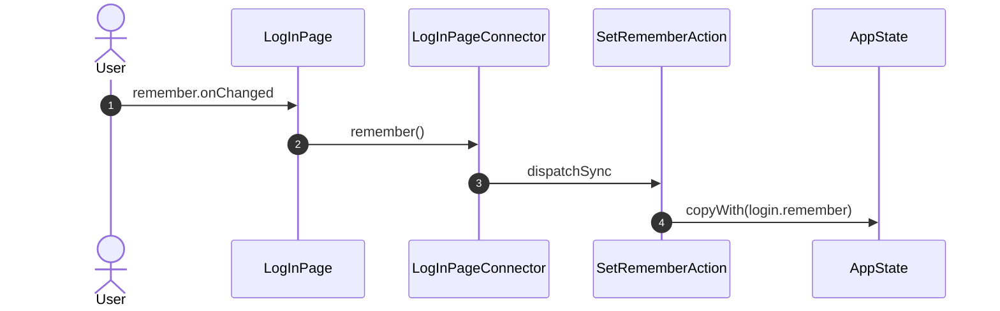

## onUseStandby

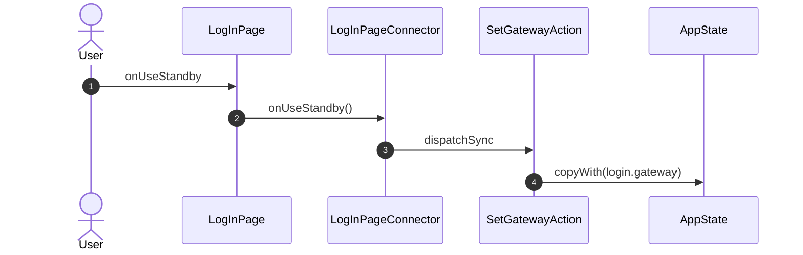

## onFind

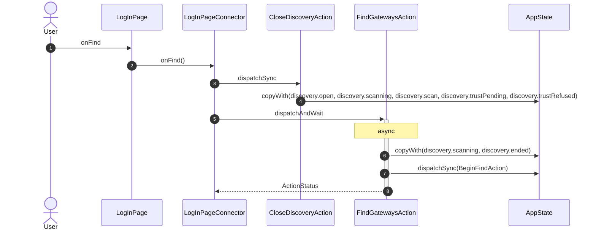

## discover.onChanged

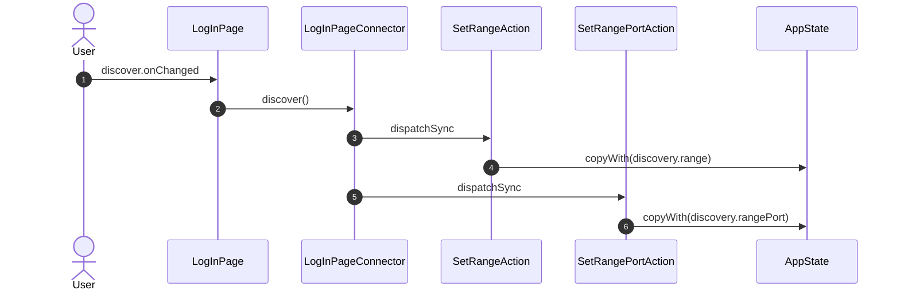

## onLookAgain

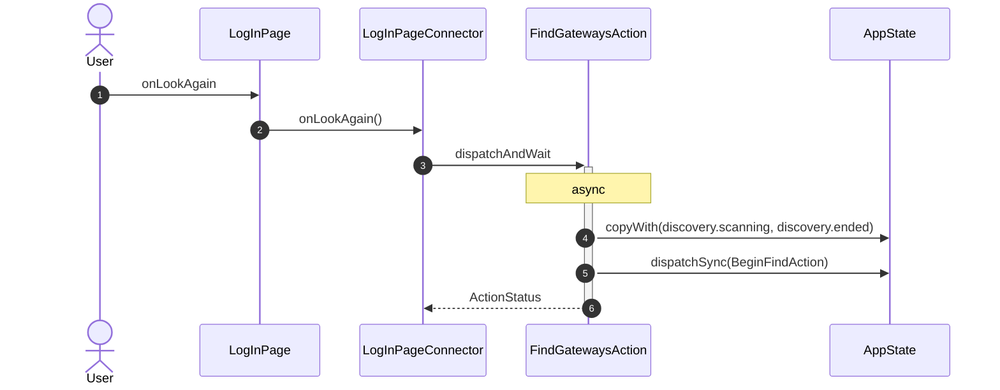

## onPick

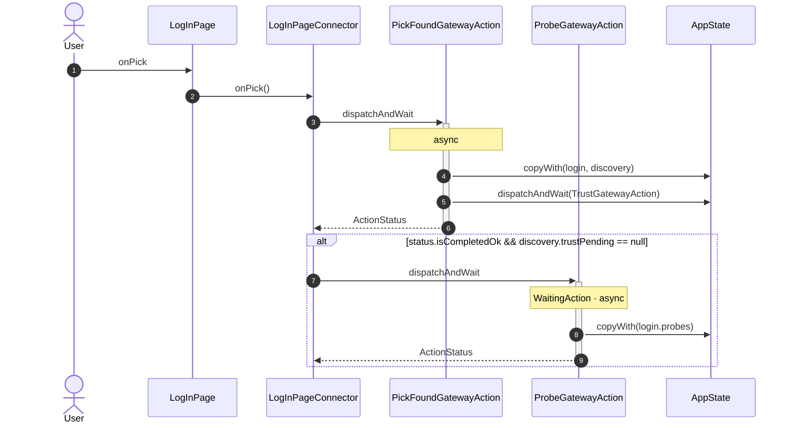

## onProbe

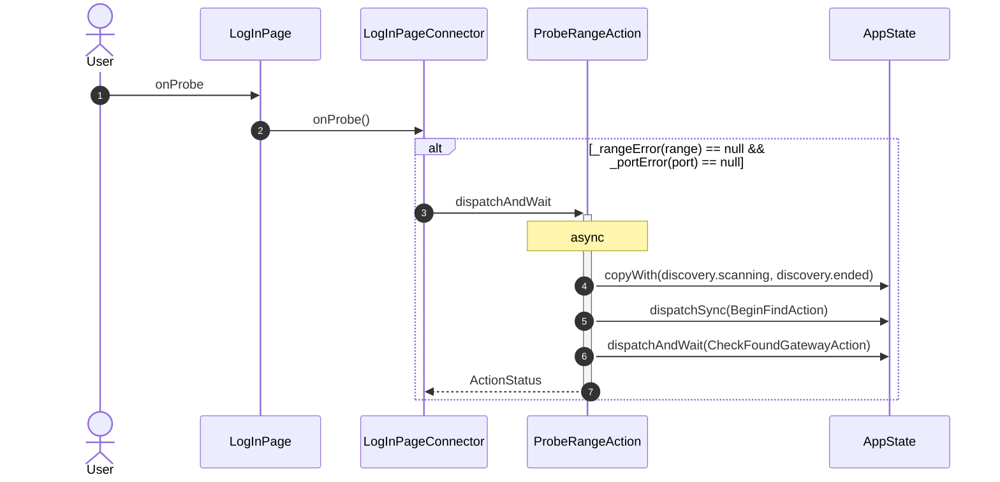

## onTrust

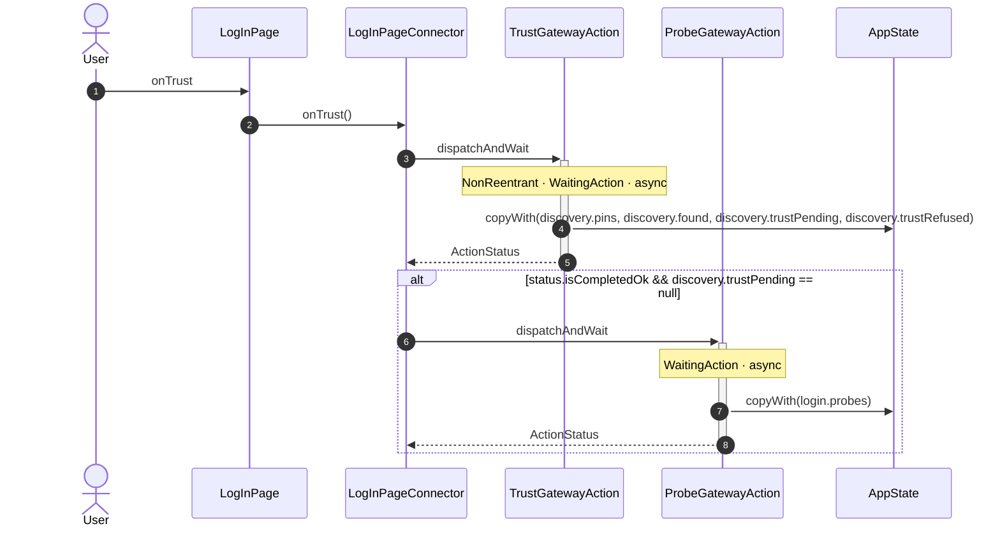

## onCancelTrust

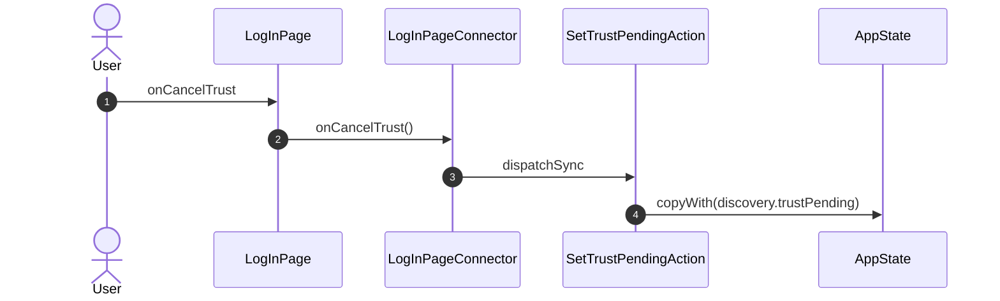

_Not drawn — these files dispatch outside any interaction:_

- `LogInPageConnector` — 5 dispatches

| Interaction | Dispatches | Writes |
| --- | --- | --- |
| `gateway.onChanged` | `SetGatewayAction` | `login.gateway` |
| `standby.onChanged` | `SetGatewayAction` | `login.gateway` |
| `user.onChanged` | `SetUserAction` | `login.user` |
| `password.onChanged` | `SetPasswordAction` | `login.password` |
| `onGatewayLeave` | `ProbeGatewayAction` | `login.probes` |
| `onRecent` | `SetGatewayAction`, `ProbeGatewayAction` | `login.gateway`, `login.probes` |
| `remember.onChanged` | `SetRememberAction` | `login.remember` |
| `onUseStandby` | `SetGatewayAction` | `login.gateway` |
| `onFind` | `CloseDiscoveryAction`, `FindGatewaysAction` | `discovery.open, discovery.scanning, discovery.scan, discovery.trustPending, discovery.trustRefused`, `discovery.scanning, discovery.ended` |
| `discover.onChanged` | `SetRangeAction`, `SetRangePortAction` | `discovery.range`, `discovery.rangePort` |
| `onLookAgain` | `FindGatewaysAction` | `discovery.scanning, discovery.ended` |
| `onPick` | `PickFoundGatewayAction`, `ProbeGatewayAction` ? | `login, discovery`, `login.probes` |
| `onProbe` | `ProbeRangeAction` ? | `discovery.scanning, discovery.ended` |
| `onTrust` | `TrustGatewayAction`, `ProbeGatewayAction` ? | `discovery.pins, discovery.found, discovery.trustPending, discovery.trustRefused`, `login.probes` |
| `onCancelTrust` | `SetTrustPendingAction` | `discovery.trustPending` |

`?` marks a dispatch that only runs under a condition.

[← all flows](README.md)
