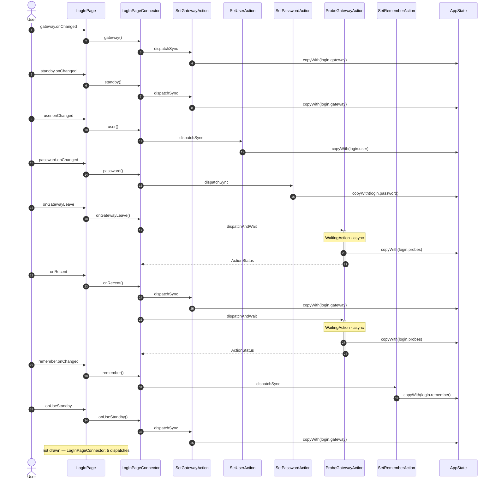

<!-- generated by `frx flow --md` — do not edit, re-run it -->

# LogInPage

`app/lib/connectors/log_in_page_connector.dart`

| Interaction | Dispatches | Writes |
| --- | --- | --- |
| `gateway.onChanged` | `SetGatewayAction` | `login.gateway` |
| `standby.onChanged` | `SetGatewayAction` | `login.gateway` |
| `user.onChanged` | `SetUserAction` | `login.user` |
| `password.onChanged` | `SetPasswordAction` | `login.password` |
| `onGatewayLeave` | `ProbeGatewayAction` | `login.probes` |
| `onRecent` | `SetGatewayAction`, `ProbeGatewayAction` | `login.gateway`, `login.probes` |
| `remember.onChanged` | `SetRememberAction` | `login.remember` |
| `onUseStandby` | `SetGatewayAction` | `login.gateway` |

`?` marks a dispatch that only runs under a condition.

[← all flows](README.md)
