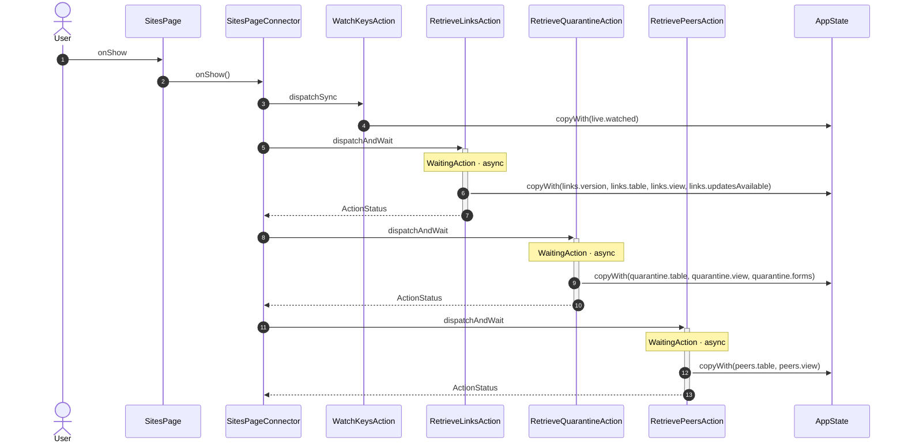
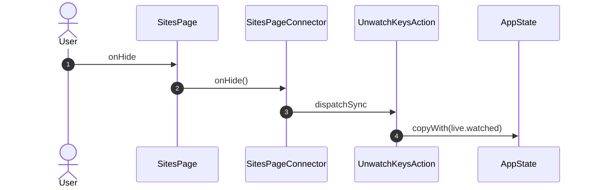
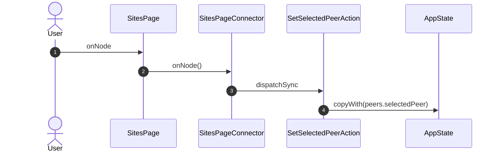
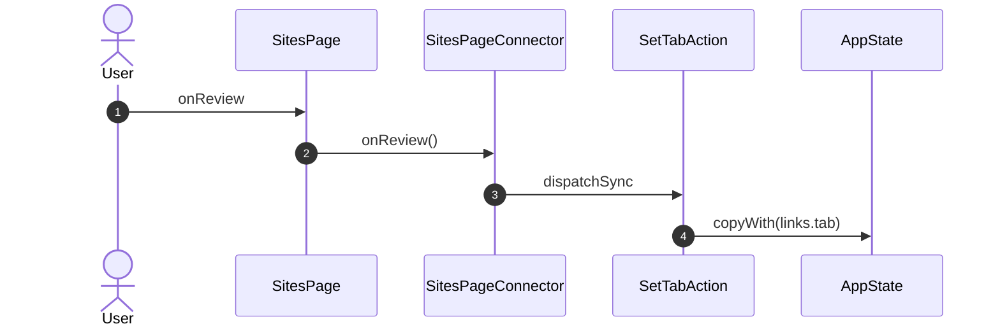
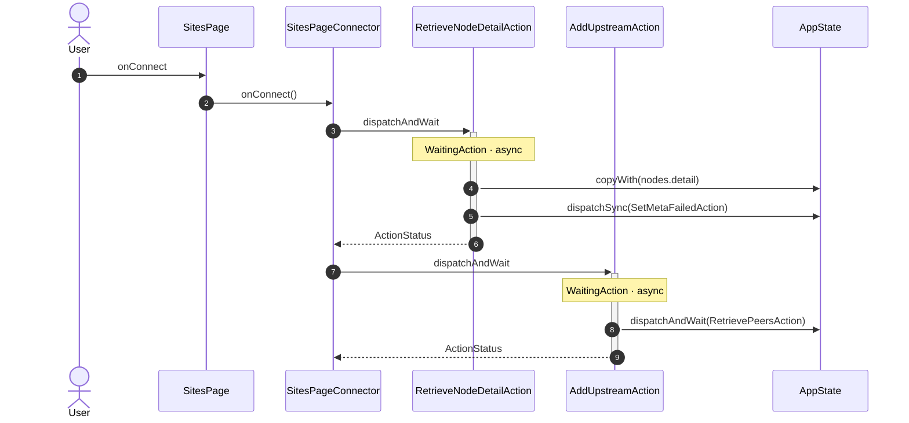
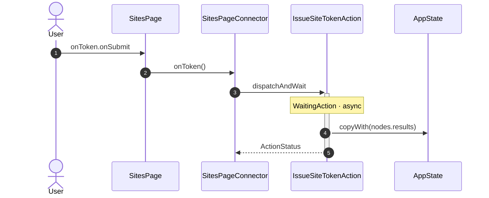
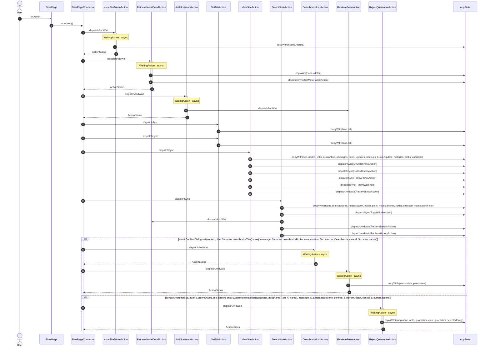
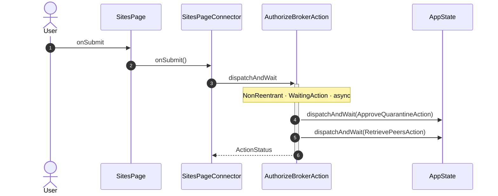

<!-- generated by `frx flow --md` — do not edit, re-run it -->

# SitesPage

`app/lib/connectors/sites_page_connector.dart`

## onShow

## onHide

## onNode

## onReview

## onConnect

## onToken.onSubmit

## onAction

## onSubmit

| Interaction | Dispatches | Writes |
| --- | --- | --- |
| `onShow` | `WatchKeysAction`, `RetrieveLinksAction`, `RetrieveQuarantineAction`, `RetrievePeersAction` | `live.watched`, `links.version, links.table, links.view, links.updatesAvailable`, `quarantine.table, quarantine.view, quarantine.forms`, `peers.table, peers.view` |
| `onHide` | `UnwatchKeysAction` | `live.watched` |
| `onNode` | `SetSelectedPeerAction` | `peers.selectedPeer` |
| `onReview` | `SetTabAction` | `links.tab` |
| `onConnect` | `RetrieveNodeDetailAction`, `AddUpstreamAction` | `nodes.detail` |
| `onToken.onSubmit` | `IssueSiteTokenAction` | `nodes.results` |
| `onAction` | `IssueSiteTokenAction`, `RetrieveNodeDetailAction`, `AddUpstreamAction`, `SetTabAction`, `SetTabAction`, `ViewSiteAction`, `SelectNodeAction`, `DeauthorizeLinkAction` ?, `RetrievePeersAction` ?, `RejectQuarantineAction` ? | `nodes.results`, `nodes.detail`, `links.tab`, `site, nodes, links, quarantine, packages, flows, updates, backups, brokerUpdate, historian, tasks, assistant`, `nodes.selectedNode, nodes.action, nodes.point, nodes.anchor, nodes.checked, nodes.pointFilter`, `peers.table, peers.view`, `quarantine.table, quarantine.view, quarantine.selectedEntry` |
| `onSubmit` | `AuthorizeBrokerAction` | — |

`?` marks a dispatch that only runs under a condition.

[← all flows](README.md)
