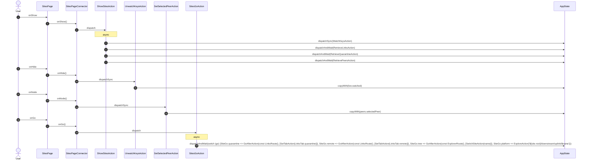

<!-- generated by `frx flow --md` — do not edit, re-run it -->

# SitesPage

`app/lib/connectors/sites_page_connector.dart`

| Interaction | Dispatches | Writes |
| --- | --- | --- |
| `onShow` | `ShowSitesAction` | — |
| `onHide` | `UnwatchKeysAction` | `live.watched` |
| `onNode` | `SetSelectedPeerAction` | `peers.selectedPeer` |
| `onGo` | `SitesGoAction` | — |

`?` marks a dispatch that only runs under a condition.

[← all flows](README.md)
