<!-- generated by `frx flow --md` — do not edit, re-run it -->

# StudioPage

`app/lib/connectors/studio_page_connector.dart`

## onTab

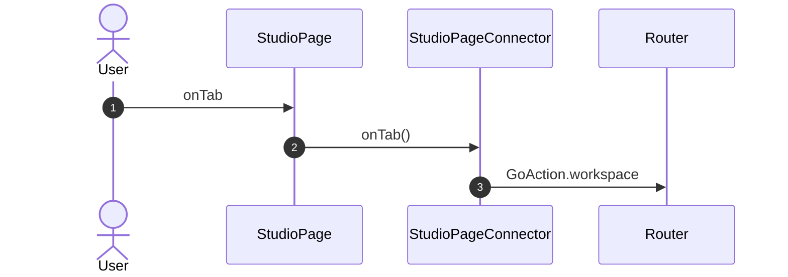

## onSite

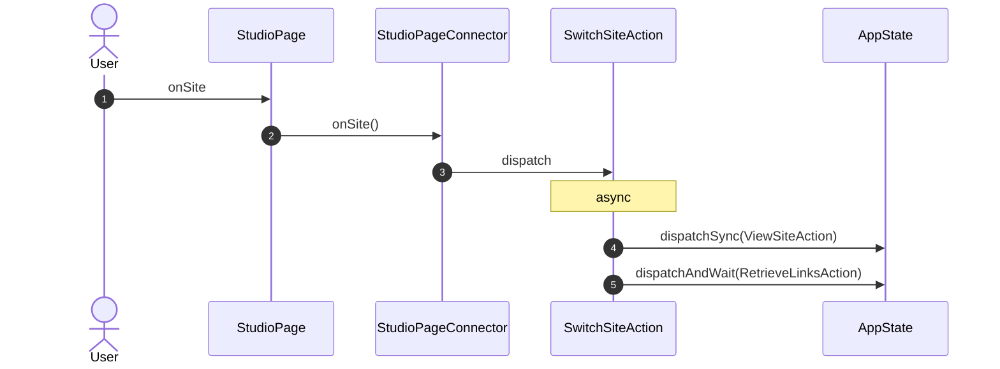

## onSearch

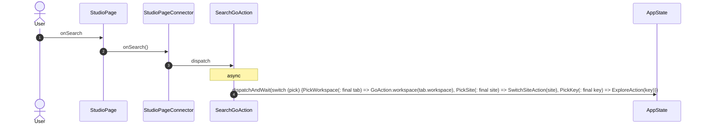

## onReview

## onCloseReview

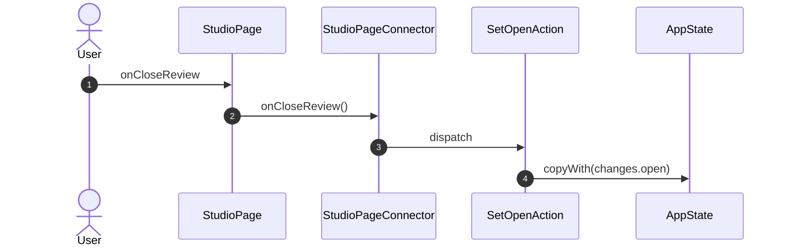

## onApply

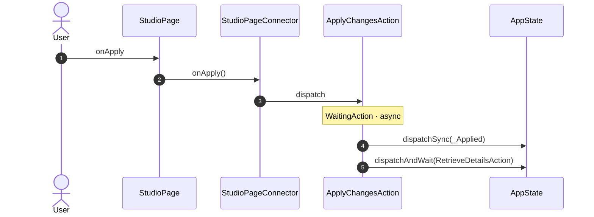

## onDiscard

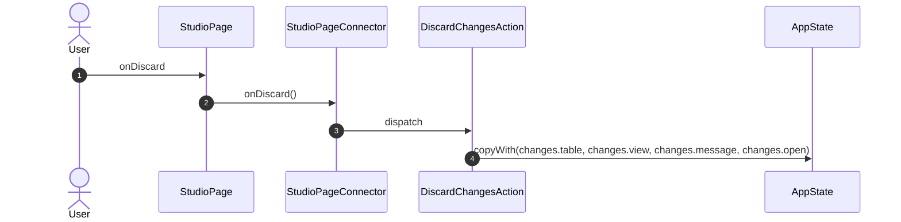

## onRemoveChange

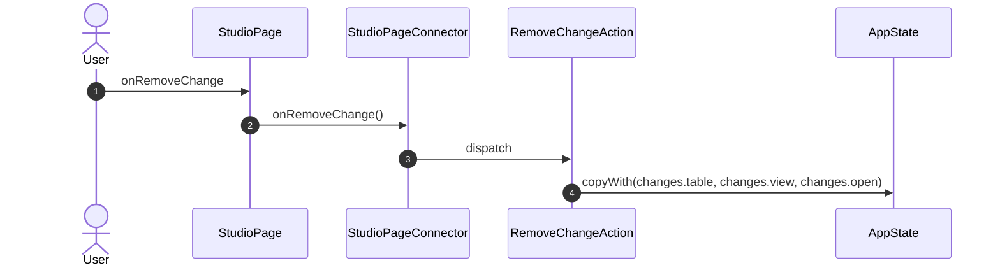

## onLogOut

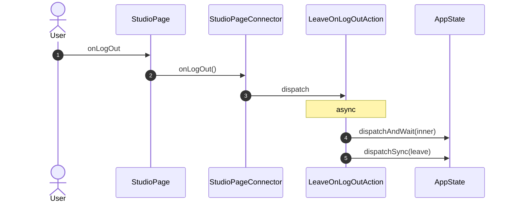

## onProblems

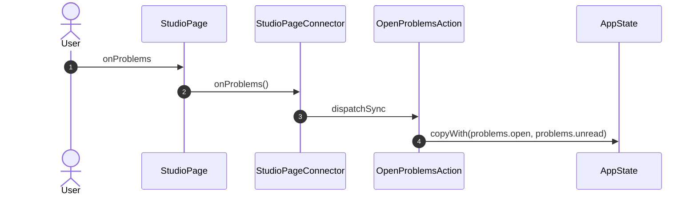

## onClearProblems

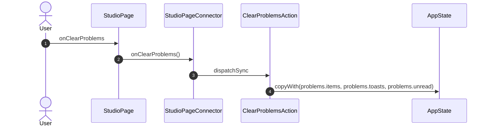

## onRetryProblem

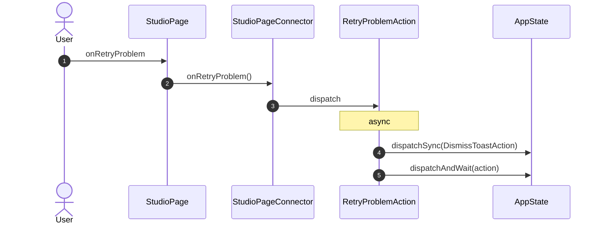

## onLanguage

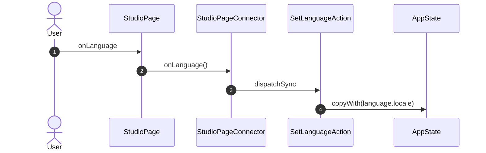

## onTheme

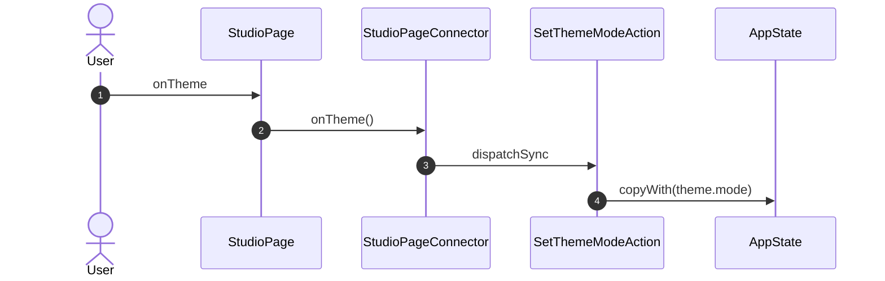

## LockOverlay ▸ onUnlock

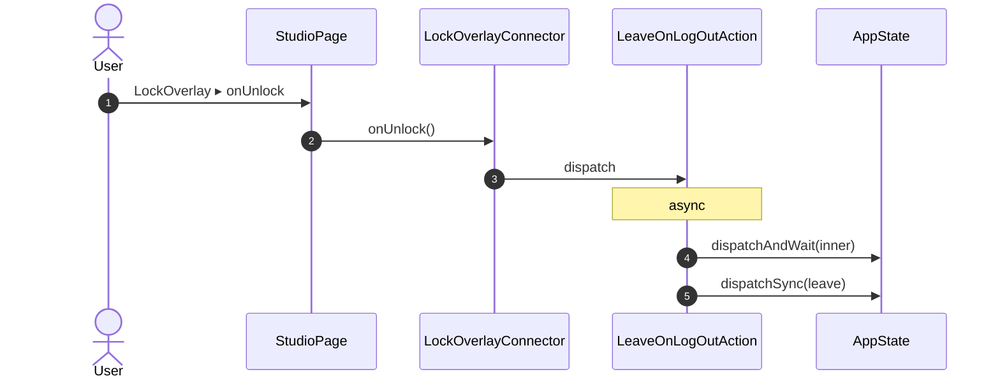

## LockOverlay ▸ onPassword

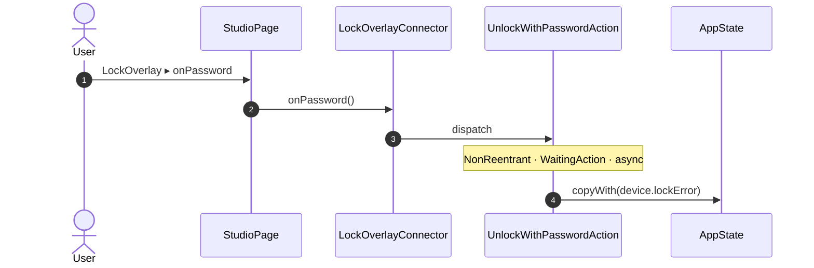

## LockOverlay ▸ onLogOut

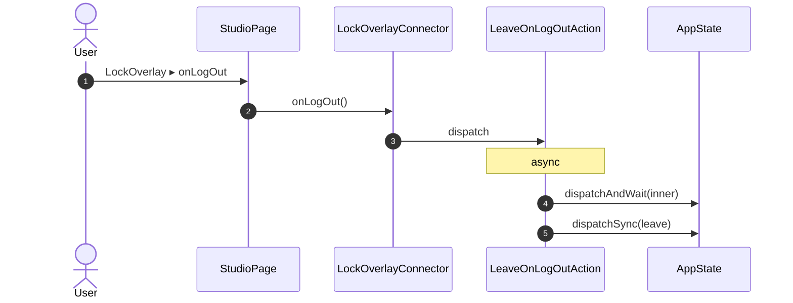

## LockOverlay ▸ onActivity

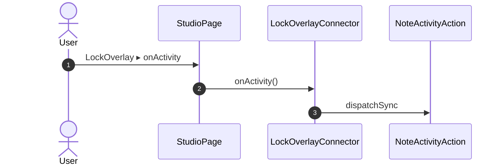

_Not drawn — these files dispatch outside any interaction:_

- `StudioPageConnector` — 1 dispatch

| Interaction | Dispatches | Writes |
| --- | --- | --- |
| `onTab` | `GoAction.workspace` | — |
| `onSite` | `SwitchSiteAction` | — |
| `onSearch` | `SearchGoAction` | — |
| `onReview` | `SetOpenAction` | `changes.open` |
| `onCloseReview` | `SetOpenAction` | `changes.open` |
| `onApply` | `ApplyChangesAction` | — |
| `onDiscard` | `DiscardChangesAction` | `changes.table, changes.view, changes.message, changes.open` |
| `onRemoveChange` | `RemoveChangeAction` | `changes.table, changes.view, changes.open` |
| `onLogOut` | `LeaveOnLogOutAction` | — |
| `onProblems` | `OpenProblemsAction` | `problems.open, problems.unread` |
| `onClearProblems` | `ClearProblemsAction` | `problems.items, problems.toasts, problems.unread` |
| `onRetryProblem` | `RetryProblemAction` | — |
| `onLanguage` | `SetLanguageAction` | `language.locale` |
| `onTheme` | `SetThemeModeAction` | `theme.mode` |
| `LockOverlay ▸ onUnlock` | `LeaveOnLogOutAction` | — |
| `LockOverlay ▸ onPassword` | `UnlockWithPasswordAction` | `device.lockError` |
| `LockOverlay ▸ onLogOut` | `LeaveOnLogOutAction` | — |
| `LockOverlay ▸ onActivity` | `NoteActivityAction` | — |

`?` marks a dispatch that only runs under a condition.

[← all flows](README.md)
