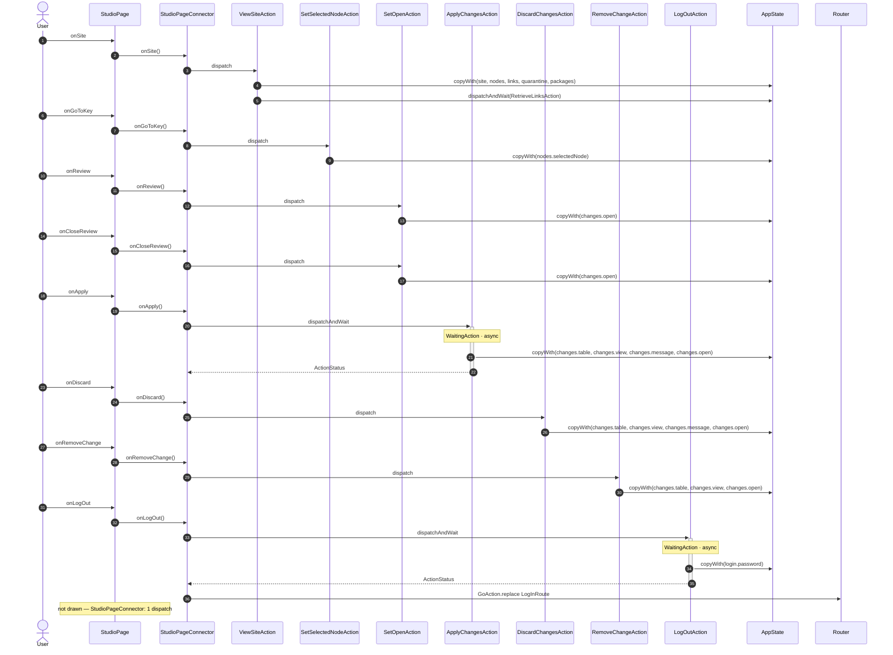

<!-- generated by `frx flow --md` — do not edit, re-run it -->

# StudioPage

`app/lib/connectors/studio_page_connector.dart`

| Interaction | Dispatches | Writes |
| --- | --- | --- |
| `onSite` | `ViewSiteAction` | `site, nodes, links, quarantine, packages` |
| `onGoToKey` | `SetSelectedNodeAction` | `nodes.selectedNode` |
| `onReview` | `SetOpenAction` | `changes.open` |
| `onCloseReview` | `SetOpenAction` | `changes.open` |
| `onApply` | `ApplyChangesAction` | `changes.table, changes.view, changes.message, changes.open` |
| `onDiscard` | `DiscardChangesAction` | `changes.table, changes.view, changes.message, changes.open` |
| `onRemoveChange` | `RemoveChangeAction` | `changes.table, changes.view, changes.open` |
| `onLogOut` | `LogOutAction`, `GoAction.replace` | `login.password` |

`?` marks a dispatch that only runs under a condition.

[← all flows](README.md)
