<!-- generated by `frx flow --md` — do not edit, re-run it -->

# SystemPage

`app/lib/connectors/system_page_connector.dart`

## onShow

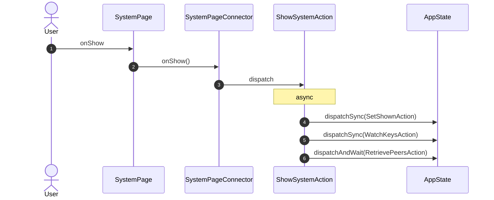

## onHide

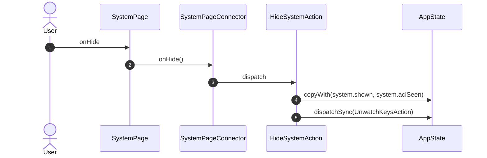

## onPoll

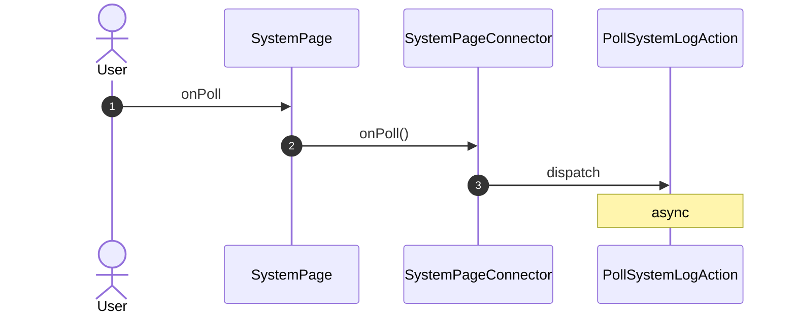

## onTab


## onTile

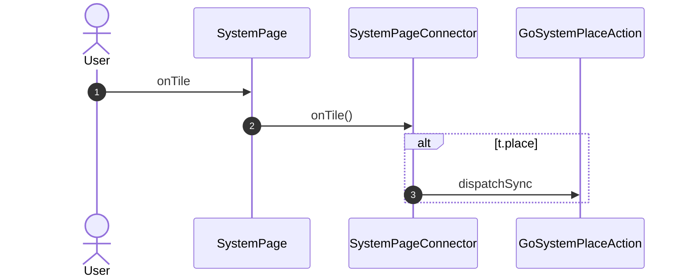

## onAttention

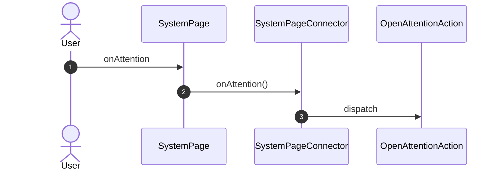

## onMeasure

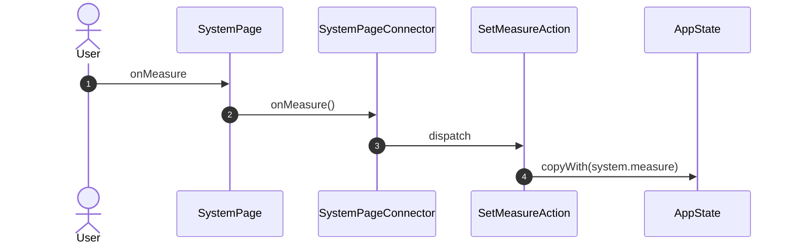

## onTrafficWindow

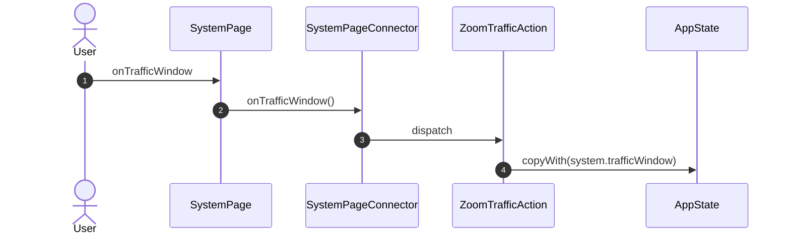

## onTrafficFollow

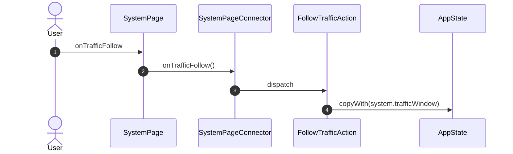

## onTrafficReset

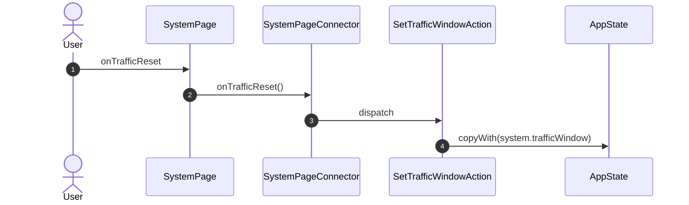

## onBanner

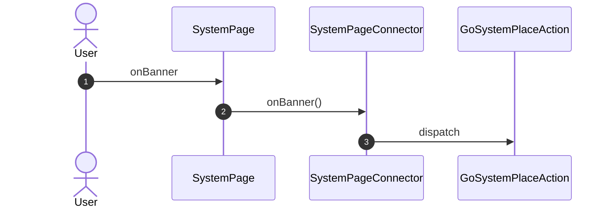

## onGuide

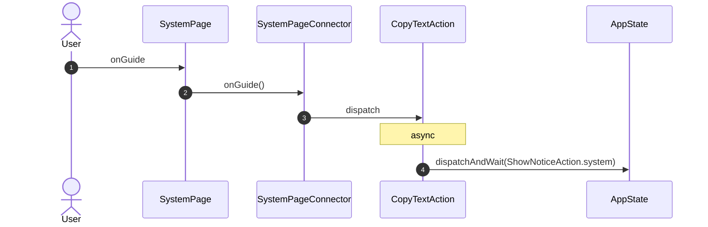

## onSource


## onLevel


## onFilter


## onAround

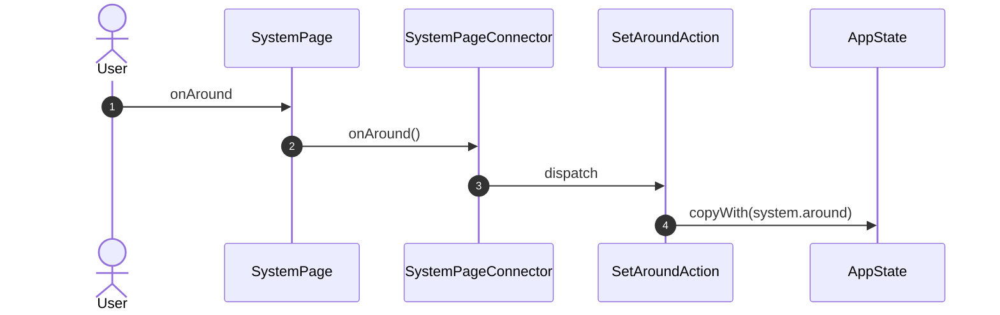

## onLines

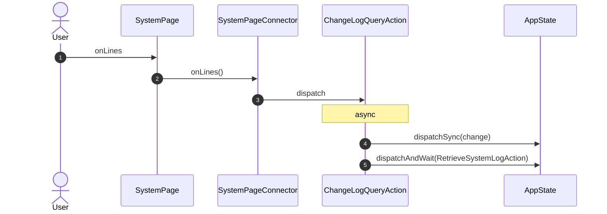

## onAuto


## onGetLog

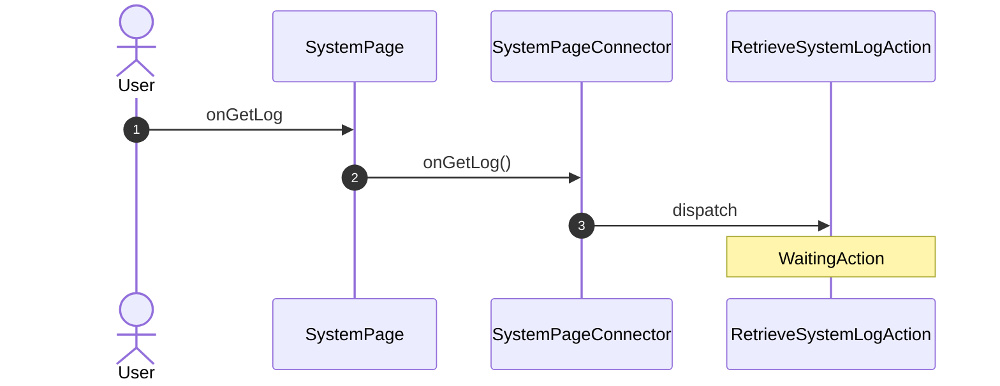

## onCopyLog

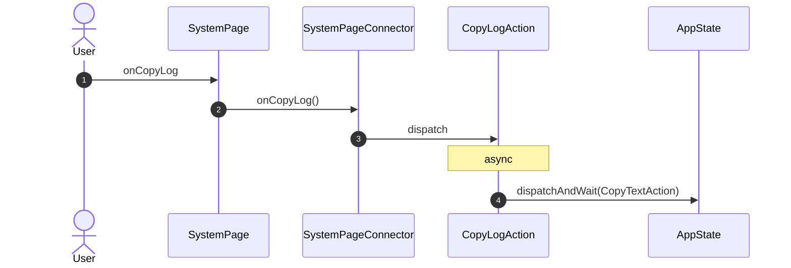

## onSaveLog

```mermaid
sequenceDiagram
    autonumber
    actor User
    participant UI as SystemPage
    participant VM as SystemPageConnector
    participant A1 as SaveLogAction
    participant ST as AppState

    User->>UI: onSaveLog
    UI->>VM: onSaveLog()
    VM->>A1: dispatch
    Note over A1: Selectors · async
    A1->>ST: dispatchAndWait(ShowNoticeAction.system)
    A1->>ST: dispatchAndWait(ShowNoticeAction.system)
```

## onLogLevel

```mermaid
sequenceDiagram
    autonumber
    actor User
    participant UI as SystemPage
    participant VM as SystemPageConnector
    participant A1 as StageLogLevelAction
    participant ST as AppState

    User->>UI: onLogLevel
    UI->>VM: onLogLevel()
    VM->>A1: dispatch
    A1->>ST: dispatchSync(RemoveChangeAction)
    A1->>ST: dispatchSync(AddChangesAction)
```

## onClear

```mermaid
sequenceDiagram
    autonumber
    actor User
    participant UI as SystemPage
    participant VM as SystemPageConnector
    participant A1 as ClearConnsAction
    participant ST as AppState

    User->>UI: onClear
    UI->>VM: onClear()
    VM->>A1: dispatch
    Note over A1: NonReentrant · WaitingAction · async
    A1->>ST: dispatchAndWait(RetrieveLinksAction)
    A1->>ST: dispatchAndWait(ShowNoticeAction.system)
```

## onRemoveProfile

```mermaid
sequenceDiagram
    autonumber
    actor User
    participant UI as SystemPage
    participant VM as SystemPageConnector
    participant A1 as RemoveProfileAction
    participant ST as AppState

    User->>UI: onRemoveProfile
    UI->>VM: onRemoveProfile()
    VM->>A1: dispatch
    Note over A1: NonReentrant · WaitingAction · async
    A1->>ST: dispatchAndWait(RetrieveProfilesAction)
    A1->>ST: dispatchAndWait(ShowNoticeAction.system)
```

## onCopyCommand

```mermaid
sequenceDiagram
    autonumber
    actor User
    participant UI as SystemPage
    participant VM as SystemPageConnector
    participant A1 as CopyTextAction
    participant ST as AppState

    User->>UI: onCopyCommand
    UI->>VM: onCopyCommand()
    VM->>A1: dispatch
    Note over A1: async
    A1->>ST: dispatchAndWait(ShowNoticeAction.system)
```

## onElsewhere

```mermaid
sequenceDiagram
    autonumber
    actor User
    participant UI as SystemPage
    participant VM as SystemPageConnector
    participant A1 as GoSystemPlaceAction

    User->>UI: onElsewhere
    UI->>VM: onElsewhere()
    VM->>A1: dispatch
```

## onReadBackups

```mermaid
sequenceDiagram
    autonumber
    actor User
    participant UI as SystemPage
    participant VM as SystemPageConnector
    participant A1 as RetrieveBackupsAction
    participant ST as AppState

    User->>UI: onReadBackups
    UI->>VM: onReadBackups()
    VM->>A1: dispatch
    Note over A1: WaitingAction · async
    A1->>ST: copyWith(backups.availability, backups.table, backups.view, backups.unread, backups.sections)
    A1->>ST: dispatchSync(_ReadFailed)
    A1->>ST: dispatchSync(AddProblemAction)
    A1->>ST: dispatchSync(AddProblemAction)
```

| Interaction | Dispatches | Writes |
| --- | --- | --- |
| `onShow` | `ShowSystemAction` | — |
| `onHide` | `HideSystemAction` | `system.shown, system.aclSeen` |
| `onPoll` | `PollSystemLogAction` | — |
| `onTab` | `OpenSystemTabAction` | — |
| `onTile` | `GoSystemPlaceAction` ? | — |
| `onAttention` | `OpenAttentionAction` | — |
| `onMeasure` | `SetMeasureAction` | `system.measure` |
| `onTrafficWindow` | `ZoomTrafficAction` | `system.trafficWindow` |
| `onTrafficFollow` | `FollowTrafficAction` | `system.trafficWindow` |
| `onTrafficReset` | `SetTrafficWindowAction` | `system.trafficWindow` |
| `onBanner` | `GoSystemPlaceAction` | — |
| `onGuide` | `CopyTextAction` | — |
| `onSource` | `ChangeLogQueryAction` | — |
| `onLevel` | `ChangeLogQueryAction` | — |
| `onFilter` | `ChangeLogQueryAction` | — |
| `onAround` | `SetAroundAction` | `system.around` |
| `onLines` | `ChangeLogQueryAction` | — |
| `onAuto` | `ChangeLogQueryAction` | — |
| `onGetLog` | `RetrieveSystemLogAction` | — |
| `onCopyLog` | `CopyLogAction` | — |
| `onSaveLog` | `SaveLogAction` | — |
| `onLogLevel` | `StageLogLevelAction` | — |
| `onClear` | `ClearConnsAction` | — |
| `onRemoveProfile` | `RemoveProfileAction` | — |
| `onCopyCommand` | `CopyTextAction` | — |
| `onElsewhere` | `GoSystemPlaceAction` | — |
| `onReadBackups` | `RetrieveBackupsAction` | `backups.availability, backups.table, backups.view, backups.unread, backups.sections` |

`?` marks a dispatch that only runs under a condition.

[← all flows](README.md)
