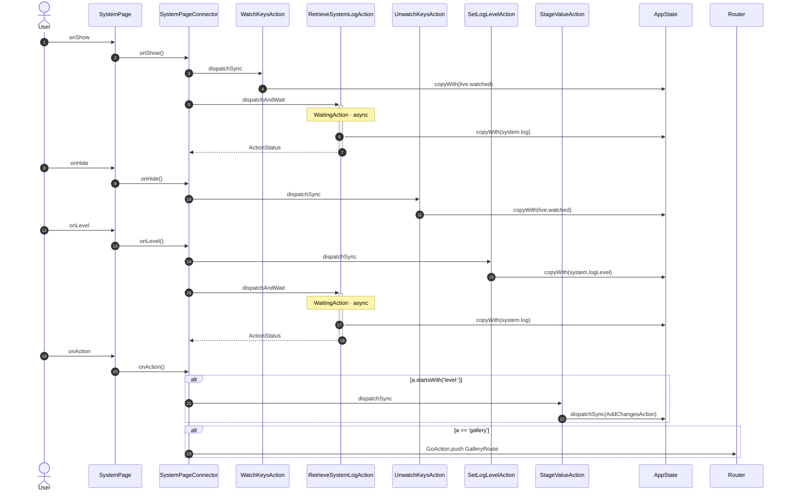

<!-- generated by `frx flow --md` — do not edit, re-run it -->

# SystemPage

`app/lib/connectors/system_page_connector.dart`

| Interaction | Dispatches | Writes |
| --- | --- | --- |
| `onShow` | `WatchKeysAction`, `RetrieveSystemLogAction` | `live.watched`, `system.log` |
| `onHide` | `UnwatchKeysAction` | `live.watched` |
| `onLevel` | `SetLogLevelAction`, `RetrieveSystemLogAction` | `system.logLevel`, `system.log` |
| `onAction` | `StageValueAction` ?, `GoAction.push` ? | — |

`?` marks a dispatch that only runs under a condition.

[← all flows](README.md)
