<!-- generated by `frx flow --md` — do not edit, re-run it -->

# SystemPage

`app/lib/connectors/system_page_connector.dart`

## onShow

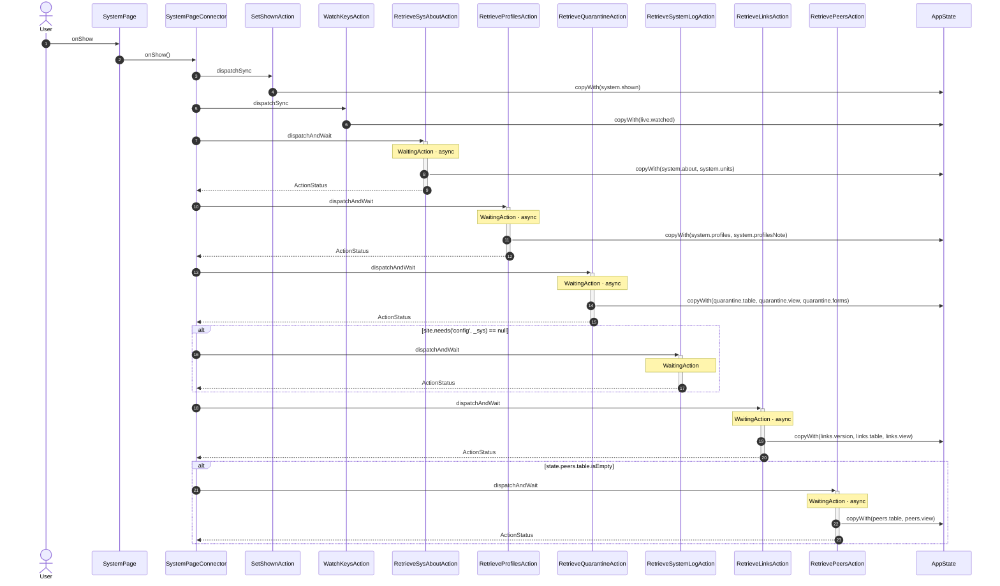

## onHide

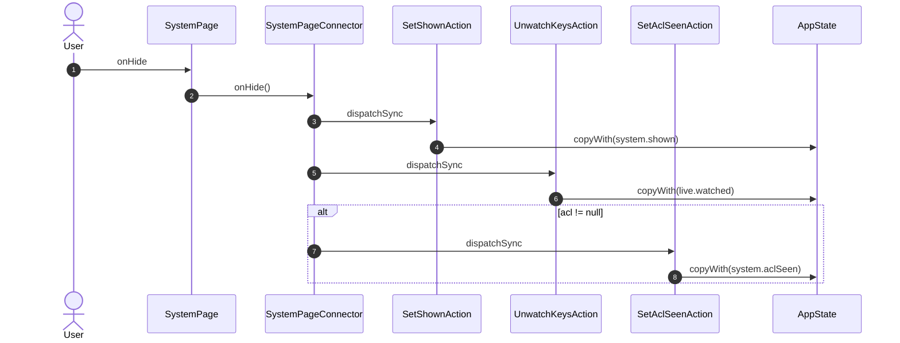

## onPoll

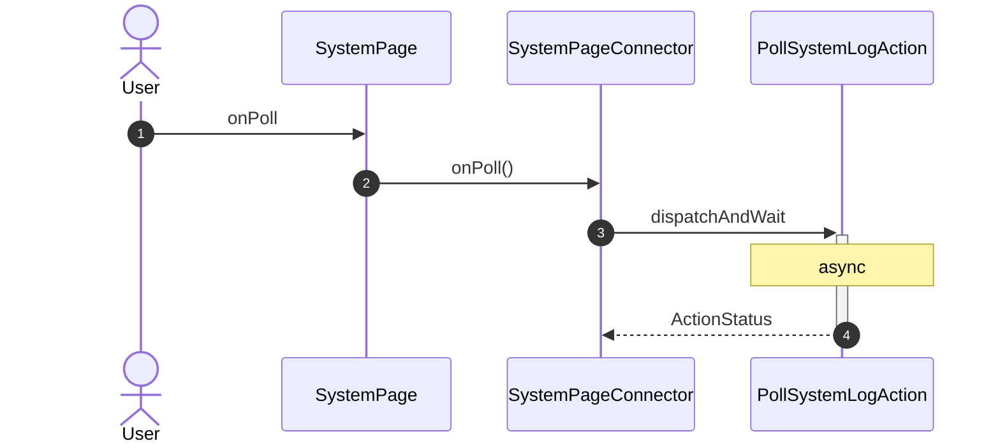

## onTab

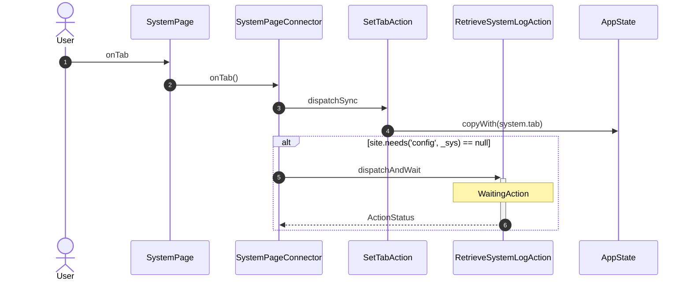

## onMeasure

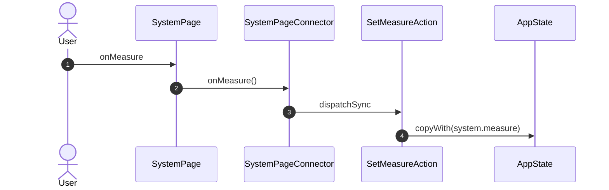

## onTrafficWindow


## onTrafficFollow


## onTrafficReset

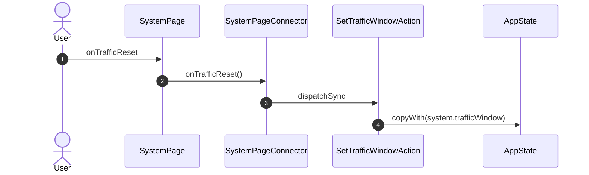

## onSource

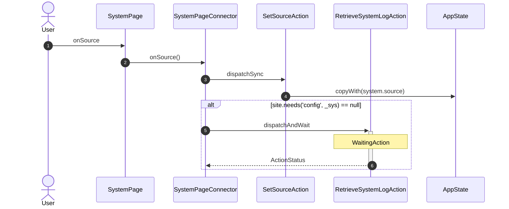

## onLevel


## onFilter

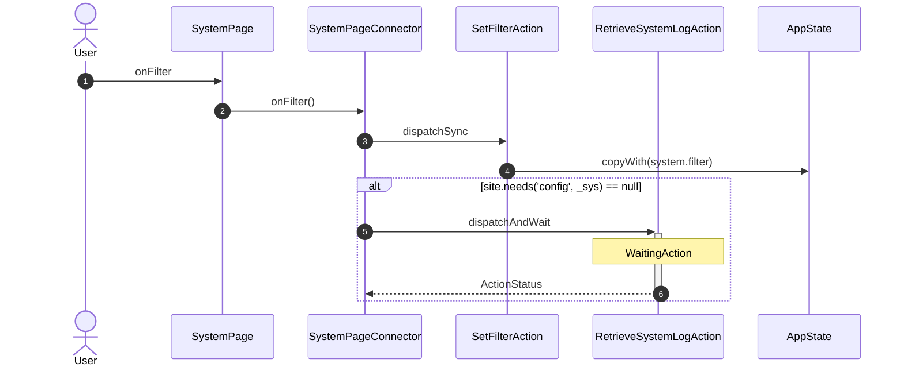

## onAround

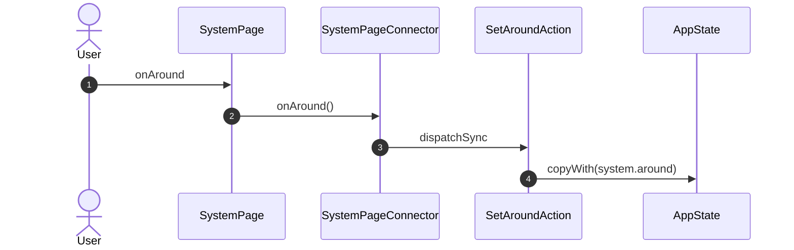

## onLines


## onAuto


## onGetLog

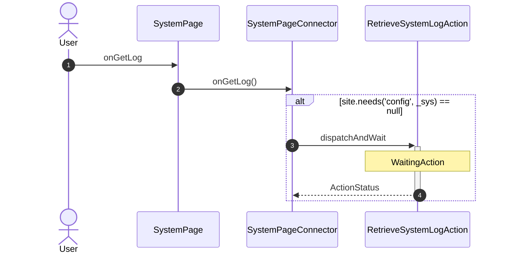

## onCopyLog

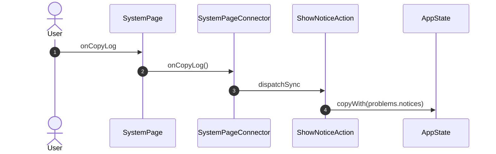

## onSaveLog


## onLogLevel

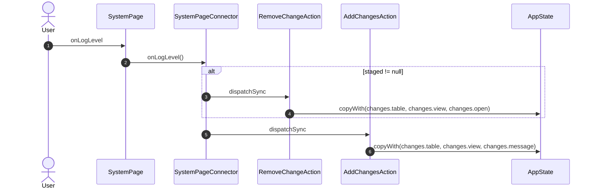

## onClear

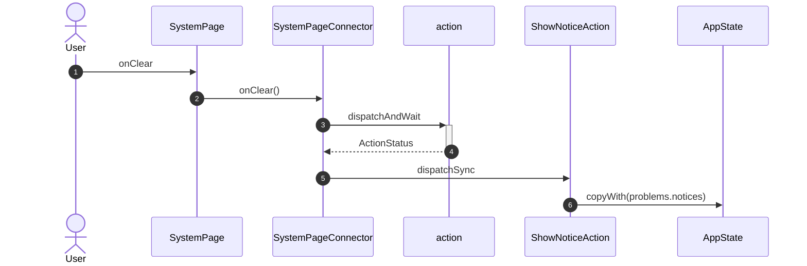

## onPutProfile


## onRemoveProfile

```mermaid
sequenceDiagram
    autonumber
    actor User
    participant UI as SystemPage
    participant VM as SystemPageConnector
    participant A1 as RemoveProfileAction
    participant A2 as ShowNoticeAction
    participant ST as AppState

    User->>UI: onRemoveProfile
    UI->>VM: onRemoveProfile()
    VM->>+A1: dispatchAndWait
    Note over A1: NonReentrant · WaitingAction · async
    A1->>ST: dispatchAndWait(RetrieveProfilesAction)
    A1-->>-VM: ActionStatus
    VM->>A2: dispatchSync
    A2->>ST: copyWith(problems.notices)
```

## onCopyCommand

```mermaid
sequenceDiagram
    autonumber
    actor User
    participant UI as SystemPage
    participant VM as SystemPageConnector
    participant A1 as ShowNoticeAction
    participant ST as AppState

    User->>UI: onCopyCommand
    UI->>VM: onCopyCommand()
    VM->>A1: dispatchSync
    A1->>ST: copyWith(problems.notices)
```

## onTile

```mermaid
sequenceDiagram
    autonumber
    actor User
    participant UI as SystemPage
    participant VM as SystemPageConnector
    participant A1 as links_slice.SetTabAction
    participant A2 as access_slice.SetTabAction
    participant NAV as Router

    User->>UI: onTile
    UI->>VM: onTile()
    VM->>A1: dispatchSync
    VM->>A1: dispatchSync
    VM->>A2: dispatchSync
    VM->>NAV: GoAction.push GalleryRoute
```

## onAttention

```mermaid
sequenceDiagram
    autonumber
    actor User
    participant UI as SystemPage
    participant VM as SystemPageConnector
    participant A1 as SetTabAction
    participant A2 as links_slice.SetTabAction
    participant A3 as SetSelectedLinkAction
    participant A4 as SetSelectedEntryAction
    participant A5 as SetSelectedPeerAction
    participant A6 as access_slice.SetTabAction
    participant ST as AppState
    participant NAV as Router

    User->>UI: onAttention
    UI->>VM: onAttention()
    VM->>A1: dispatchSync
    A1->>ST: copyWith(system.tab)
    VM->>A2: dispatchSync
    VM->>A3: dispatchSync
    A3->>ST: copyWith(links.selectedLink)
    VM->>A2: dispatchSync
    VM->>A4: dispatchSync
    A4->>ST: copyWith(quarantine.selectedEntry)
    VM->>A5: dispatchSync
    A5->>ST: copyWith(peers.selectedPeer)
    VM->>A2: dispatchSync
    VM->>A6: dispatchSync
    VM->>NAV: GoAction.push GalleryRoute
```

## onElsewhere

```mermaid
sequenceDiagram
    autonumber
    actor User
    participant UI as SystemPage
    participant VM as SystemPageConnector
    participant A1 as links_slice.SetTabAction
    participant A2 as access_slice.SetTabAction
    participant NAV as Router

    User->>UI: onElsewhere
    UI->>VM: onElsewhere()
    VM->>A1: dispatchSync
    VM->>A2: dispatchSync
    VM->>NAV: GoAction.push GalleryRoute
```

## onGuide

```mermaid
sequenceDiagram
    autonumber
    actor User
    participant UI as SystemPage
    participant VM as SystemPageConnector
    participant A1 as ShowNoticeAction
    participant ST as AppState

    User->>UI: onGuide
    UI->>VM: onGuide()
    VM->>A1: dispatchSync
    A1->>ST: copyWith(problems.notices)
```

## onTapViewsLab

```mermaid
sequenceDiagram
    autonumber
    actor User
    participant UI as SystemPage
    participant VM as SystemPageConnector
    participant NAV as Router

    User->>UI: onTapViewsLab
    UI->>VM: onTapViewsLab()
    VM->>NAV: GoAction.push ViewsLabRoute
```

| Interaction | Dispatches | Writes |
| --- | --- | --- |
| `onShow` | `SetShownAction`, `WatchKeysAction`, `RetrieveSysAboutAction`, `RetrieveProfilesAction`, `RetrieveQuarantineAction`, `RetrieveSystemLogAction` ?, `RetrieveLinksAction`, `RetrievePeersAction` ? | `system.shown`, `live.watched`, `system.about, system.units`, `system.profiles, system.profilesNote`, `quarantine.table, quarantine.view, quarantine.forms`, `links.version, links.table, links.view`, `peers.table, peers.view` |
| `onHide` | `SetShownAction`, `UnwatchKeysAction`, `SetAclSeenAction` ? | `system.shown`, `live.watched`, `system.aclSeen` |
| `onPoll` | `PollSystemLogAction` | — |
| `onTab` | `SetTabAction`, `RetrieveSystemLogAction` ? | `system.tab` |
| `onMeasure` | `SetMeasureAction` | `system.measure` |
| `onTrafficWindow` | `SetTrafficWindowAction` | `system.trafficWindow` |
| `onTrafficFollow` | `SetTrafficWindowAction` | `system.trafficWindow` |
| `onTrafficReset` | `SetTrafficWindowAction` | `system.trafficWindow` |
| `onSource` | `SetSourceAction`, `RetrieveSystemLogAction` ? | `system.source` |
| `onLevel` | `SetLogLevelAction`, `RetrieveSystemLogAction` ? | `system.logLevel` |
| `onFilter` | `SetFilterAction`, `RetrieveSystemLogAction` ? | `system.filter` |
| `onAround` | `SetAroundAction` | `system.around` |
| `onLines` | `SetLinesAction`, `RetrieveSystemLogAction` ? | `system.lines` |
| `onAuto` | `SetAutoAction`, `RetrieveSystemLogAction` ? | `system.auto` |
| `onGetLog` | `RetrieveSystemLogAction` ? | — |
| `onCopyLog` | `ShowNoticeAction` | `problems.notices` |
| `onSaveLog` | `ShowNoticeAction` | `problems.notices` |
| `onLogLevel` | `RemoveChangeAction` ?, `AddChangesAction` | `changes.table, changes.view, changes.open`, `changes.table, changes.view, changes.message` |
| `onClear` | `action`, `ShowNoticeAction` | `problems.notices` |
| `onPutProfile` | `ShowNoticeAction` | `problems.notices` |
| `onRemoveProfile` | `RemoveProfileAction`, `ShowNoticeAction` | `problems.notices` |
| `onCopyCommand` | `ShowNoticeAction` | `problems.notices` |
| `onTile` | `links_slice.SetTabAction`, `links_slice.SetTabAction`, `access_slice.SetTabAction`, `GoAction.push` | — |
| `onAttention` | `SetTabAction`, `links_slice.SetTabAction`, `SetSelectedLinkAction`, `links_slice.SetTabAction`, `SetSelectedEntryAction`, `SetSelectedPeerAction`, `links_slice.SetTabAction`, `access_slice.SetTabAction`, `GoAction.push` | `system.tab`, `links.selectedLink`, `quarantine.selectedEntry`, `peers.selectedPeer` |
| `onElsewhere` | `links_slice.SetTabAction`, `access_slice.SetTabAction`, `GoAction.push` | — |
| `onGuide` | `ShowNoticeAction` | `problems.notices` |
| `onTapViewsLab` | `GoAction.push` | — |

`?` marks a dispatch that only runs under a condition.

[← all flows](README.md)
