<!-- generated by `frx flow --md` — do not edit, re-run it -->

# ViewsLabPage

`app/lib/connectors/views_lab_page_connector.dart`

## theme.onChanged

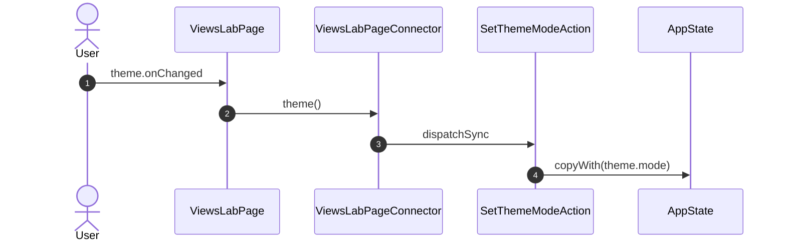

## sample.onChanged

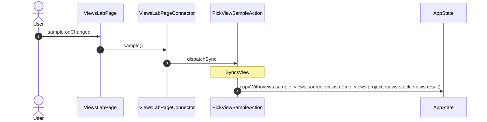

## onRefine

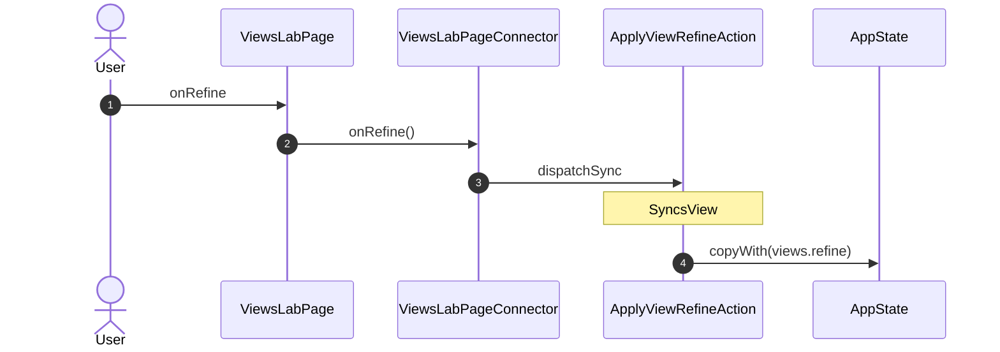

## project.onChanged

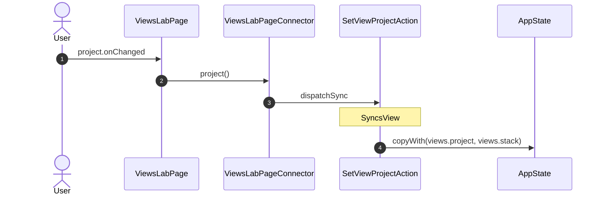

## draft.onChanged

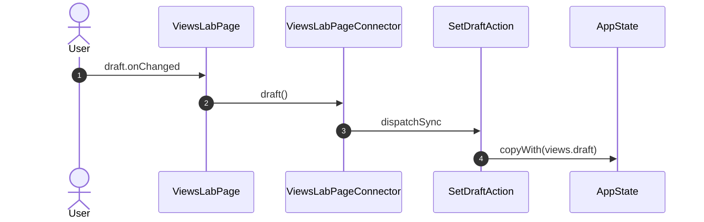

## onShowDraft

## width.onChanged

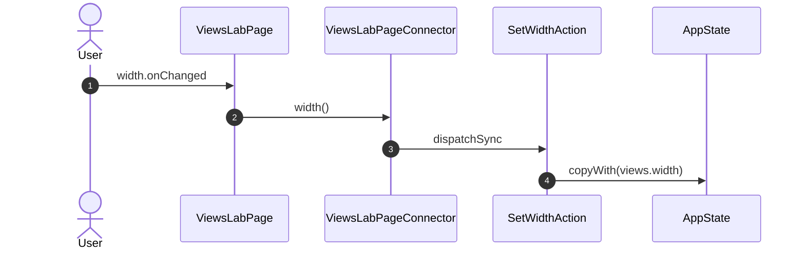

## density.onChanged

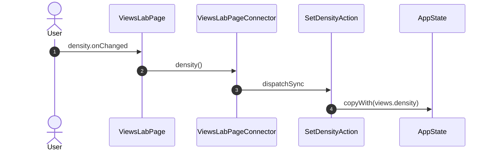

## tab.onChanged

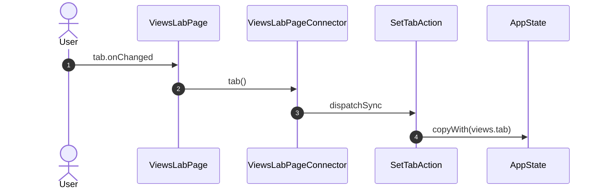

## onBack

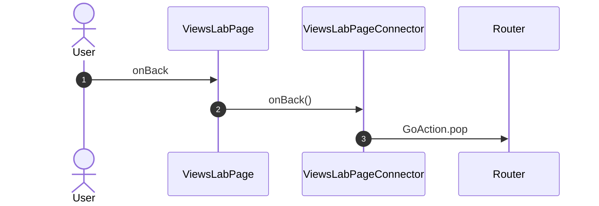

## onAction

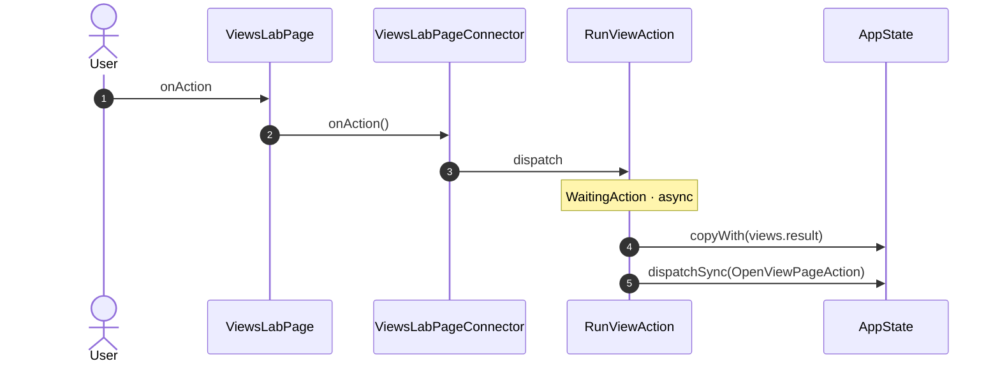

## onItem

## onCrumb

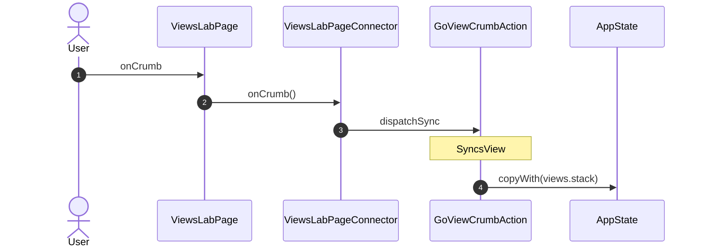

## onPageBack

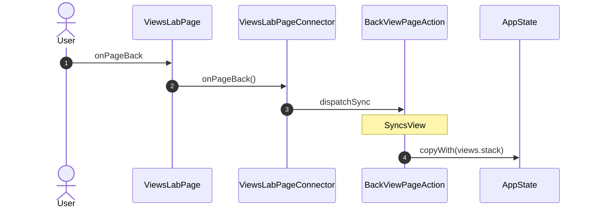

_Not drawn — these files dispatch outside any interaction:_

- `ViewsLabPageConnector` — 2 dispatches

| Interaction | Dispatches | Writes |
| --- | --- | --- |
| `theme.onChanged` | `SetThemeModeAction` | `theme.mode` |
| `sample.onChanged` | `PickViewSampleAction` | `views.sample, views.source, views.refine, views.project, views.stack, views.result` |
| `onRefine` | `ApplyViewRefineAction` | `views.refine` |
| `project.onChanged` | `SetViewProjectAction` | `views.project, views.stack` |
| `draft.onChanged` | `SetDraftAction` | `views.draft` |
| `onShowDraft` | `SetViewSourceAction` | `views.sample, views.source, views.refine, views.project, views.stack, views.result` |
| `width.onChanged` | `SetWidthAction` | `views.width` |
| `density.onChanged` | `SetDensityAction` | `views.density` |
| `tab.onChanged` | `SetTabAction` | `views.tab` |
| `onBack` | `GoAction.pop` | — |
| `onAction` | `RunViewAction` | `views.result` |
| `onItem` | `OpenViewPageAction` | `views.result` |
| `onCrumb` | `GoViewCrumbAction` | `views.stack` |
| `onPageBack` | `BackViewPageAction` | `views.stack` |

`?` marks a dispatch that only runs under a condition.

[← all flows](README.md)
